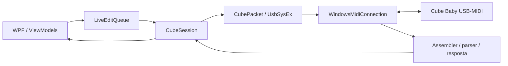

# Arquitetura e dados locais

[Documentação](../README.md) · Revisão: 12/10/2026

O aplicativo Windows é C#/.NET 10 com WPF. O acervo descompilado Android em `engenharia-reversa/apk-cubesuite/` reúne `sources/` e `resources/` e fornece evidências de protocolo; não é dependência de execução nem solução de build do aplicativo.

## Projetos

Os caminhos abaixo são relativos a [windows/](../../windows/README.md).

| Projeto | Responsabilidade |
| --- | --- |
| Cube.Protocol | Envelope, parser, empacotamento SysEx, perfil Cube Baby, sessão, fila, formatos de IR/amp e backups |
| Cube.Usb | Implementação de `IMidiConnection` com `Windows.Devices.Midi` e descoberta de portas |
| Cube.Desktop | Janela WPF, ViewModels, controles, aparência, idiomas, IRs, criador de amps e áudio de backing tracks |
| Cube.Tests | Executável de testes de protocolo e `FakeConnection` |
| Cube.Desktop.Tests | Executável de testes WPF, cenários simulados e capturas |
| Cube.Diagnostics | Operações de diagnóstico/pesquisa que acessam o pedal |

O desktop referencia Cube.Usb, que referencia Cube.Protocol. O build de simulação inclui `Cube.Tests/FakeConnection.cs` por condição no projeto desktop. O áudio de backing tracks utiliza NAudio Core/Wasapi 3.1.0 e saída WASAPI, fora do protocolo de controle do pedal. O processamento de velocidade e pitch usa `CubeBackingDsp.dll`, compilada em C++ com Signalsmith Stretch. O player tem fila própria de comandos, loops, metrônomo, gravação e exportação. Busca, download e prévia do YouTube usam ferramentas preparadas pelo build: yt-dlp, FFmpeg/ffprobe e Deno.

## Caminho de uma edição

`LiveEditQueue` reúne mudanças de parâmetros e mantém o preset de destino de cada comando. `CubeSession` serializa operações com semáforo e mantém uma requisição pendente por vez. O timeout padrão de troca é 1,5 segundo. O parser verifica envelope/checksum e as leituras esperadas conferem região, endereço e tamanho.

Formato: `00 59 CMD LEN24_LE PAYLOAD CHECKSUM`, com checksum `(~sum(payload)) & 0xFF`, seguido de empacotamento contínuo em sete bits entre `F0/F7`. A referência completa está no [catálogo de comandos](../../../../engenharia-reversa/cube-baby/CUBE_BABY_COMANDOS.md).

## Estado e persistência

O editor mantém banco de referência (`baseline`), última confirmação (`confirmed`) e edição (`edited`). A/B/C têm 16 bytes cada, total de 48; treze campos são conhecidos em cada preset. Bytes reservados são preservados.

| Domínio | Prévia/edição | Persistência |
| --- | --- | --- |
| Presets | Região 5, `0x80000000 + preset × 16 + offset` | Escrita dos 48 bytes em região 5, endereço 0 |
| IR | Flag em região 4, `0x764`; 2052 bytes a partir de `0x768` | Oito setores de 4096 bytes, região 0, bases `0x69000–0x70000` |
| Amp | Corpo de 1568 bytes em região 4, `0x1C–0x63B` | Nove setores de 4096 bytes, região 0, bases `0x60000–0x68000` |
| Preferências e backing tracks | Estado local da interface/player | Arquivos no perfil Windows, sem gravação desses dados no pedal |

As bases da tabela são inícios de setores, não limites finais de conteúdo. A leitura do banco pode refletir edições live; somente ler de volta não prova persistência após desligamento. Uma confirmação de gravação exige a comparação implementada pelo fluxo, além do ACK.

A conexão automática identifica o aparelho, lê o banco e inventaria IRs. Existe código experimental de footswitch, mas `StartFootswitchMonitoring` não é chamado no fluxo atual. Ver [investigação](../historico/physical-switch-investigation.md).

## Criadores de efeitos e atualização de firmware

Chorus, Phaser, Delay e Reverb têm prévias em RAM com verificação de assinaturas de código/tabelas do firmware e do contexto físico. O perfil adicional `cubebaby_B_20220706.up` possui endereços e hashes próprios em [CubeSession.EffectsFirmware](../../windows/Cube.Protocol/CubeSession.EffectsFirmware.cs). Compatibilidade recusada pelo criador não implica, por si só, bloqueio da edição normal de presets. Os criadores consultam o estado físico ao preparar a prévia; a seleção A/B/C da interface não comprova o footswitch ativo.

Os snapshots dos quatro efeitos são copiados e validados em memória pelo editor. O fechamento normal tenta encerrar essas prévias, restaurar o amp e restaurar o IR; se uma etapa falhar, apresenta a opção de fechar mesmo assim. Encerramento abrupto não executa esse fluxo nem conserva os snapshots para a próxima execução.

A atualização de firmware usa [FirmwareUpdater](../../windows/Cube.Desktop/FirmwareUpdater.cs), separadamente da sessão USB-MIDI. Um processo auxiliar elevado comunica progresso por named pipe. O fluxo valida extensão, tamanho, cabeçalho e CRC do arquivo `.up`, confere seu SHA-256 após a confirmação, valida o auxiliar de reinicialização e a identificação da flash e verifica o CRC dos blocos gravados. Essas verificações não constituem homologação de qualquer arquivo ou modelo de pedal.

## Arquivos do usuário

Diretório padrão: `%LOCALAPPDATA%\CubeControl`. Com `CubeSimulation=true`, os dados do editor usam `%LOCALAPPDATA%\CubeControl-Simulation`.

| Caminho relativo | Conteúdo / comportamento |
| --- | --- |
| `gear-images-v1.json` | Associações de imagens; na primeira carga, migra apenas imagens elegíveis de `visual-preferences-v1.json`, se existir |
| `ir-pack-names-v1.json` | Nomes locais por hash, salvos ao aplicar packs e carregados ao atualizar o catálogo |
| `IrPacks/` | Packs pessoais em `.cubeirpack.json` |
| `ImportedIrs/` | IRs importados usados pelo armazenamento de packs |
| `Images/` | Cópias de imagens personalizadas |
| `backing-metronome-v1.json` | Preferências do metrônomo, BPM manual e alinhamento por arquivo, som e lista de sons personalizados |
| `metronome-sounds/` | Cópias de WAVs importados para o metrônomo |
| `youtube-downloads-v1.json` | Pasta de download e associação de IDs de vídeos a caminhos de downloads concluídos |
| `appearance-v1.json` | Tema, sempre na pasta CubeControl |
| `language-v1.json` | Idioma, sempre na pasta CubeControl |
| `zoom-v1.json` | Zoom, sempre na pasta CubeControl |

O player salva a ordem e os caminhos da playlist em `backing-playlist-v1.json` após gravações concluídas e no encerramento, e os restaura na inicialização. Seleção, saída e ajustes de reprodução ficam na sessão atual; o antigo `backing-tracks-v1.json` continua sem leitura ou atualização. REC captura somente a entrada selecionada, finaliza o WAV em `Recordings` no diretório de dados recebido pelo ViewModel e acrescenta uma faixa sem interromper a reprodução atual. Preferências do metrônomo e registros de downloads são persistências separadas. O metrônomo inicia parado. As associações amp–gabinete e a opção de associação automática ficam somente na sessão; `SaveMatches` não grava preferências nem envia comandos. O editor atual também não lê os antigos nomes em `IrNames/*.txt`; a migração de `visual-preferences-v1.json` abrange apenas imagens, não associações de gabinetes ou nomes.

Os fluxos automáticos de `BackupBank`, `BackupIr` e preservação de amp mantêm cópias em memória da sessão. As prévias de IR e dos criadores também não geram nem carregam arquivos `pending-*-preview.json` no editor atual. Reconectar na mesma execução pode permitir restaurar uma prévia, conforme identidade e contexto; reiniciar o aplicativo perde esses snapshots. Exportar banco, backup de setor IR, amp ou ajustes de efeito é uma operação explícita, com arquivo no destino escolhido. Arquivos de recuperação de versões anteriores e evidências produzidas por diagnósticos não equivalem a recuperação automática do editor.

Tema, idioma e zoom são compartilhados entre aplicativo real e simulado. Exportações ficam no destino escolhido. Logs da sessão são mantidos na interface; diagnósticos podem gravar arquivos nos caminhos solicitados. Não há telemetria implementada no código de produção inspecionado.

## Formatos e recursos

| Recurso | Origem / formato |
| --- | --- |
| Banco de presets | JSON `cubecontrol-bank-v1`: dispositivo, data e `bankHex` de 48 bytes |
| Backup de setor IR | Manifesto `cubecontrol-ir-v1` e `.bin` de 4096 bytes, com integridade verificada |
| WAV preparado | Mono, 48 kHz, 512 amostras float32, sem normalização de amplitude |
| Setor de amp | 4096 bytes; corpo editável separado do cabeçalho e preenchimento |
| Biblioteca de IRs | 958 WAVs em `Cube.Desktop/Assets/ImpulseResponses` no inventário de 12/10/2026: 276 do acervo anterior e 682 de Overdriven.fr; copiados à saída |
| Amps originais | `Assets/FactoryAmps.bin`, 36864 bytes, recurso embutido `Cube.FactoryAmps`; usado para reconhecer o nome pelo conteúdo |
| Presets e IRs de fábrica | Extraídos da instalação original do CubeSuite por `FactoryResources.Load`, com hashes específicos |
| Manual | PDF em `Cube.Desktop/Assets/Documents`, copiado à saída |
| Idiomas e fotos | JSON em `Localization` e PNGs em `Assets/Images/Equipment` |

`FactoryAmps.bin` não substitui `BFI.bin` no fluxo de recuperação de presets/IRs. O CubeSuite.exe e o BFI.bin exigidos pelo carregador não são redistribuídos nesta árvore. O conteúdo e os hashes são documentados em [IR e fábrica](../referencias/cubecontrol-ir-e-fabrica.md).

## Fontes de implementação

[Perfil de presets](../../windows/Cube.Protocol/CubeBabyProfile.cs), [sessão](../../windows/Cube.Protocol/CubeSession.cs), [fila](../../windows/Cube.Protocol/LiveEditQueue.cs), [transporte Windows](../../windows/Cube.Usb/WindowsMidiConnection.cs), [estado do editor](../../windows/Cube.Desktop/ViewModels/EditorViewModel.cs) e [projeto desktop](../../windows/Cube.Desktop/Cube.Desktop.csproj).

Os resultados históricos, as correções já incorporadas e as falhas de testes reproduzidas em 12/10/2026, além do registro da padronização de versão/publicação em 1.1, estão reunidos na [revisão documental](revisao-documental.md).

## Comunicação interativa — revisão de 12/10/2026

Os estados `baseline`, `confirmed`, histórico de operações e snapshots de prévia continuam necessários para salvar, desfazer, retornar pelo histórico e restaurar após falhas parciais. Cópias e comparações locais desses estados não exigem tráfego MIDI. A otimização reduz capturas no aparelho, sem remover os estados de retorno.

- Ajustes simples pela fila do editor usam `WriteLiveConfirmed`: uma escrita de parâmetro e uma leitura de confirmação do banco inteiro (duas trocas, antes três). O valor solicitado substitui aquele parâmetro; mudanças externas nos demais parâmetros são detectadas **depois** da escrita, preservadas no pedal e interrompem a fila. Operações compostas, preparação, restauração e diagnósticos mantêm `WriteLiveChecked`, com comparação anterior à escrita.
- A preparação de um criador usa `ReadEffectPreparationState`: banco, alias e preset físico, sem capturar DSP que esse passo não utiliza. A compatibilidade do firmware continua verificada e armazenada somente na conexão atual. `Begin*Preview` mantém a captura completa do estado inicial.
- Aplicar/restaurar chorus, phaser, delay e reverb relê os três blocos de efeitos (`0x63C..0x763`, 296 bytes), além do banco, alias e contexto físico. São oito leituras por captura, antes quarenta. A comparação durante a mutação cobre esses blocos e o banco; não é mais uma auditoria dos dados de amp/IR ou de toda a RAM. O snapshot original completo permanece intacto para recuperação. Buffers internos compactos preservam índices absolutos, mas os bytes fora da faixa não representam uma leitura do pedal e não são usados como evidência de integridade.
- Aplicar parâmetros iguais aos já confirmados verifica novamente o contexto e termina sem escrita nem segunda captura. A restauração de transações parciais mantém a validação byte a byte: bytes intermediários podem não formar um parâmetro válido até o reparo terminar.
- Packs parciais leem e preservam apenas os destinos presentes na montagem. Comparação antes de apagar, backup e leitura de retorno permanecem nas gravações de flash. Um slot idêntico não é regravado.

No teste de uma alteração de profundidade do chorus, as leituras caem de 83 para 19 (aproximadamente 77% menos solicitações). Isso mede mensagens, não tempo acústico nem latência real do USB. Não foram aumentados tamanhos de pacotes, removidos ACKs, paralelizadas transações MIDI nem reduzida a espera de estabilização após ativar um efeito. O protocolo sem identificador de transação continua serializado; timeout exige reconexão para impedir que uma resposta atrasada confirme outro comando.

Validação reproduzível: `Cube.Tests --communication-only`, suíte padrão de protocolo e modos de efeitos; no Desktop, `--pack-workflow-only`, `--live-session-only` e `--advanced-lifecycle-only` usam dispositivos simulados. O teste de sessão verifica explicitamente o retorno pelo histórico após os novos envios interativos. Os testes antigos de intervalo mínimo de 100 ms e de bloqueio do reverb por alteração de delay foram alinhados aos contratos atuais: fila serial sem atraso artificial e recuperação limitada ao contexto do efeito.
