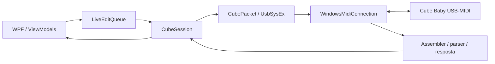

# Arquitetura e dados locais

[Documentação](../README.md) · Revisão: 01/10/2026

O aplicativo Windows é C#/.NET 10 com WPF. O acervo descompilado Android em `engenharia-reversa/apk-cubesuite/` reúne `sources/` e `resources/` e fornece evidências de protocolo; não é dependência de execução nem solução de build do aplicativo.

## Projetos

Os caminhos abaixo são relativos a [windows/](../../windows/README.md).

| Projeto | Responsabilidade |
| --- | --- |
| Cube.Protocol | Envelope, parser, empacotamento SysEx, perfil Cube Baby, sessão, fila, formatos de IR/amp e backups |
| Cube.Usb | Implementação de `IMidiConnection` com `Windows.Devices.Midi` e descoberta de portas |
| Cube.Desktop | Janela WPF, ViewModels, controles, aparência, idiomas, IRs, criador de amps e áudio de backing tracks |
| Cube.Tests | Executável de testes de protocolo e `FakeConnection` |
| Cube.Desktop.Tests | Executável de testes WPF, cenários simulados e capturas |
| Cube.Diagnostics | Operações de diagnóstico/pesquisa que acessam o pedal |

O desktop referencia Cube.Usb, que referencia Cube.Protocol. O build de simulação inclui `Cube.Tests/FakeConnection.cs` por condição no projeto desktop. O áudio de backing tracks utiliza APIs de mídia do Windows, fora do protocolo de controle do pedal.

## Caminho de uma edição

`LiveEditQueue` reúne mudanças de parâmetros e mantém o preset de destino de cada comando. `CubeSession` serializa operações com semáforo e mantém uma requisição pendente por vez. O timeout padrão de troca é 1,5 segundo. O parser verifica envelope/checksum e as leituras esperadas conferem região, endereço e tamanho.

Formato: `00 59 CMD LEN24_LE PAYLOAD CHECKSUM`, com checksum `(~sum(payload)) & 0xFF`, seguido de empacotamento contínuo em sete bits entre `F0/F7`. A referência completa está no [catálogo de comandos](../../../../engenharia-reversa/cube-baby/CUBE_BABY_COMANDOS.md).

## Estado e persistência

O editor mantém banco de referência (`baseline`), última confirmação (`confirmed`) e edição (`edited`). A/B/C têm 16 bytes cada, total de 48; treze campos são conhecidos em cada preset. Bytes reservados são preservados.

| Domínio | Prévia/edição | Persistência |
| --- | --- | --- |
| Presets | Região 5, `0x80000000 + preset × 16 + offset` | Escrita dos 48 bytes em região 5, endereço 0 |
| IR | Flag em região 4, `0x764`; 2052 bytes a partir de `0x768` | Oito setores de 4096 bytes, região 0, bases `0x69000–0x70000` |
| Amp | Corpo de 1568 bytes em região 4, `0x1C–0x63B` | Nove setores de 4096 bytes, região 0, bases `0x60000–0x68000` |
| Preferências e backing tracks | Estado local da interface/player | Arquivos no perfil Windows, sem gravação desses dados no pedal |

As bases da tabela são inícios de setores, não limites finais de conteúdo. A leitura do banco pode refletir edições live; somente ler de volta não prova persistência após desligamento. Uma confirmação de gravação exige a comparação implementada pelo fluxo, além do ACK.

A conexão automática identifica o aparelho, lê o banco e inventaria IRs. Existe código experimental de footswitch, mas `StartFootswitchMonitoring` não é chamado no fluxo atual. Ver [investigação](../historico/physical-switch-investigation.md).

## Arquivos do usuário

Diretório padrão: `%LOCALAPPDATA%\CubeControl`. Com `CubeSimulation=true`, os dados do editor usam `%LOCALAPPDATA%\CubeControl-Simulation`.

| Caminho relativo | Conteúdo / comportamento |
| --- | --- |
| `Backups/` | Bancos JSON, snapshots e backups de IR criados pelos fluxos do editor |
| `pending-ir-preview.json` | Snapshot de recuperação de IR; carregado após reiniciar e removido depois de restaurar |
| `AmpRecovery/` | Cópias RAM reconstruídas e setores flash anteriores de amps; não há retomada automática de prévia de amp após reiniciar |
| `visual-preferences-v1.json` | Associações de gabinetes, nomes por conteúdo, imagens e preferência de associação automática |
| `IrNames/` | Arquivos `.txt` por hash do IR com o nome local do WAV; mantidos também para compatibilidade com metadados anteriores |
| `Images/` | Cópias de imagens personalizadas |
| `backing-tracks-v1.json` | Lista de caminhos de áudio, ordem, seleção, saída, volume e mute |
| `appearance-v1.json` | Tema, sempre na pasta CubeControl |
| `language-v1.json` | Idioma, sempre na pasta CubeControl |
| `zoom-v1.json` | Zoom, sempre na pasta CubeControl |

Tema, idioma e zoom são compartilhados entre aplicativo real e simulado. Exportações ficam no destino escolhido. Logs da sessão são mantidos na interface; diagnósticos podem gravar arquivos nos caminhos solicitados. Não há telemetria implementada no código de produção inspecionado.

## Formatos e recursos

| Recurso | Origem / formato |
| --- | --- |
| Banco de presets | JSON `cubecontrol-bank-v1`: dispositivo, data e `bankHex` de 48 bytes |
| Backup de setor IR | Manifesto `cubecontrol-ir-v1` e `.bin` de 4096 bytes, com integridade verificada |
| WAV preparado | Mono, 48 kHz, 512 amostras float32, sem normalização de amplitude |
| Setor de amp | 4096 bytes; corpo editável separado do cabeçalho e preenchimento |
| Biblioteca de IRs | 276 WAVs em `Cube.Desktop/Assets/ImpulseResponses`, copiados à saída |
| Amps originais | `Assets/FactoryAmps.bin`, 36864 bytes, recurso embutido `Cube.FactoryAmps`; usado para reconhecer o nome pelo conteúdo |
| Presets e IRs de fábrica | Extraídos da instalação original do CubeSuite por `FactoryResources.Load`, com hashes específicos |
| Manual | PDF em `Cube.Desktop/Assets/Documents`, copiado à saída |
| Idiomas e fotos | JSON em `Localization` e PNGs em `Assets/Images/Equipment` |

`FactoryAmps.bin` não substitui `BFI.bin` no fluxo de recuperação de presets/IRs. O CubeSuite.exe e o BFI.bin exigidos pelo carregador não são redistribuídos nesta árvore. O conteúdo e os hashes são documentados em [IR e fábrica](../referencias/cubecontrol-ir-e-fabrica.md).

## Fontes de implementação

[Perfil de presets](../../windows/Cube.Protocol/CubeBabyProfile.cs), [sessão](../../windows/Cube.Protocol/CubeSession.cs), [fila](../../windows/Cube.Protocol/LiveEditQueue.cs), [transporte Windows](../../windows/Cube.Usb/WindowsMidiConnection.cs), [estado do editor](../../windows/Cube.Desktop/ViewModels/EditorViewModel.cs) e [projeto desktop](../../windows/Cube.Desktop/Cube.Desktop.csproj).

Os problemas conhecidos de validação de amps e recuperação, além do registro da padronização de versão/publicação em 1.1, estão reunidos na [revisão documental](revisao-documental.md).
