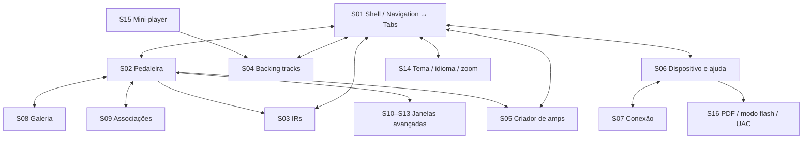
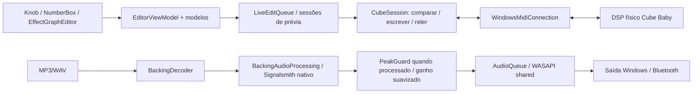

# QA TEST PLAN

## 1. Resumo Executivo

Auditoria estática do **cubeControl 1.1.0**, em 03/10/2026. Base: checkout `7bfe7ca979b88fe267e5daeab39472c3573469b0` **mais alterações locais preexistentes**, incluindo FirmwareUpdater e mudanças nos efeitos. O commit sozinho não reproduz a árvore analisada. Este arquivo é um catálogo para seleção humana; nenhuma bateria foi selecionada ou executada, nenhum build foi disparado e nenhum dispositivo foi acessado.

O produto é um editor WPF para o Cube Baby de guitarra por USB-MIDI, com player de backing tracks independente pelo Windows. O DSP da guitarra roda no pedal; o computador prepara parâmetros/IRs e processa velocidade/tom das backing tracks. Simulação não comprova áudio nem retenção em flash.

Os riscos mais relevantes são gravação destrutiva de firmware/slots, perda de edição local, restauração incompleta de RAM, divergência entre preset editado e físico, concorrência entre prévias e edições, e continuidade do player. A prioridade indica urgência de investigação, não severidade de defeito comprovado.

**Legenda:** P0 = integridade/crash/indisponibilidade crítica; P1 = fluxo central ou recuperação; P2 = usabilidade/compatibilidade; P3 = refinamento secundário; P4 = investigação opcional. Risco combina impacto, exposição e recuperabilidade; probabilidades não foram medidas. Requisitos inferidos aparecem como critérios propostos ou questões em aberto.

**57 baterias:** 19 P0, 30 P1, 8 P2, 0 P3, 0 P4. Tipos exclusivos: **16 automatizáveis, 34 parcialmente automatizáveis, 7 manuais**. Marcadores sobrepostos: **12 dependentes de hardware, 5 com escuta/captura auditiva, 3 de profiling/performance**. Automação indica viabilidade, não script já implementado.

| Domínio | Quantidade |
| --- | ---: |
| Smoke (SMK) | 2 |
| Navegação (NAV) | 3 |
| UI (UI) | 3 |
| Usabilidade (UX) | 1 |
| Mensageria (MSG) | 2 |
| Hints (HINT) | 1 |
| Estados (STA) | 3 |
| Inputs (INP) | 2 |
| Arquivos (FILE) | 2 |
| Persistência (PERS) | 2 |
| Presets (PRE) | 3 |
| Amplificadores (AMP) | 2 |
| IR (IR) | 3 |
| Signal chain (CHAIN) | 2 |
| DSP (DSP) | 4 |
| Áudio (AUD) | 2 |
| Player (PLY) | 2 |
| Backing tracks (BT) | 2 |
| Dispositivos (DEV) | 2 |
| MIDI (MIDI) | 2 |
| Concorrência (CONC) | 2 |
| Resiliência (RES) | 2 |
| Performance (PERF) | 2 |
| Memória (MEM) | 1 |
| Acessibilidade (ACC) | 2 |
| Regressão (REG) | 1 |
| Firmware (FW) | 2 |

## 2. Escopo Analisado

Caminhos abreviados neste documento: **W** = `CubeControl-1.1/Cube/windows/`; **D** = W + `Cube.Desktop/`; **P** = W + `Cube.Protocol/`. Símbolos citados são referências estáveis para localizar evidência mesmo após deslocamento de linhas.

| Área | Evidências inspecionadas | Limite |
| --- | --- | --- |
| Estrutura/build | Seis projetos C#, Directory.Build.props/targets, Desktop.csproj, Native/Build.ps1, scripts/Build-CubeControl.ps1, README Windows | Não foi encontrada solution .sln no inventário; build organizado por projetos/scripts. Compilabilidade não aferida |
| UI | MainWindow.xaml/code-behind/Zoom, oito Views XAML e respectivos code-behind, App.xaml/cs | Mapeamento estático, sem certificação visual ou interação real |
| Estado | Todos os grupos EditorViewModel.*, BackingTracksViewModel, modelos de efeitos/amp/IR, Observable/UiCommand | Fluxos centrais lidos em detalhe; classes auxiliares correlacionadas por bindings, métodos e buscas |
| Serviços/protocolo | CubeSession.*, LiveEditQueue, parsers, perfil, formatos, WindowsMidiConnection | Nenhum comando enviado ao hardware |
| DSP/áudio | BackingAudioEngine, BackingAudioProcessing, Native/BackingDsp.cpp; parâmetros e prévias no protocolo | Código próprio e fronteira nativa inspecionados; bibliotecas vendor não auditadas linha a linha |
| Recursos | Appearance, Localization, converters, controles/behaviors, Assets, manifesto e referências de empacotamento | Conteúdo binário e todos os pixels dos recursos não revisados |
| Testes | Cube.Tests e Cube.Desktop.Tests, entradas, FakeConnection e famílias especializadas | Inventário e leitura estática; existência de teste não prova cobertura executada |
| Documentação/pesquisa | READMEs, arquitetura, guia de uso, backing tracks, índices e relatórios de engenharia reversa | APK descompilado é acervo de pesquisa, não aplicativo Windows; não se inventariam suas telas como produto |
| Diagnóstico | Cube.Diagnostics e scripts de pesquisa de chorus/phaser/delay/reverb | Ferramentas separadas; não executar como smoke, pois podem acessar o pedal |

Não foram encontrados no produto fluxos de gravação de guitarra no PC, ASIO, seleção de entrada de áudio, metrônomo/tuner de software, cadeia arbitrária com adicionar/remover/reordenar efeitos, MIDI Learn, favoritos ou CRUD de biblioteca ilimitada de presets A/B/C. O manual descreve ações físicas do pedal; isso não cria esses recursos na UI. Casos dessas funcionalidades são **NOT_APPLICABLE** ao catálogo atual.

## 3. Arquitetura Identificada

- `Cube.Desktop`: .NET 10/WPF, WPF UI 4.3.0, NAudio.Core/Wasapi 3.1.0, alvo Windows 10.0.19041.0; cria diretamente EditorViewModel e BackingTracksViewModel. Não foi identificado contêiner de DI ou NavigationService.
- `MainWindow` é a shell. ListBox Navigation sincroniza índice com TabControl Tabs; não há pilha Back/Forward. AmpEditor é criado sob demanda e retido em AmpEditorHost.
- Os quatro criadores avançados são janelas modeless com Owner e DataContext compartilhado; `advancedEffectWindows` impede duplicar a janela por estágio. Fechar a janela envolve restauração, além de remoção do dicionário.
- `Observable` implementa INotifyPropertyChanged; `UiCommand` recebe Action e consulta CommandManager.RequerySuggested. Lambdas async tornam vários comandos async void; exclusão depende de Busy, flags e guards específicos, não de um AsyncCommand central.
- `Cube.Usb → Cube.Protocol`: Windows.Devices.Midi → IMidiConnection → CubeSession. Sessão usa semáforo, um pending e timeout de 1,5 s. Sem ID de transação, falha em Exchange invalida a sessão para evitar resposta atrasada atribuída à próxima operação.
- `LiveEditQueue` agrega por slot/offset, preserva destino, ordena chaves e substitui valor pendente. Flush precede operações; Stop descarta pendências não enviadas.
- Recursos dinâmicos/ThemeService, TranslateConverter e LanguageService fornecem apresentação; Knob/EffectGraphEditor têm UI Automation. Behaviors incluem SurfaceMotion, SmoothScroll, SmoothHorizontalWheel, GalleryDialogDismissal e ExpanderChevron.
- BackingAudioEngine possui worker LongRunning e BlockingCollection; thread WASAPI consome AudioQueue com lock. BackingAudioProcessing usa decoder, SafeHandle e DLL C++ Signalsmith Stretch.
- FirmwareUpdater é um processo auxiliar elevado, lançado por `--firmware-worker`, com named pipe de usuário atual, validação de hash/CRC, acesso ao dispositivo em modo flash e verificação do retorno normal.

## 4. Inventário de Telas

Estados comuns: offline, conectando, Busy, bloqueado por falha, operação concluída e restauração pendente. Para todas as superfícies, cruzar Tab/Shift+Tab, Enter/Escape, foco, tradução, DPI e áudio ativo conforme baterias referenciadas.

| ID / superfície e fonte | Acesso e saídas | Ações/controles | Estado, dependências, vazios/erros e diálogos |
| --- | --- | --- | --- |
| S01 Shell — MainWindow | Startup; sidebar dá acesso S02–S06 | Conectar/carregar, A/B/C, salvar banco, histórico, notificações, reticências | VM global; banco ausente/Dirty/Busy/blocked; Ask no fechamento; recursos WPF e perfil Windows |
| S02 Pedaleira — MainWindow, EditorViewModel.Visual, MusicalViewModels | Sidebar índice 0; cards e carrossel; volta por sidebar | Seis estágios, knobs, switches, amp/cab, imagem, associação e undo | Preset selecionado não comprova preset físico; galeria e MatchSettings; inventário incompleto bloqueia matching; USB para edição |
| S03 IRs — MainWindow, IrViewModel, IrLibraryViewModel | Sidebar índice 1 ou Gerenciar IRs | Árvore/busca, WAV externo, waveform, distância 0–100%, slots 1–8, prévia, encerrar, ler, gravar, restaurar | Biblioteca offline; prévia automática se conectado; busca vazia, WAV ausente/inválido; FilePicker, confirmação com imagem, backup; RAM/flash |
| S04 Backing tracks — MainWindow, BackingTracksViewModel | Sidebar índice 2 ou mini-player | Playlist, drop/reorder/contexto, MP3/WAV, play/pause/stop, ±5 s, anterior/próxima, A/B, loop, velocidade 50–150%, tom ±6, volume/mute, saída, exportar/cancelar | Empty/Loading/Ready/Playing/Paused/Ended/Error; arquivo/codec/endpoint/DLL; localizar arquivo; escolha de exportação e SaveFileDialog |
| S05 Criador de amps — Views/AmpEditor | Sidebar índice 3 ou criar amp; ChooseBase | Base 1–9, EQ, ganho/volume, curva/resposta, reset, importar/exportar .bin, restaurar som, gravar slot | Inicialmente CTA sem editor; Loaded/local/preview/saving/error; confirmação ao mudar base e gravar; importação pode iniciar prévia pelo code-behind |
| S06 Dispositivo e ajuda — MainWindow | Sidebar índice 4 | Conexão, manual PDF, atalhos físicos, recovery, log, restaurar A/B/C e 8 IRs; firmware | Manual/recursos de fábrica externos podem faltar; reinstalação exige offline normal, modo flash/UAC; confirmações destrutivas |
| S07 Conexão — Views/ConnectionDetails | Card de ajuda e chamadas ConnectionClick; fecha para shell | Combo entrada/saída MIDI, buscar, conectar, desconectar | ContentDialog; CanConnect limita seleção; portas vazias/ocupadas/timeout; transporte Windows |
| S08 Galeria — Views/GearGallery | Imagens/seletores amp e cabinet da pedaleira | Navegar itens, aplicar, duplo clique, cancelar | Seleção provisória separada; conteúdo por hash, imagens ausentes com fallback; retorno ao estágio; sem escrita por mero abrir |
| S09 Associações — Views/MatchSettings | MatchSettingsClick | Amp → gabinete, salvar associações/cancelar | Inventário e hashes; referência órfã; persistência local; salvar tabela não grava pedal |
| S10 Chorus — Views/ChorusEditor | Card estágio 1 → AdvancedEffectClick | Gráfico, forma, valores, ouvir, restaurar, importar/exportar; leitura automática ao abrir | Janela retida por estágio; prévia/monitor/recovery, firmware/contexto físico; fechamento pede restauração se alterado |
| S11 Phaser — Views/PhaserEditor | Card estágio 2 | Gráfico, limites inferior/superior, seções, ouvir/restaurar/arquivos; leitura automática ao abrir | Como S10; diferença no carregamento de recovery inválido merece cobertura própria |
| S12 Delay — Views/DelayEditor | Card estágio 3 | Gráfico temporal, depth/rate/time/feedback/mix, congelar, arquivos e RAM | Tempo interno sem ms comprovados; prévia concorrente com outros efeitos conforme código atual |
| S13 Reverb — Views/ReverbEditor | Card estágio 4 | Sinal direto/reverberado, realimentação/retorno/amortecimento, arquivos e RAM | Sem promessa de cauda medida; restauração e referência por identidade |
| S14 Reticências — MoreOptionsClick, MainWindow.Zoom | Shell → menus/submenus → retorno ao botão | Tema sistema/claro/escuro, idioma, zoom 50–200% | Popup recriado a cada abertura; preferência compartilhada com simulação; erro de gravação e posicionamento multimonitor |
| S15 Mini-player/histórico/feedback | Overlay da shell; mini-player retorna S04, histórico por duplo clique | Transporte global; retornar à operação; Snackbar, InfoBar, status e BusyOverlay | Não são players independentes; histórico restrito à sessão/revisão do som; confirmação antes de restaurar RAM |
| S16 Diálogos e SO | Ask/ContentDialog/MessageBox/FilePicker/UAC/Explorer/Bluetooth/manual | Confirmar/cancelar, seleção de arquivos, abrir aplicações externas | Owner/foco, cancelamento e chamadas repetidas; helper firmware é processo separado, sem janela de editor normal |

Não há botões Ler/Aplicar nos XAML atuais dos quatro criadores: a leitura vem de AdvancedEffectClick e os ajustes/imports podem enviar automaticamente. Métodos públicos Apply*Edits não implicam botão visível. Não há descoberta de telas órfãs apenas pela ausência de sidebar: S07–S13 possuem handlers de acesso. `StartFootswitchMonitoring` existe sem chamada localizada; separar implementação experimental de funcionalidade ativa.

## 5. Mapa de Navegação

Cada aba pode acessar outra via shell; janelas avançadas permanecem abertas e compartilham VM. Não exigir Back/Forward inexistentes. Ciclos planejados: S02→S03→S04→S05→S06→S02; S02→S10→S11→S12→S13→S02; S04→S03→mini-player→S04. Variar 20 ciclos normais e 100 sob instrumentação, sem repetir gravação flash. Fluxos que encerram preview devem registrar aceitação/cancelamento, não assumir que navegar equivale a descartar.

## 6. Mapa de Estados

| Máquina / fonte de verdade | Transições e invariantes a testar |
| --- | --- |
| Conexão | Offline → enumeração → identidade → banco → inventário → conectado; falha → blocked/faulted → reler/reconectar. Desconexão manual pausa reconexão; timer automático 600 ms e recuo de 7,5 s após falha |
| Banco | baseline = referência local; edited = intenção; confirmed = último retorno verificado. edited ≠ confirmed: Enviando; edited ≠ baseline: não gravado. Save compara banco remoto antes de gravar os 48 bytes |
| A/B/C | Índice de edição 0–2; não é controle geral de footswitch. PrepareAdvancedEffectAsync lê estado físico e alinha seleção ao slot físico; medir alteração automática de seleção |
| Operação | Execute: guard Busy → aguardar sends/check → Flush → confirmação quando changesEffects → ação → catch → finally desbloqueia. BusyOverlay não bloqueia hit test; CanExecute precisa sustentar exclusão |
| IR | Sem arquivo → preparado → snapshot persistido → PreviewActive antes da mutação → PreviewConfirmed após leitura → restaurado. Falha preserva snapshot/identidade e não afirma restauração |
| Amp | Local → PreviewSending → PreviewConfirmed → Saving → Saved; Restored mantém edição local; Error mantém diagnóstico. Exportar arquivo é independente de flash |
| Efeitos | Não carregado → preparar contexto → verificar firmware → recovery → enviar/monitorar → ativo ou stopped → restaurar. Múltiplas janelas e estados existem; chorus/phaser não são simultaneamente audíveis |
| Player | Empty → Ready/Loading → Playing ↔ Paused → Ended; Stop reconstrói e retorna Ready, não existe enum Stopped. Troca de faixa limpa engine e incrementa generation; saída trocada libera reprodução |
| Histórico | Gestos agrupam mudanças; restauração de operação exige mesma sessão, soundContentRevision e Available. Undo de presets não é rollback de flash |
| Fechamento | Busy impede fechar; Dirty/efeitos alterados pedem confirmação; Flush e restauração antes de Dispose. Local amp sem Dirty do banco requer investigação específica |

## 7. Mapa de Áudio / DSP

A cadeia desenhada Amp→Chorus→Phaser→Delay→Reverb→Cabinet é apresentação fixa, não editor de grafo DSP arbitrário. A ordem física exata não deve ser certificada apenas pelo XAML; correlacionar capturas/firmware e sinais na bateria objetiva. Tone não é bypass geral. Modulação 0–6 chorus, 7–8 desligada, 9–15 phaser; gates compartilhados afetam combinação de efeitos.

| Controles | Contrato derivado / critério |
| --- | --- |
| Presets, CubeBabyProfile.Parameters | Gain 0–7; Tone/Reverb 0–15; feedback/volume 0–127; Time 0–31; Mix 0–118; modulação 0–15; Amp 0–8; Cabinet 0–8; gates 0/1; preservar offsets 13–15 |
| AmpImage/AmpViewModel | Ganho/compensação 0–100; curva 0–1; EQ 20–20000 Hz, ±12 dB, Q 0,1–10; estabilidade dos filtros finais; floats finitos |
| Chorus/Phaser/Delay/ReverbParameters | Validate/Read/Apply delimitam bytes, faixas e estruturas. Usar defaults codificados como oráculo; unidades do gráfico são representação, não medição |
| IR | WAV até 32 MiB no carregador UI; PCM 16/24/32 e float32 mono/stereo; preparo mono 48 kHz, 512 amostras; RAM 2052 bytes, setor 4096; não normalizar ganho silenciosamente |
| Backing | Speed 50–150%, pitch −6…+6 semitons, volume 0–100%; A/B mínimo 0,1 s; WASAPI compartilhado, latência configurada no código 100 ms, sem seletor de buffer/sample rate na UI |
| DSP nativo | backing_create aceita 1–32 canais, 8–384 kHz; prepare rejeita valores não finitos; wrapper converte códigos de falha; DLL ausente/arquitetura errada requer cobertura |
| Feedback áudio | Waveforms são desenho de sinal/arquivo, gráficos de efeitos ilustrativos. Não foram encontrados medidores de entrada/saída da guitarra; não exigir leitura de clipping inexistente |

Não atribuir ms ao índice TIME, centímetros à distância do microfone nem dry/wet complementar aos mixes internos sem evidência. Captura de áudio físico deve separar latência USB de controle, processamento no pedal e latência de reprodução Windows.

## 8. Mapa de Persistência

Raiz real `%LOCALAPPDATA%\CubeControl`; editor simulado usa `CubeControl-Simulation`. Aparência/idioma/zoom continuam compartilhados. Em ensaios futuros usar perfil Windows descartável e cópias dos dados; passar dataDirectory isolado não isola automaticamente serviços singleton.

| Dados / responsável | Escrita, restauração e riscos |
| --- | --- |
| Banco ABC / EditorViewModel | JSON cubecontrol-bank-v1, bankHex 48 bytes, backups antes de operações; import aplica campos conhecidos em RAM; export escreve direto no destino; salvar grava banco completo |
| IR flash / IrBackup, CubeSession.Ir | Manifesto cubecontrol-ir-v1 + bin 4096, SHA256 e nome simples; backup verificado antes de apagar; slots 0x69000–0x70000 |
| IR RAM / IrRamBackup | pending-ir-preview.json e backup; Flag + payload 2052 + hash + IdentityHex; só remover após restauração confirmada |
| Amp / EditorViewModel.Amps | AmpRecovery contém RAM reconstruída e setores; slots 0x60000–0x68000; edição local em memória e .bin exportado; sem carregamento automático de pending amp no startup |
| Efeitos | pending-chorus/phaser/delay/reverb-preview.json, diretórios *Recovery e *.chorus/phaser/delay/reverb.json; snapshots temporários verificados antes de promover; recuperação explícita |
| VisualPreferences / CabinetCatalog | visual-preferences-v1.json via .tmp + Move; Matches por hash, Images e IrNames; migração remove associações legacy factory-cab-* |
| Imagens e nomes | Images/ e IrNames/{hash}.txt; falha de imagem admite fallback; cache precisa acompanhar conteúdo alterado/movido |
| Player | backing-tracks-v1.json contém versão 2, lê 1/2; caminhos, ordem, seleção, endpoint, A/B/speed/pitch/assinatura size+mtime; debounce 500 ms + .tmp/Move; log backing-audio.log limitado |
| Aparência | appearance-v1.json, language-v1.json, zoom-v1.json; temporário/Move; fallback em corrupção; erros de leitura podem ser silenciosos |
| Fábrica | FactoryAmps.bin embutido; presets/IRs dependem de CubeSuite.exe/BFI.bin reconhecidos por hash, fora da distribuição; falha não deve inventar recurso disponível |
| Firmware | .up + Assets/Firmwares/reset.bin; hash entre confirmação/helper, CRC por bloco; não confundir atualização de firmware com backup restaurável de banco |
| Exportação WAV | Temporário único, PCM16 com dither determinístico, Move ao concluir, cleanup no finally; recusa sobrescrever fonte presente na playlist |

## 9. Mapa de Mensageria

| Canal / localização | Gatilho e texto representativo | Avaliação a realizar |
| --- | --- | --- |
| Status/ErrorMessage — Execute/Fault | ex.Message, “Releia ou reconecte”, “edição preservada” | Separar detalhe técnico de ação útil; não atribuir preservação em disco à mera edição em memória |
| Snackbar — NotifyUser/NotifyFailure/ShowNotification | Conexão, conclusão, gravação pendente, falha | Severidade, duração, repetição/deduplicação, leitura por tecnologia assistiva; não encobrir mini-player |
| Preset.State/BankSaveStatus | Enviando, aplicado não gravado, gravado verificado | Resultado só após confirmação; retenção após power cycle é outra prova |
| Efeitos/Amp/IR | PreviewConfirmed, restauração não confirmada, arquivo no computador | Distinguir RAM/arquivo/flash; mensagens na janela cujo contexto originou a ação |
| Player InfoBar/AnalysisStatus | Sem saída, waveform indisponível, arquivo ausente, exportação cancelada | Causa e próxima ação; falha de análise não deve impedir tentativa legítima de playback |
| Confirmações Ask | Importar, reler/descartar, salvar recursos, reset, histórico, encerrar previews, fechar | Destino, extensão da perda, default/Enter/Escape, cancelamento sem alteração |
| ContentDialog | Galeria, MatchSettings, conexão, escolha de exportação, imagem do IR | Isolamento da seleção provisória e foco no retorno |
| Validação inline | ParameterNumberBox.InputError, valor gráfico inválido, AmpControl.TryEdit | Faixa/unidade e preservação da última entrada válida |
| Busy/progresso | Mensagens rotativas 4 s, inventário, TransferProgress, helper firmware | Detalhe útil, progresso obsoleto rejeitado, não oferecer cancelamento inexistente de flash |
| SO | FilePicker, UAC, PDF, Explorer e Bluetooth | Cancelamento normal, dependência indisponível e retorno à janela proprietária |

**Erros técnicos expostos, categoria separada:** Execute atribui ex.Message a Status/ErrorMessage (D/ViewModels/EditorViewModel.cs); Import de JSON/hex pode levar mensagens de parser à UI. EditorViewModel.Visual concatena ex.Message em preferências/imagem. MainWindow.Closing concatena ex.Message ao pedido de fechar mesmo assim. FirmwareUpdater pode expor Win32Exception e endereços CRC. Isso confirma canais de exposição; conteúdo exato/stack trace visível depende do erro. O player normalmente mostra mensagem contextual e guarda exceção completa em backing-audio.log. Bateria QA-MSG-002.

## 10. Mapa de Hints / Tooltips

| Superfície | Fonte e atenção |
| --- | --- |
| Knobs/NumberBox | CubeBabyProfile.Description, ParameterViewModel, MainWindow bindings: nome, valor, limite e escala própria; wheel não pode alterar outro controle |
| Gráficos avançados | EffectGraphEditor gera faixa contextual, Unit/Hint, AutomationProperties.Name/HelpText; conferir tradução após janela já aberta |
| Amp EQ | AmpEditor e AmpEqGraph: Hz/dB/Q, reset de banda inteira e ganho global; evitar confundir com ganho do preset |
| IR/microfone | Tooltip de prévia versus gravação; percentagem de distância sem unidade física; detalhes de preparação não devem prometer normalização |
| Transporte | Ícones possuem ToolTip/AutomationProperties; PlayLabel muda com estado; A/B e limpar precisam explicar efeito |
| Sidebar/galeria/firmware | Ajuda contextual para IR e recuperação; “reinstalar/atualizar” explica modo flash/admin; ações disabled devem indicar pré-condição |
| Global App.xaml.cs | Delay inicial 1200 ms, duração 20000 ms; posição em DPI/zoom e não cobrir valor durante gesto |

A presença de Tooltip no código não certifica legibilidade, precisão semântica ou acessibilidade.

## 11. Mapa de Ações Destrutivas

| Ação | Alvo / proteção existente | Bateria |
| --- | --- | --- |
| Save | 48 bytes A/B/C; compara banco e backups | QA-PRE-002 |
| Import/reload/histórico | Estado local/RAM; confirmação e backup em fluxos específicos | QA-STA-002, QA-PRE-003 |
| WriteIr/RestoreIr/ResetIrs | Slot ou oito setores; confirma, backup, erase/write/readback | QA-IR-003 |
| WriteAmp | Setor de amp; confirma destino, backup e comparação | QA-AMP-002 |
| Mudar base/importar amp | Substitui edição local; confirmação de base, import sem confirmação equivalente localizada | QA-STA-002 |
| Fechar prévia | Restaura RAM e pode perder personalização não exportada | QA-RES-002 |
| Firmware | Blocos de flash, pode substituir presets/IRs; confirmação + UAC + CRC, sem promessa de rollback automático | QA-FW-002 |
| Remover faixa | Remove referência da playlist, não arquivo de áudio | QA-BT-001 |
| Exportar sobre destino | Arquivo escolhido; FilePicker/Move, proteção da fonte no player | QA-FILE-002 |

Não existem Delete de preset A/B/C, remoção de estágio ou exclusão de amp como item de biblioteca; não inventar essas ações. Ensaios de falha durante erase devem começar com fake; corte físico de energia só em unidade de laboratório recuperável e selecionado explicitamente na etapa de execução.

## 12. Operações Assíncronas

| Fluxo | Coordenação observada | Risco/teste |
| --- | --- | --- |
| Execute/UiCommand | Busy, operationCompletion, Flush, await sends; async void nos comandos | Reentrância antes/depois do primeiro await, CanExecute versus chamada programática — QA-CONC-001 |
| Prévia de amp | ampPreviewTask + pending + Task.Yield; último ajuste agregado | Resultado obsoleto após mudar base/slot — QA-CONC-002 |
| Prévia de efeitos | sendTask/pending, cancellation de monitores, previewCheckTask compartilhado | Concorrência com controles normais, fechar e restaurar — QA-CONC-002 |
| Biblioteca IR | debounce 125 ms, irSelectionGeneration/transferGeneration | Última seleção e progresso antigo — QA-CONC-002 |
| Conexão automática | timer 600 ms, checkingConnection, pausa manual, timeout | Reconexão durante operação/fechamento — QA-DEV-002 |
| Player | worker serial, snapshots/generation, Dispatcher, opening | Ação tardia após selecionar faixa/saída — QA-PLY-001/QA-CONC-002 |
| Waveform/export | Task.Run, CancellationToken ligado ao lifetime, cache e backgroundWork | Cancelamento/Dispose e arquivo temporário — QA-BT-002/QA-FILE-002 |
| Firmware | Processo elevado, pipe, connect timeout 45 s, espera de exit | Helper que não encerra após conectar; fechar durante operação — QA-FW-001 |
| UI | async handlers para modais/fechamento, BeginInvoke, timers | Dialog duplicado, foco velho e handler acumulado — QA-NAV-002/QA-UI-002 |

## 13. Riscos Identificados

| ID | Risco específico | Prioridade / justificativa | Cobertura |
| --- | --- | --- | --- |
| R01 | Firmware/IR/amp parcialmente gravados ou destino incorreto | P0; perda persistente e recuperação dependente de hardware | FW-002, IR-003, AMP-002 |
| R02 | Preview restaurado apenas na mensagem, não no dispositivo | P0; próximo uso pode manter timbre inesperado | RES-002, DSP-002 |
| R03 | Banco/RAM/UI divergirem sob edições cruzadas | P0; guitarrista ouve estado diferente do mostrado | PRE-001, CONC-002, AUD-001 |
| R04 | Edição local perdida ao importar/reler/fechar | P0; trabalho não exportado não é recuperável por snapshot de hardware | STA-002 |
| R05 | Loading/Busy/helper preso | P1; indisponibilidade, especialmente durante performance | RES-001, FW-001 |
| R06 | Tempo/tom/loop produzirem dropout, clipping ou canais trocados | P1; ensaio/gravação inutilizável | DSP-003, PLY-002, AUD-002 |
| R07 | Reconectar equipamento/contexto errado | P0; identidade de protocolo pode representar modelo, não serial único | DEV-002, MIDI-001; questão Q04 |
| R08 | Layout/scroll invisível/foco dificultarem operação com instrumento | P2; erro de ajuste e custo de interrupção | UI-001, ACC-001, UX-001 |
| R09 | Testes/simulação divergirem do produto atual | P1; falsa confiança, especialmente firmware B e múltiplas prévias | REG-001, SMK-000 |
| R10 | Growth de callbacks/cache/recursos nativos e waits no Dispose | P1; lentidão acumulada ou travamento no fechamento | MEM-001, PERF-002 |

## 14. Achados Preliminares

**CONFIRMADO POR INSPEÇÃO ESTÁTICA** significa propriedade do código demonstrada, não falha observada em execução.

| ID / classificação | Localização / categoria | Descrição e evidência | Impacto potencial / bateria |
| --- | --- | --- | --- |
| AP01 — CONFIRMADO POR INSPEÇÃO ESTÁTICA | MainWindow.xaml.cs, AdvancedEffectClick/Closing; restauração | Faz await Model.CloseAdvancedPreviewAsync(stage) e depois closeReady=true sem usar o bool retornado; o método retorna false quando restauração falha | Janela pode fechar apesar da falha; backup pode continuar preservado, portanto não afirmar perda de backup. QA-RES-002 |
| AP02 — CONFIRMADO POR INSPEÇÃO ESTÁTICA | EditorViewModel.ImportAmpAsync + AmpEditor.ImportClick; proteção de edição | ImportAmpAsync carrega novo Amp sem Ask de descarte; ImportClick chama PreviewAmpAsync após sucesso. BaseSelected possui confirmação de perda | Substituição da edição anterior não exportada; possível surpresa sonora na importação. QA-STA-002/QA-AMP-001 |
| AP03 — CONFIRMADO POR INSPEÇÃO ESTÁTICA | EditorViewModel.Execute; mensageria | catch publica ex.Message diretamente em Status/ErrorMessage | Mensagem nativa/parser/caminho pode chegar ao guitarrista; não prova exposição de stack trace. QA-MSG-002 |
| AP04 — CONFIRMADO POR INSPEÇÃO ESTÁTICA | Guia de uso/backing tracks versus BackingTracksViewModel.AddPaths/Restore | Guia cita “até três arquivos”; os dois métodos percorrem lista sem limite de três | Divergência de contrato; não classificar playlist maior como bug sem decisão funcional. QA-BT-001 |
| AP05 — CONFIRMADO POR INSPEÇÃO ESTÁTICA | Guia de uso versus CanEdit/PrepareAdvancedEffectAsync/CanStart* | Documentação descreve bloqueio de edição comum, leitura/aplicação por botões e importação sem envio; código atual lê ao abrir, sincroniza controles, prepara gates/preset físico e Import* chama Apply*Edits quando há preview ativo | Testes baseados só no guia usariam oráculo antigo. QA-DSP-002/QA-REG-001 |
| AP06 — CONFIRMADO POR INSPEÇÃO ESTÁTICA | EditorViewModel.Footswitch.StartFootswitchMonitoring | Busca de referências encontrou definição, sem chamada; testes chamam leitura interna separadamente | Não prometer sincronização contínua de A/B/C. QA-MIDI-002 |
| AP07 — RISCO A VALIDAR EM EXECUÇÃO | FirmwareUpdater.RunElevated; liveness | Timeout explícito cobre conexão inicial; após conectar há ReadLineAsync e espera de exit sem timeout global localizado | Helper/driver bloqueado pode manter Busy indefinidamente. QA-FW-001 |
| AP08 — RISCO A VALIDAR EM EXECUÇÃO | BackingTracksViewModel.ExportSelection | exporting só é ativado após await ChooseExportMode e SaveFileDialog | Cliques concorrentes podem disputar diálogo/seleção; confirmar por sequência reproduzível. QA-CONC-001 |
| AP09 — RISCO A VALIDAR EM EXECUÇÃO | MainWindow.Closing + AmpViewModel | Fechamento verifica Dirty do banco e AdvancedPreviewHasChanges, sem guard equivalente de edição local de amp | Amp local não exportado pode ser perdido sem aviso específico. QA-STA-002 |
| AP10 — RISCO A VALIDAR EM EXECUÇÃO | EditorViewModel.LoadPendingPhaser/Initialize | Phaser desserializa/valida sem fallback local equivalente aos flags invalid de chorus/delay/reverb; Initialize os carrega antes de enumeração | Recovery phaser corrompido pode interromper restante do startup. QA-PERS-002 |

**Catches silenciosos/fallbacks inventariados:** ThemeService.Load e ZoomSettings.Load (preferência inválida → padrão); LanguageService (pacote opcional/preferência inválidos); VisualCatalogViewModel/GearItem.ReadImage (imagem → null); EditorViewModel.Visual.UpdateCabinet (tentativa de reconhecer nome pela biblioteca); AmpViewModel (EQ não reconstruível → efetivo “—”/ignora tentativa); WindowsMidiConnection.DisposeLatePort (erro tardio após timeout já comunicado); BackingAudioEngine callback PlaybackStopped (fila encerrada); BackingTracksViewModel.LoadWaveform/Start (OperationCanceledException), Save (cleanup), Log (falha no próprio log); monitores de efeitos (cancelamento esperado); FirmwareUpdater pipe e envio final/reset (casos específicos). Não são automaticamente bugs: QA-RES-001 deve distinguir cancelamento normal, fallback explicado e erro que perde evidência. Buscas de TODO/FIXME/HACK/WORKAROUND em C# próprio não revelaram marcador que, por si, comprovasse defeito.

## 15. Índice de Baterias

Todas estão **não executadas**. READY significa planejável em ambiente isolado, não pré-condições já verificadas. REQUIRES_HARDWARE exige preparar o equipamento; REQUIRES_MANUAL_VALIDATION exige julgamento humano. BLOCKED será aplicado na execução se fixture/oráculo/dependência faltar; NOT_APPLICABLE está reservado aos recursos ausentes listados no escopo. Nenhum status representa aprovação/reprovação.

| Selecionar | ID | Bateria | Área | Prioridade | Risco | Tipo | Dependências | Disponibilidade |
| --- | --- | --- | --- | --- | --- | --- | --- | --- |
| [ ] | QA-SMK-000 | Bateria zero: pacote, build e isolamento | Smoke | P0 | Crítico | Automatizável | — | READY |
| [ ] | QA-SMK-001 | Startup limpo, sujo e shutdown | Smoke | P0 | Crítico | Parcialmente automatizável | QA-SMK-000 | READY |
| [ ] | QA-NAV-001 | Navegação principal e acessos contextuais | Navegação | P1 | Alto | Parcialmente automatizável | QA-SMK-000 | READY |
| [ ] | QA-NAV-002 | NAVIGATION LOOP / CIRCULAR NAVIGATION | Navegação | P1 | Alto | Parcialmente automatizável | QA-NAV-001 | READY |
| [ ] | QA-NAV-003 | Navegação rápida e operação em andamento | Navegação | P1 | Alto | Parcialmente automatizável | QA-NAV-001 | READY |
| [ ] | QA-UI-001 | Resize, DPI, zoom e scroll funcional | UI | P2 | Médio | Parcialmente automatizável | QA-NAV-001 | READY |
| [ ] | QA-UI-002 | Modais, popups, foco e default buttons | UI | P1 | Alto | Parcialmente automatizável | QA-NAV-001 | READY |
| [ ] | QA-UI-003 | Bindings, recursos e coerência visual | UI | P1 | Alto | Parcialmente automatizável | QA-SMK-000 | READY |
| [ ] | QA-UX-001 | Fluxos musicais e custo de interação | Usabilidade | P2 | Médio | Manual | QA-NAV-001 | REQUIRES_MANUAL_VALIDATION |
| [ ] | QA-MSG-001 | Mensageria, feedback e tempestade de notificações | Mensageria | P1 | Alto | Parcialmente automatizável | QA-SMK-000 | READY |
| [ ] | QA-MSG-002 | Erros técnicos expostos e logs úteis | Mensageria | P2 | Médio | Parcialmente automatizável | QA-MSG-001 | READY |
| [ ] | QA-HINT-001 | Hints, unidades e controles compactos | Hints | P2 | Médio | Manual | QA-UI-003 | REQUIRES_MANUAL_VALIDATION |
| [ ] | QA-STA-001 | Estados vazios e AÇÕES INCOERENTES / IMPROVÁVEIS / FORA DE ORDEM | Estados | P1 | Alto | Parcialmente automatizável | QA-SMK-000 | READY |
| [ ] | QA-STA-002 | Unsaved changes e proteção contra perda de trabalho | Estados | P0 | Crítico | Parcialmente automatizável | QA-SMK-000 | READY |
| [ ] | QA-STA-003 | Histórico, undo e estado global | Estados | P1 | Alto | Automatizável | QA-PRE-001 | READY |
| [ ] | QA-INP-001 | Limites, cultura e sincronização de parâmetros | Inputs | P1 | Alto | Automatizável | QA-SMK-000 | READY |
| [ ] | QA-INP-002 | Gestos, wheel, drag e edição numérica | Inputs | P2 | Médio | Parcialmente automatizável | QA-INP-001 | READY |
| [ ] | QA-FILE-001 | Formatos inválidos, paths e round-trip | Arquivos | P1 | Alto | Automatizável | QA-SMK-000 | READY |
| [ ] | QA-FILE-002 | Exportação, overwrite e cancelamento | Arquivos | P1 | Alto | Parcialmente automatizável | QA-FILE-001 | READY |
| [ ] | QA-PERS-001 | Preferências, associações e compatibilidade | Persistência | P1 | Alto | Automatizável | QA-SMK-000 | READY |
| [ ] | QA-PERS-002 | Recuperação pendente corrompida e startup | Persistência | P0 | Crítico | Automatizável | QA-FILE-001 | READY |
| [ ] | QA-PRE-001 | Edição A/B/C, fila e sincronização | Presets | P0 | Crítico | Automatizável | QA-MIDI-001 | READY |
| [ ] | QA-PRE-002 | Salvar banco completo e retenção | Presets | P0 | Crítico | Parcialmente automatizável | QA-PRE-001 | REQUIRES_HARDWARE |
| [ ] | QA-PRE-003 | Importação de banco e recuperação de fábrica | Presets | P0 | Crítico | Parcialmente automatizável | QA-FILE-001, QA-PRE-001 | READY |
| [ ] | QA-AMP-001 | Criador de amps: edição e arquivos | Amplificadores | P1 | Alto | Parcialmente automatizável | QA-INP-001, QA-FILE-001 | READY |
| [ ] | QA-AMP-002 | Gravação de amp e recuperação RAM/flash | Amplificadores | P0 | Crítico | Parcialmente automatizável | QA-AMP-001, QA-MIDI-001 | REQUIRES_HARDWARE |
| [ ] | QA-IR-001 | Decodificação e preparo de IR | IR | P1 | Alto | Automatizável | QA-FILE-001 | READY |
| [ ] | QA-IR-002 | Biblioteca, busca, preview e microfone | IR | P1 | Alto | Parcialmente automatizável | QA-IR-001 | READY |
| [ ] | QA-IR-003 | Gravar/restaurar slots e oito IRs de fábrica | IR | P0 | Crítico | Parcialmente automatizável | QA-IR-001, QA-MIDI-001 | REQUIRES_HARDWARE |
| [ ] | QA-CHAIN-001 | Cadeia fixa e switches compartilhados | Signal chain | P1 | Alto | Automatizável | QA-PRE-001 | READY |
| [ ] | QA-CHAIN-002 | Match Cabinet, identidade por conteúdo e imagens | Signal chain | P1 | Alto | Automatizável | QA-IR-002, QA-PERS-001 | READY |
| [ ] | QA-DSP-001 | Parâmetros DSP finitos e preservação de bytes | DSP | P0 | Crítico | Automatizável | QA-FILE-001 | READY |
| [ ] | QA-DSP-002 | Prévias avançadas e sincronização UI ↔ RAM | DSP | P0 | Crítico | Parcialmente automatizável | QA-DSP-001, QA-MIDI-001 | REQUIRES_HARDWARE |
| [ ] | QA-DSP-003 | DSP nativo de velocidade/tom e exportação objetiva | DSP | P1 | Alto | Automatizável | QA-FILE-001 | READY |
| [ ] | QA-DSP-004 | DSP físico: referência, bypass e transientes | DSP | P1 | Alto | Manual | QA-DSP-002, QA-AMP-002, QA-IR-003 | REQUIRES_HARDWARE |
| [ ] | QA-AUD-001 | Áudio ativo durante navegação e modais | Áudio | P0 | Crítico | Manual | QA-NAV-002, QA-PLY-001, QA-DSP-002 | REQUIRES_HARDWARE |
| [ ] | QA-AUD-002 | Diagnóstico de não sai som e UI/áudio divergentes | Áudio | P1 | Alto | Manual | QA-AUD-001, QA-DEV-001 | REQUIRES_HARDWARE |
| [ ] | QA-PLY-001 | Máquina de transporte e comandos fora de ordem | Player | P1 | Alto | Parcialmente automatizável | QA-SMK-000 | READY |
| [ ] | QA-PLY-002 | Loop A/B, waveform e sincronização | Player | P1 | Alto | Parcialmente automatizável | QA-PLY-001, QA-DSP-003 | READY |
| [ ] | QA-BT-001 | Playlist, arquivos externos e menus de faixa | Backing tracks | P1 | Alto | Parcialmente automatizável | QA-PLY-001 | READY |
| [ ] | QA-BT-002 | Análise de waveform, cache e invalidação | Backing tracks | P2 | Médio | Automatizável | QA-BT-001 | READY |
| [ ] | QA-DEV-001 | Saídas Windows, hotplug e Bluetooth | Dispositivos | P1 | Alto | Parcialmente automatizável | QA-PLY-001 | REQUIRES_HARDWARE |
| [ ] | QA-DEV-002 | USB-MIDI, reconexão e identidade | Dispositivos | P0 | Crítico | Parcialmente automatizável | QA-MIDI-001, QA-PERS-002 | REQUIRES_HARDWARE |
| [ ] | QA-MIDI-001 | Envelope, parser, sessão e respostas atrasadas | MIDI | P0 | Crítico | Automatizável | QA-SMK-000 | READY |
| [ ] | QA-MIDI-002 | Footswitch físico versus preset editado | MIDI | P1 | Alto | Parcialmente automatizável | QA-MIDI-001, QA-DSP-002 | REQUIRES_HARDWARE |
| [ ] | QA-CONC-001 | Double/triple/spam click e reentrância | Concorrência | P0 | Crítico | Parcialmente automatizável | QA-PRE-001, QA-UI-002 | READY |
| [ ] | QA-CONC-002 | Resultados obsoletos e operações cruzadas | Concorrência | P0 | Crítico | Automatizável | QA-PRE-001, QA-DSP-002, QA-IR-002, QA-PLY-001 | READY |
| [ ] | QA-FW-001 | Firmware: validação, seleção e processo auxiliar | Firmware | P0 | Crítico | Parcialmente automatizável | QA-FILE-001 | READY |
| [ ] | QA-FW-002 | Firmware: alvo, CRC e retorno ao modo normal | Firmware | P0 | Crítico | Manual | QA-FW-001, QA-DEV-002 | REQUIRES_HARDWARE |
| [ ] | QA-RES-001 | Erros repetidos, fallback e recuperação | Resiliência | P1 | Alto | Parcialmente automatizável | QA-MSG-001, QA-PERS-002 | READY |
| [ ] | QA-RES-002 | Encerramento de prévias e restauração interrompida | Resiliência | P0 | Crítico | Parcialmente automatizável | QA-PERS-002, QA-DSP-002, QA-AMP-001, QA-IR-002 | READY |
| [ ] | QA-PERF-001 | Responsividade e latência de operações | Performance | P2 | Médio | Parcialmente automatizável | QA-PLY-001, QA-BT-002 | READY |
| [ ] | QA-PERF-002 | Soak de estudo e operação prolongada | Performance | P1 | Alto | Parcialmente automatizável | QA-AUD-001, QA-MEM-001 | REQUIRES_HARDWARE |
| [ ] | QA-MEM-001 | Lifetime WPF, timers, handles e cache nativo | Memória | P1 | Alto | Parcialmente automatizável | QA-NAV-002, QA-BT-002 | READY |
| [ ] | QA-ACC-001 | Teclado, foco e atalhos contextuais | Acessibilidade | P1 | Alto | Parcialmente automatizável | QA-UI-002 | READY |
| [ ] | QA-ACC-002 | UI Automation, contraste e anúncios | Acessibilidade | P2 | Médio | Manual | QA-ACC-001, QA-UI-003 | REQUIRES_MANUAL_VALIDATION |
| [ ] | QA-REG-001 | Regressão orientada a risco e lacunas dos testes | Regressão | P1 | Alto | Automatizável | QA-SMK-000 | READY |

**Contrato comum de entrada:** fixar checkout incluindo diff, versão/build, Windows/cultura/DPI, diretório descartável, fixtures com hashes, parâmetros iniciais e dependências satisfeitas. Não executar derivada quando a dependência estrutural falhar. Casos físicos requerem identificação do pedal/firmware e cópia verificada dos setores; distinguir simulação, fake e hardware em toda evidência.

**Contrato comum de saída futura:** registrar cenários escolhidos e não executados, resultado observado versus esperado, evidência suficiente para falhas, bloqueios e estado final. Cleanup: parar player, cancelar export/análise quando disponível, restaurar RAM e conferir; encerrar sessão/janelas e conferir temporários. Nunca apagar recovery cuja restauração não foi confirmada. Estas regras integram todas as baterias abaixo.

**Evidência comum:** versão/hash de fixture, sequência exata e timestamps, screenshots quando UI, log quando protocolo, estado inicial/final e método de reprodução. Vídeo não substitui comparação de bytes ou captura de áudio quando estas são o oráculo.

## 16. Smoke / Sanity

### [ ] QA-SMK-000 — Bateria zero: pacote, build e isolamento

**Objetivo:** Estabelecer um executável reproduzível e um ambiente que não contamine os dados reais.

**Risco coberto:** Pacote incompleto, startup abortado ou dados reais contaminados.

**Escopo:** scripts/Build-CubeControl.ps1; W/Directory.Build.props/targets; D/Cube.Desktop.csproj; App.OnStartup.

**Pré-condições:** cumprir o contrato de entrada da seção 15 e as dependências abaixo; preparar sDK .NET 10, toolchain nativa descrita em Native/Build.ps1, checkout/diff arquivados e perfil descartável.

**Cenários principais:**

1. Na execução futura, compilar pelo script documentado com OutputRoot externo e registrar warnings, versão e dependências nativas.
2. Inventariar DLL nativa, idiomas, 276 IRs esperados, FactoryAmps.bin, manual e recursos de firmware; comparar manifesto do pacote com projeto.
3. Iniciar fixture offline/simulação em perfil isolado; verificar que não abre worker de firmware nem envia escrita por renderização.

**Variações relevantes:** Release/debug; real/simulação; DLL ausente ou arquitetura incompatível; instalação sem CubeSuite.

**Resultado esperado geral:** Pacote completo inicia com identidade de versão correta; ausência de dependência é localizada antes das baterias derivadas. Sem gravação no pedal.

**Tipo de execução:** Automatizável.

**Prioridade sugerida:** P0.

**Risco:** Crítico.

**Impacto potencial:** Bloqueio de todas as validações seguintes e indisponibilidade do editor.

**Dependências:** —.

**Dados necessários:** SDK .NET 10, toolchain nativa descrita em Native/Build.ps1, checkout/diff arquivados e perfil descartável.

**Evidências recomendadas:** Sequência reproduzível com timestamps, screenshots/tracing do controle e estado VM/arquivo antes e depois; log de erro quando aplicável.

**Disponibilidade inicial:** READY; não executada. Cleanup e saída conforme seção 15; qualquer restauração não confirmada conserva o snapshot.

### [ ] QA-SMK-001 — Startup limpo, sujo e shutdown

**Objetivo:** Separar falha de inicialização, recuperação pendente e fechamento incompleto.

**Risco coberto:** Pacote incompleto, startup abortado ou dados reais contaminados.

**Escopo:** D/App.xaml.cs; MainWindow.Loaded/Closing; EditorViewModel.Initialize/Dispose; BackingTracksViewModel.Dispose.

**Pré-condições:** cumprir o contrato de entrada da seção 15 e as dependências abaixo; preparar perfil limpo e perfil com dados conhecidos, WAV curto, snapshots fake.

**Cenários principais:**

1. Abrir sem dados, sem MIDI e sem saídas; percorrer cinco áreas e fechar.
2. Reabrir com preferências, playlist e pending previews válidos; verificar ausência de aplicação automática não anunciada.
3. Fechar durante carregamento, exportação e Busy; confirmar/cancelar Dirty e conferir conclusão dos workers e liberação de arquivos.

**Variações relevantes:** Pending inválido tratado em QA-PERS-002; áudio e helper reais dependem das baterias próprias.

**Resultado esperado geral:** Startup informa indisponibilidades e permite ações offline; fechamento respeita Busy/confirmar/restaurar e não deixa processo órfão.

**Tipo de execução:** Parcialmente automatizável.

**Prioridade sugerida:** P0.

**Risco:** Crítico.

**Impacto potencial:** Bloqueio de todas as validações seguintes e indisponibilidade do editor.

**Dependências:** QA-SMK-000.

**Dados necessários:** Perfil limpo e perfil com dados conhecidos, WAV curto, snapshots fake.

**Evidências recomendadas:** Sequência reproduzível com timestamps, screenshots/tracing do controle e estado VM/arquivo antes e depois; log de erro quando aplicável.

**Disponibilidade inicial:** READY; não executada. Cleanup e saída conforme seção 15; qualquer restauração não confirmada conserva o snapshot.

## 17. Navegação

### [ ] QA-NAV-001 — Navegação principal e acessos contextuais

**Objetivo:** Conferir correspondência entre sidebar, conteúdo e contexto de edição.

**Risco coberto:** Contexto de tela incorreto, duplicação de instâncias e callbacks tardios.

**Escopo:** D/MainWindow.NavigationChanged/ManageIrsClick/CreateAmpClick/BackingReturnClick.

**Pré-condições:** cumprir o contrato de entrada da seção 15 e as dependências abaixo; preparar banco fake com valores distintos em A/B/C, uma faixa e IR local.

**Cenários principais:**

1. Percorrer Pedaleira → IRs → Backing → Amp → Ajuda; conferir título, índice e footer em cada passo.
2. Acessar IRs pelo card, amp pelo CTA e player pelo mini-player; retornar à pedaleira e conferir estágio/preset.
3. Clicar na seção atual; abrir conexão, galeria e associações por seus pontos de entrada e cancelar.

**Variações relevantes:** A/B/C distintos; selecionado versus tocando; offline e Busy; conteúdo com scroll.

**Resultado esperado geral:** Somente o conteúdo pretendido é ativado, sem duplicar editor ou alterar parâmetros por navegação. Não exigir histórico Back inexistente.

**Tipo de execução:** Parcialmente automatizável.

**Prioridade sugerida:** P1.

**Risco:** Alto.

**Impacto potencial:** Ajuste no recurso errado, lentidão e perda de confiança durante estudo/performance.

**Dependências:** QA-SMK-000.

**Dados necessários:** Banco fake com valores distintos em A/B/C, uma faixa e IR local.

**Evidências recomendadas:** Sequência reproduzível com timestamps, screenshots/tracing do controle e estado VM/arquivo antes e depois; log de erro quando aplicável.

**Disponibilidade inicial:** READY; não executada. Cleanup e saída conforme seção 15; qualquer restauração não confirmada conserva o snapshot.

### [ ] QA-NAV-002 — NAVIGATION LOOP / CIRCULAR NAVIGATION

**Objetivo:** Revelar estado residual, instâncias, handlers e timers acumulados.

**Risco coberto:** Contexto de tela incorreto, duplicação de instâncias e callbacks tardios.

**Escopo:** D/MainWindow.advancedEffectWindows/AmpEditorHost; Views/*; SurfaceMotion; ThemeService subscriptions.

**Pré-condições:** cumprir o contrato de entrada da seção 15 e as dependências abaixo; preparar contadores de instância/handlers, snapshots de memória e sequência fixa; som real condicionado a QA-AUD-001.

**Cenários principais:**

1. Repetir 20 vezes Pedaleira → IRs → Backing → Amp → Ajuda → Pedaleira; anotar scroll, seleções e contador de ações.
2. Repetir abrir Chorus → Phaser → Delay → Reverb → fechar em ordem inversa, cancelando e confirmando fechamento em rodadas separadas.
3. Repetir Pedaleira → Galeria → cancelar → Associações → cancelar → Pedaleira e player → IR → mini-player → player; medir antes/depois.

**Variações relevantes:** 100 ciclos para investigação de memória em QA-MEM-001; executar primeiro em fake sem erase/flash.

**Resultado esperado geral:** Uma janela por efeito, um disparo por ação e nenhum player adicional; estado mantido conforme contrato e crescimento limitado após estabilização.

**Tipo de execução:** Parcialmente automatizável.

**Prioridade sugerida:** P1.

**Risco:** Alto.

**Impacto potencial:** Ajuste no recurso errado, lentidão e perda de confiança durante estudo/performance.

**Dependências:** QA-NAV-001.

**Dados necessários:** Contadores de instância/handlers, snapshots de memória e sequência fixa; som real condicionado a QA-AUD-001.

**Evidências recomendadas:** Sequência reproduzível com timestamps, screenshots/tracing do controle e estado VM/arquivo antes e depois; log de erro quando aplicável.

**Disponibilidade inicial:** READY; não executada. Cleanup e saída conforme seção 15; qualquer restauração não confirmada conserva o snapshot.

### [ ] QA-NAV-003 — Navegação rápida e operação em andamento

**Objetivo:** Verificar navegação antes de debounce, animação ou operação terminar.

**Risco coberto:** Contexto de tela incorreto, duplicação de instâncias e callbacks tardios.

**Escopo:** D/EditorViewModel.IrLibrary; MainWindow.AdvancedEffectClick; BackingTracksViewModel.selectionGeneration.

**Pré-condições:** cumprir o contrato de entrada da seção 15 e as dependências abaixo; preparar fake com atrasos, WAV longo, biblioteca com dois IRs distinguíveis.

**Cenários principais:**

1. Alternar cinco abas a intervalos de 50–150 ms durante carga de waveform e seleção de IR.
2. Abrir/fechar/reabrir janela avançada durante Read* e abrir outra enquanto há envio pendente.
3. Mudar A/B/C durante prévia e cancelar a confirmação; navegar durante exportação e voltar ao mini-player.

**Variações relevantes:** Resposta síncrona/atrasada, operação falhando e último clique cancelado; navegação não significa cancelamento implícito.

**Resultado esperado geral:** Última intenção válida corresponde ao contexto exibido; operação não conclui em item errado, foco não aponta para conteúdo removido e loading termina.

**Tipo de execução:** Parcialmente automatizável.

**Prioridade sugerida:** P1.

**Risco:** Alto.

**Impacto potencial:** Ajuste no recurso errado, lentidão e perda de confiança durante estudo/performance.

**Dependências:** QA-NAV-001.

**Dados necessários:** Fake com atrasos, WAV longo, biblioteca com dois IRs distinguíveis.

**Evidências recomendadas:** Sequência reproduzível com timestamps, screenshots/tracing do controle e estado VM/arquivo antes e depois; log de erro quando aplicável.

**Disponibilidade inicial:** READY; não executada. Cleanup e saída conforme seção 15; qualquer restauração não confirmada conserva o snapshot.

## 18. UI

### [ ] QA-UI-001 — Resize, DPI, zoom e scroll funcional

**Objetivo:** Manter acesso a controles críticos nas combinações de janela e escala suportadas.

**Risco coberto:** Controle crítico inacessível, foco perdido ou binding desatualizado.

**Escopo:** D/MainWindow.xaml/MainWindow.Zoom.cs; Appearance/WindowWorkArea/AdaptiveDialogs; Controls/AdaptivePanel/StagePanel.

**Pré-condições:** cumprir o contrato de entrada da seção 15 e as dependências abaixo; preparar dois monitores ou ambiente DPI equivalente, screenshots em resolução nativa.

**Cenários principais:**

1. Redimensionar shell e quatro janelas, incluindo mínimo, maximizar/restaurar e mover entre monitores de DPI diferente.
2. Cruzar DPI 100/125/150/200% com zoom 50/100/200% e temas; conferir botões Salvar/Cancelar, valores, tooltips e reticências.
3. Percorrer conteúdo longo por wheel, teclado e touchpad; conferir áreas cujo ScrollBar é ocultado por App.

**Variações relevantes:** 680×600 e demais tamanhos de fixture existentes são pontos de amostragem, não requisito universal; nomes longos e idioma maior.

**Resultado esperado geral:** Controles essenciais continuam alcançáveis, sem recorte ou overlay interceptando input; zoom e DPI não produzem aplicação duplicada da escala.

**Tipo de execução:** Parcialmente automatizável.

**Prioridade sugerida:** P2.

**Risco:** Médio.

**Impacto potencial:** Operação incompleta ou confirmação/ajuste acidental.

**Dependências:** QA-NAV-001.

**Dados necessários:** Dois monitores ou ambiente DPI equivalente, screenshots em resolução nativa.

**Evidências recomendadas:** Sequência reproduzível com timestamps, screenshots/tracing do controle e estado VM/arquivo antes e depois; log de erro quando aplicável.

**Disponibilidade inicial:** READY; não executada. Cleanup e saída conforme seção 15; qualquer restauração não confirmada conserva o snapshot.

### [ ] QA-UI-002 — Modais, popups, foco e default buttons

**Objetivo:** Evitar confirmações acidentais, modais duplicados e retorno ao controle errado.

**Risco coberto:** Controle crítico inacessível, foco perdido ou binding desatualizado.

**Escopo:** D/MainWindow DialogHost/Ask/ShowNoticeAsync; Appearance/AdaptiveDialogs; GalleryDialogDismissal; Views/AmpEditor.BaseSelected.

**Pré-condições:** cumprir o contrato de entrada da seção 15 e as dependências abaixo; preparar captura de foco e eventos UI; fake para confirmações com escrita.

**Cenários principais:**

1. Abrir galeria, alterar seleção provisória, cancelar por botão/Escape/clique externo conforme suporte; reabrir e aplicar por duplo clique.
2. Abrir FilePicker, cancelar, Alt+Tab e voltar; conferir Owner, foco e Enter em campo numérico versus confirmação destrutiva.
3. Tentar abrir outro modal ou fechar owner durante diálogo; repetir reticências e mudança de tema com submenu aberto.

**Variações relevantes:** Janela avançada ativa, monitor secundário, operação Busy; bloqueio visual e keyboard trap.

**Resultado esperado geral:** Cancelamento preserva estado e restaura foco útil; uma decisão corresponde a uma ação, sem confirmar erase por Enter destinado a outro campo.

**Tipo de execução:** Parcialmente automatizável.

**Prioridade sugerida:** P1.

**Risco:** Alto.

**Impacto potencial:** Operação incompleta ou confirmação/ajuste acidental.

**Dependências:** QA-NAV-001.

**Dados necessários:** Captura de foco e eventos UI; fake para confirmações com escrita.

**Evidências recomendadas:** Sequência reproduzível com timestamps, screenshots/tracing do controle e estado VM/arquivo antes e depois; log de erro quando aplicável.

**Disponibilidade inicial:** READY; não executada. Cleanup e saída conforme seção 15; qualquer restauração não confirmada conserva o snapshot.

### [ ] QA-UI-003 — Bindings, recursos e coerência visual

**Objetivo:** Encontrar controles sem efeito, bindings rompidos e apresentação desatualizada.

**Risco coberto:** Controle crítico inacessível, foco perdido ou binding desatualizado.

**Escopo:** D/App.xaml/MainWindow.xaml; Views/*.xaml; Observable/UiCommand; TranslateConverter.

**Pré-condições:** cumprir o contrato de entrada da seção 15 e as dependências abaixo; preparar tracing WPF, fixtures de estados e recursos faltantes controlados.

**Cenários principais:**

1. Capturar tracing de binding ao carregar todas as superfícies e seus estados vazios/Busy/erro.
2. Alterar UI → VM e VM → UI para knobs, switches, seleção, rótulos e CanExecute, observando DynamicResource e tradução.
3. Mudar tema/idioma enquanto janelas avançadas e mini-player estão abertos; conferir imagens fallback, contrastes e valores.

**Variações relevantes:** Null legítimo, recurso ausente, HighContrast e controles reciclados; distinguir exceção de teste da aplicação.

**Resultado esperado geral:** Sem erros de binding atribuíveis ao app; cada ação habilitada tem efeito/feedback e estado derivado é atualizado sem reabrir.

**Tipo de execução:** Parcialmente automatizável.

**Prioridade sugerida:** P1.

**Risco:** Alto.

**Impacto potencial:** Operação incompleta ou confirmação/ajuste acidental.

**Dependências:** QA-SMK-000.

**Dados necessários:** Tracing WPF, fixtures de estados e recursos faltantes controlados.

**Evidências recomendadas:** Sequência reproduzível com timestamps, screenshots/tracing do controle e estado VM/arquivo antes e depois; log de erro quando aplicável.

**Disponibilidade inicial:** READY; não executada. Cleanup e saída conforme seção 15; qualquer restauração não confirmada conserva o snapshot.

## 19. UX / Usabilidade

### [ ] QA-UX-001 — Fluxos musicais e custo de interação

**Objetivo:** Medir clareza para o guitarrista ao criar timbre e estudar sobre uma faixa.

**Risco coberto:** Usuário confundir edição, prévia e persistência.

**Escopo:** D/Pedaleira, mini-player, AmpEditor; docs/guia-de-uso.md.

**Pré-condições:** cumprir o contrato de entrada da seção 15 e as dependências abaixo; preparar roteiro e participante, dados descartáveis, saída controlada; ensaio auditivo opcional nas baterias de áudio.

**Cenários principais:**

1. Com guitarra em mãos, localizar preset editado, ajustar Gain/Tone e explicar o que foi aplicado versus salvo.
2. Preparar faixa, loop A/B, reduzir velocidade, navegar para IR e retornar usando mini-player sem perder o trecho.
3. Comparar amp original/variação e chorus/phaser, exportar ajustes e identificar como voltar ao som anterior.

**Variações relevantes:** Estudo/aula/performance; uso por teclado; não confundir comparação manual com funcionalidade A/B de timbre inexistente.

**Resultado esperado geral:** Usuário consegue apontar destino/estado e próximo passo; registrar erros, tempo e intervenções, sem impor número arbitrário de cliques ou gosto visual.

**Tipo de execução:** Manual.

**Prioridade sugerida:** P2.

**Risco:** Médio.

**Impacto potencial:** Perda de tempo ou timbre/trabalho inesperadamente substituído.

**Dependências:** QA-NAV-001.

**Dados necessários:** Roteiro e participante, dados descartáveis, saída controlada; ensaio auditivo opcional nas baterias de áudio.

**Evidências recomendadas:** Sequência reproduzível com timestamps, screenshots/tracing do controle e estado VM/arquivo antes e depois; log de erro quando aplicável.

**Disponibilidade inicial:** REQUIRES_MANUAL_VALIDATION; não executada. Cleanup e saída conforme seção 15; qualquer restauração não confirmada conserva o snapshot.

## 20. Mensageria

### [ ] QA-MSG-001 — Mensageria, feedback e tempestade de notificações

**Objetivo:** Conferir causa, consequência e ação útil nos estados de operação.

**Risco coberto:** Feedback falso, incompreensível ou sem diagnóstico útil.

**Escopo:** D/UserNotification; EditorViewModel.Presentation; MainWindow.ShowNotification; BackingTracksViewModel.Status.

**Pré-condições:** cumprir o contrato de entrada da seção 15 e as dependências abaixo; preparar fake com falhas determinísticas e tabela de mensagens da seção 9.

**Cenários principais:**

1. Provocar sucesso, cancelamento, sem saída, falha de arquivo e desconexão; registrar mensagem/canal/severidade.
2. Repetir mesma falha e alternar sucesso/falha para observar deduplicação, duração e sobreposição com mini-player.
3. Confrontar momento de mensagem de gravação/prévia com readback e comparar histórico, status e janela avançada.

**Variações relevantes:** PT e EN, strings dinâmicas longas, erro seguido de recuperação; não exigir CTA redundante em todo aviso.

**Resultado esperado geral:** Sem sucesso antecipado, toast flood ou cancelamento descrito como erro; mensagem identifica o recurso e oferece ação compatível.

**Tipo de execução:** Parcialmente automatizável.

**Prioridade sugerida:** P1.

**Risco:** Alto.

**Impacto potencial:** Usuário repetir ação perigosa ou não conseguir recuperar o fluxo.

**Dependências:** QA-SMK-000.

**Dados necessários:** Fake com falhas determinísticas e tabela de mensagens da seção 9.

**Evidências recomendadas:** Sequência reproduzível com timestamps, screenshots/tracing do controle e estado VM/arquivo antes e depois; log de erro quando aplicável.

**Disponibilidade inicial:** READY; não executada. Cleanup e saída conforme seção 15; qualquer restauração não confirmada conserva o snapshot.

### [ ] QA-MSG-002 — Erros técnicos expostos e logs úteis

**Objetivo:** Separar mensagem ao usuário de diagnóstico técnico e garantir rastreabilidade.

**Risco coberto:** Feedback falso, incompreensível ou sem diagnóstico útil.

**Escopo:** D/EditorViewModel.Execute/Fault; EditorViewModel.Visual; FirmwareUpdater; BackingTracksViewModel.Log.

**Pré-condições:** cumprir o contrato de entrada da seção 15 e as dependências abaixo; preparar arquivos corrompidos e ACL descartável, logs sanitizados.

**Cenários principais:**

1. Importar JSON malformado/hex inválido e tentar exportar a caminho sem permissão; registrar texto integral visível.
2. Simular timeout, Win32 error e falta de DLL; identificar caminhos, classes, códigos ou termos nativos sem explicação.
3. Negar escrita do log e repetir erro de playback; verificar feedback principal e limite/rotação do log sem travar.

**Variações relevantes:** HRESULT localizado/inglês, caminho Unicode, arquivo de log maior que limite; tratar AP03 separadamente.

**Resultado esperado geral:** Critério proposto: mensagem compreensível com contexto/ação; detalhe técnico disponível em evidência sem exigir stack trace na UI. Divergência é registrada, não corrigida nesta fase.

**Tipo de execução:** Parcialmente automatizável.

**Prioridade sugerida:** P2.

**Risco:** Médio.

**Impacto potencial:** Usuário repetir ação perigosa ou não conseguir recuperar o fluxo.

**Dependências:** QA-MSG-001.

**Dados necessários:** Arquivos corrompidos e ACL descartável, logs sanitizados.

**Evidências recomendadas:** Sequência reproduzível com timestamps, screenshots/tracing do controle e estado VM/arquivo antes e depois; log de erro quando aplicável.

**Disponibilidade inicial:** READY; não executada. Cleanup e saída conforme seção 15; qualquer restauração não confirmada conserva o snapshot.

## 21. Hints / Tooltips

### [ ] QA-HINT-001 — Hints, unidades e controles compactos

**Objetivo:** Verificar se a ajuda descreve a operação musical real.

**Risco coberto:** Ajuda indicar unidade ou consequência diferente da ação real.

**Escopo:** D/MainWindow.xaml; CubeBabyProfile.Descriptions; EffectGraphEditor; App tooltip metadata.

**Pré-condições:** cumprir o contrato de entrada da seção 15 e as dependências abaixo; preparar inventário seção 10 e capturas de cada família de controle.

**Cenários principais:**

1. Inspecionar todos os ícones sem label, switches, gráficos, microfone e controles de player com mouse e teclado.
2. Comparar hints de Save/Export/Aplicar/Restaurar com destino real e conferir ausência de unidade inventada no Time e mixes.
3. Aguardar tooltip, ajustar parâmetro e mover janela entre monitores/zoom; conferir valor legível, posição e ajuda em disabled.

**Variações relevantes:** Idioma alterado com janela aberta, atraso 1200 ms e duração 20 s; parâmetros sem unidade física devem explicitar escala.

**Resultado esperado geral:** Nome, valor/unidade e consequência são claros; tooltip não encobre interação essencial nem promete bypass/gravação inexistente.

**Tipo de execução:** Manual.

**Prioridade sugerida:** P2.

**Risco:** Médio.

**Impacto potencial:** Ajuste musical equivocado ou gravação acidental.

**Dependências:** QA-UI-003.

**Dados necessários:** Inventário seção 10 e capturas de cada família de controle.

**Evidências recomendadas:** Sequência reproduzível com timestamps, screenshots/tracing do controle e estado VM/arquivo antes e depois; log de erro quando aplicável.

**Disponibilidade inicial:** REQUIRES_MANUAL_VALIDATION; não executada. Cleanup e saída conforme seção 15; qualquer restauração não confirmada conserva o snapshot.

## 22. Estados / State Management

### [ ] QA-STA-001 — Estados vazios e AÇÕES INCOERENTES / IMPROVÁVEIS / FORA DE ORDEM

**Objetivo:** Verificar guards e feedback quando falta contexto ou a ação não faz sentido.

**Risco coberto:** Transição inválida ou descarte de estado com valor para o usuário.

**Escopo:** D/EditorViewModel.CanEdit/CanOperate; BackingTracksViewModel commands; Amp.Loaded; Ir.Audio.

**Pré-condições:** cumprir o contrato de entrada da seção 15 e as dependências abaixo; preparar perfis vazios, biblioteca/endpoint ausentes e fake conectado.

**Cenários principais:**

1. Offline sem banco: tentar Save/Import/ler slot; conectado limpo: Save deve ficar disabled; amp não carregado: export/gravar indisponível.
2. Playlist vazia: Play/Stop/Next/Remove desabilitados conforme guards; Stop duas vezes com faixa pronta não cria áudio; marcar B antes de A não cria loop inválido.
3. Busca IR sem resultado, pasta Assets ausente, nenhum endpoint e firmware não selecionado: conferir orientação e próxima ação; chamar controles pela UI, sem forçar escrita proibida.

**Variações relevantes:** Sem seleção, seleção removida externamente, recuperação pendente e Busy; não incluir Delete de preset inexistente.

**Resultado esperado geral:** Estados impossíveis não geram efeito colateral. Ação desabilitada tem contexto; ignorar é aceitável para Stop idempotente, erro é adequado para arquivo inválido e confirmação para substituição destrutiva.

**Tipo de execução:** Parcialmente automatizável.

**Prioridade sugerida:** P1.

**Risco:** Alto.

**Impacto potencial:** Perda de edição e divergência entre intenção e resultado.

**Dependências:** QA-SMK-000.

**Dados necessários:** Perfis vazios, biblioteca/endpoint ausentes e fake conectado.

**Evidências recomendadas:** Sequência reproduzível com timestamps, screenshots/tracing do controle e estado VM/arquivo antes e depois; log de erro quando aplicável.

**Disponibilidade inicial:** READY; não executada. Cleanup e saída conforme seção 15; qualquer restauração não confirmada conserva o snapshot.

### [ ] QA-STA-002 — Unsaved changes e proteção contra perda de trabalho

**Objetivo:** Revelar perda silenciosa na fronteira entre memória, arquivo, RAM e flash.

**Risco coberto:** Transição inválida ou descarte de estado com valor para o usuário.

**Escopo:** D/MainWindow.Closing; EditorViewModel.Import/Reload; AmpEditor.ImportClick/BaseSelected; AdvancedPreviewHasChanges.

**Pré-condições:** cumprir o contrato de entrada da seção 15 e as dependências abaixo; preparar banco/amp/efeitos com alterações identificáveis e backups em diretório isolado.

**Cenários principais:**

1. Editar banco → trocar A/B/C → navegar → reler/fechar: cancelar e confirmar cada descarte, conferir backup/Dirty.
2. Editar amp local → importar outro .bin → mudar base → sair; comparar bytes exportados antes/depois e registrar aviso ou ausência dele.
3. Editar efeitos → importar/fechar janela/carregar banco; distinguir arquivo exportado de restauração de RAM e de banco salvo.

**Variações relevantes:** Edits sem mudança efetiva, reset ao original, falha de backup, offline e preview interrompido.

**Resultado esperado geral:** Contrato do banco/efeitos respeitado; para amp local, avaliar critério proposto de descarte explícito e registrar AP02/AP09 sem presumir requisito já implementado.

**Tipo de execução:** Parcialmente automatizável.

**Prioridade sugerida:** P0.

**Risco:** Crítico.

**Impacto potencial:** Perda de edição e divergência entre intenção e resultado.

**Dependências:** QA-SMK-000.

**Dados necessários:** Banco/amp/efeitos com alterações identificáveis e backups em diretório isolado.

**Evidências recomendadas:** Sequência reproduzível com timestamps, screenshots/tracing do controle e estado VM/arquivo antes e depois; log de erro quando aplicável.

**Disponibilidade inicial:** READY; não executada. Cleanup e saída conforme seção 15; qualquer restauração não confirmada conserva o snapshot.

### [ ] QA-STA-003 — Histórico, undo e estado global

**Objetivo:** Preservar identidade de operações e impedir recuperação fora do contexto válido.

**Risco coberto:** Transição inválida ou descarte de estado com valor para o usuário.

**Escopo:** D/EditorViewModel.Visual UndoAsync; Presentation.RecordOperation/RestoreOperationAsync; gesture/revisions.

**Pré-condições:** cumprir o contrato de entrada da seção 15 e as dependências abaixo; preparar fakeConnection, valores distintos e captura de banco/operation history.

**Cenários principais:**

1. Alterar vários parâmetros em um gesto, desfazer e comparar banco; gesto cancelado e wheel burst não fragmentam indevidamente histórico.
2. Restaurar item do histórico por duplo clique, cancelar e confirmar; conferir confirmação de substituição somente em RAM.
3. Reconectar, substituir conteúdo IR/amp ou mudar soundContentRevision e tentar histórico antigo; verificar indisponibilidade justificada.

**Variações relevantes:** A/B/C intercalados, múltiplos gestos, erros parciais e restauro de efeito já fechado.

**Resultado esperado geral:** Undo não desfaz flash; snapshots não compartilham arrays mutáveis; ação antiga não se aplica em outra sessão/conteúdo.

**Tipo de execução:** Automatizável.

**Prioridade sugerida:** P1.

**Risco:** Alto.

**Impacto potencial:** Perda de edição e divergência entre intenção e resultado.

**Dependências:** QA-PRE-001.

**Dados necessários:** FakeConnection, valores distintos e captura de banco/operation history.

**Evidências recomendadas:** Sequência reproduzível com timestamps, screenshots/tracing do controle e estado VM/arquivo antes e depois; log de erro quando aplicável.

**Disponibilidade inicial:** READY; não executada. Cleanup e saída conforme seção 15; qualquer restauração não confirmada conserva o snapshot.

## 23. Inputs / Validação

### [ ] QA-INP-001 — Limites, cultura e sincronização de parâmetros

**Objetivo:** Validar entradas e equivalência UI/VM/serialização nos limites.

**Risco coberto:** Entrada fora da faixa ou gesto gerar valores/eventos indevidos.

**Escopo:** P/CubeBabyProfile; D/ParameterNumberBox, Knob, AmpControl.TryEdit, EffectGraphEditor.EndNumber.

**Pré-condições:** cumprir o contrato de entrada da seção 15 e as dependências abaixo; preparar tabela seção 7, culturas e fixtures que capturam chamadas, sem pedal.

**Cenários principais:**

1. Para cada mapa de parâmetro, testar min/max/default/centro e ±1 passo fora; verificar offset/slot e nenhum wrap de byte.
2. Digitar vazio, espaço, sinal, decimal, exponencial, NaN/Infinity e string longa; Enter/Escape/perda de foco; comparar vírgula/ponto em pt-BR/en-US.
3. Ajustar arraste/wheel/setas/reset e via binding em fixture; conferir último valor válido e estado disabled.

**Variações relevantes:** Phaser lower≤upper, EQ Q/frequência, A/B mínimo; culture de JSON independente da UI.

**Resultado esperado geral:** Entradas inválidas não chegam ao protocolo; unidade/precisão correspondem ao mapa e reset faz o que o rótulo declara.

**Tipo de execução:** Automatizável.

**Prioridade sugerida:** P1.

**Risco:** Alto.

**Impacto potencial:** Estado inválido enviado ao áudio/protocolo ou ajuste involuntário.

**Dependências:** QA-SMK-000.

**Dados necessários:** Tabela seção 7, culturas e fixtures que capturam chamadas, sem pedal.

**Evidências recomendadas:** Sequência reproduzível com timestamps, screenshots/tracing do controle e estado VM/arquivo antes e depois; log de erro quando aplicável.

**Disponibilidade inicial:** READY; não executada. Cleanup e saída conforme seção 15; qualquer restauração não confirmada conserva o snapshot.

### [ ] QA-INP-002 — Gestos, wheel, drag e edição numérica

**Objetivo:** Evitar alterações acidentais e gestos presos quando foco/captura mudam.

**Risco coberto:** Entrada fora da faixa ou gesto gerar valores/eventos indevidos.

**Escopo:** D/Controls/Knob, MicrophoneDistance, AmpEqGraph, EffectGraphEditor, SmoothHorizontalWheel.

**Pré-condições:** cumprir o contrato de entrada da seção 15 e as dependências abaixo; preparar contador de gestos/transações e capturas de foco.

**Cenários principais:**

1. Arrastar lento/rápido para extremos, sair da janela, Alt+Tab e soltar; conferir Begin/EndGesture e restauração por Escape onde suportada.
2. Aplicar wheel de 120 e frações de alta resolução sobre knob, carrossel e área vazia; verificar consumo/scroll corretos.
3. Editar valor com Enter, cancelar com Escape e resetar; tocar UI enquanto Busy altera disponibilidade do controle.

**Variações relevantes:** Shift fino quando suportado, duplo clique somente onde implementado, mouse/touchpad e DPI.

**Resultado esperado geral:** Um gesto gera uma sequência coesa e termina; controle disabled não altera som; scroll fora do controle continua acessível.

**Tipo de execução:** Parcialmente automatizável.

**Prioridade sugerida:** P2.

**Risco:** Médio.

**Impacto potencial:** Estado inválido enviado ao áudio/protocolo ou ajuste involuntário.

**Dependências:** QA-INP-001.

**Dados necessários:** Contador de gestos/transações e capturas de foco.

**Evidências recomendadas:** Sequência reproduzível com timestamps, screenshots/tracing do controle e estado VM/arquivo antes e depois; log de erro quando aplicável.

**Disponibilidade inicial:** READY; não executada. Cleanup e saída conforme seção 15; qualquer restauração não confirmada conserva o snapshot.

## 24. Arquivos / Import / Export

### [ ] QA-FILE-001 — Formatos inválidos, paths e round-trip

**Objetivo:** Testar parsers e preservação de dados sem tocar em hardware.

**Risco coberto:** Parser aceitar conteúdo inválido, path indevido ou exportação parcial.

**Escopo:** P/IrBackup/IrAudio/AmpImage/*Parameters; EditorViewModel.ImportAsync.

**Pré-condições:** cumprir o contrato de entrada da seção 15 e as dependências abaixo; preparar corpus determinístico de arquivos válidos/corrompidos e hashes.

**Cenários principais:**

1. Importar/exportar/reimportar banco e quatro formatos de efeitos; comparar campos, bytes reservados e identidade.
2. Usar JSON truncado/null/campos ausentes/extras/versão ou enum desconhecido, hex inválido, bin com tamanho incorreto e WAV com chunks danificados.
3. Modificar BinaryFile do manifesto IR para caminho absoluto/../subpasta; conferir rejeição; testar Unicode, acentos, nomes longos e arquivos bloqueados.

**Variações relevantes:** Arquivo vazio, extensão enganosa, float não finito; extensão sozinha não comprova formato.

**Resultado esperado geral:** Formato incompatível rejeitado antes de escrita; round-trip preserva conteúdo relevante e nenhum manifesto acessa arquivo fora do diretório permitido.

**Tipo de execução:** Automatizável.

**Prioridade sugerida:** P1.

**Risco:** Alto.

**Impacto potencial:** Corrupção/substituição de arquivos ou tentativa de aplicar dados incompatíveis.

**Dependências:** QA-SMK-000.

**Dados necessários:** Corpus determinístico de arquivos válidos/corrompidos e hashes.

**Evidências recomendadas:** Sequência reproduzível com timestamps, screenshots/tracing do controle e estado VM/arquivo antes e depois; log de erro quando aplicável.

**Disponibilidade inicial:** READY; não executada. Cleanup e saída conforme seção 15; qualquer restauração não confirmada conserva o snapshot.

### [ ] QA-FILE-002 — Exportação, overwrite e cancelamento

**Objetivo:** Preservar arquivos originais e estado de exportação em sucesso/interrupção.

**Risco coberto:** Parser aceitar conteúdo inválido, path indevido ou exportação parcial.

**Escopo:** D/BackingTracksViewModel.ExportSelection; BackingAudioProcessing.Export; EditorViewModel.ExportAsync/ExportAmpAsync/Export*Async.

**Pré-condições:** cumprir o contrato de entrada da seção 15 e as dependências abaixo; preparar cópias de arquivos, destino limitado e WAV referência.

**Cenários principais:**

1. Exportar WAV original e processado, faixa completa e A/B, comparar duração/canais e distinguir volume de monitor de áudio exportado.
2. Cancelar picker/exportação, negar destino e simular disco cheio; verificar temporário, IsExporting e destino anterior.
3. Tentar salvar sobre arquivo fonte/entrada da playlist; repetir exportar rapidamente e trocar faixa enquanto escolhe modo.

**Variações relevantes:** Destino existente, UNC indisponível, arquivo removido durante leitura, cancelamento próximo ao Move.

**Resultado esperado geral:** Fonte protegida; cancelamento não afirma sucesso; WAV só promovido após conclusão. Exportações JSON/bin diretas exigem registrar risco de arquivo parcial, sem prometer atomicidade universal.

**Tipo de execução:** Parcialmente automatizável.

**Prioridade sugerida:** P1.

**Risco:** Alto.

**Impacto potencial:** Corrupção/substituição de arquivos ou tentativa de aplicar dados incompatíveis.

**Dependências:** QA-FILE-001.

**Dados necessários:** Cópias de arquivos, destino limitado e WAV referência.

**Evidências recomendadas:** Sequência reproduzível com timestamps, screenshots/tracing do controle e estado VM/arquivo antes e depois; log de erro quando aplicável.

**Disponibilidade inicial:** READY; não executada. Cleanup e saída conforme seção 15; qualquer restauração não confirmada conserva o snapshot.

## 25. Persistência

### [ ] QA-PERS-001 — Preferências, associações e compatibilidade

**Objetivo:** Conferir persistência de estado local e isolamento real/simulação.

**Risco coberto:** Estado não restaurado ou snapshot inválido aceito.

**Escopo:** P/VisualPreferences; D/ThemeService/LanguageService/ZoomService; BackingTracksViewModel.Restore/Save.

**Pré-condições:** cumprir o contrato de entrada da seção 15 e as dependências abaixo; preparar cópias v1/v2 e perfil isolado; fixture de ACL.

**Cenários principais:**

1. Salvar/reabrir tema/idioma/zoom, associações/imagens e playlist; comparar campos realmente persistidos.
2. Migrar playlist versão 1 para 2 e preferências legacy factory-cab; verificar descarte documentado de referências antigas.
3. Falhar escrita .tmp/Move, abrir duas instâncias e observar conflitos; não confundir last-writer-wins com merge garantido.

**Variações relevantes:** Versão desconhecida, null em dicionário, caracteres especiais, reset de tamanho/mtime do áudio.

**Resultado esperado geral:** Dados válidos restaurados; falha não produz sucesso falso; arquivos de destino anteriores preservados quando há escrita temporária. Compartilhamento de aparência com simulação é explicitado.

**Tipo de execução:** Automatizável.

**Prioridade sugerida:** P1.

**Risco:** Alto.

**Impacto potencial:** Perda de recuperação, preferências e trabalho local.

**Dependências:** QA-SMK-000.

**Dados necessários:** Cópias v1/v2 e perfil isolado; fixture de ACL.

**Evidências recomendadas:** Sequência reproduzível com timestamps, screenshots/tracing do controle e estado VM/arquivo antes e depois; log de erro quando aplicável.

**Disponibilidade inicial:** READY; não executada. Cleanup e saída conforme seção 15; qualquer restauração não confirmada conserva o snapshot.

### [ ] QA-PERS-002 — Recuperação pendente corrompida e startup

**Objetivo:** Evitar recuperação inválida aplicada ao pedal ou startup silenciosamente incompleto.

**Risco coberto:** Estado não restaurado ou snapshot inválido aceito.

**Escopo:** D/EditorViewModel.Initialize/LoadPending*; P/*Recovery.Validate; IrRamBackup.

**Pré-condições:** cumprir o contrato de entrada da seção 15 e as dependências abaixo; preparar snapshots sintéticos e FakeConnection instrumentado.

**Cenários principais:**

1. Preparar cada pending-* válido separadamente e depois todos juntos; confirmar estado stopped/restauração pendente sem reaplicar automaticamente.
2. Truncar JSON, alterar hash/identidade/tamanho/Target/OriginalDsp e iniciar; conferir preservação do arquivo e acesso a conexão/exportação.
3. Comparar phaser com chorus/delay/reverb diante do mesmo erro; tentar operação changesEffects após recuperação inválida.

**Variações relevantes:** IR e phaser corrompidos simultaneamente; exceção antes de enumeração; arquivo somente leitura.

**Resultado esperado geral:** Nenhuma escrita a partir de snapshot inválido; causa e recuperação manual disponíveis. Registrar comportamento assimétrico AP10 e bloquear casos físicos sem snapshot confiável.

**Tipo de execução:** Automatizável.

**Prioridade sugerida:** P0.

**Risco:** Crítico.

**Impacto potencial:** Perda de recuperação, preferências e trabalho local.

**Dependências:** QA-FILE-001.

**Dados necessários:** Snapshots sintéticos e FakeConnection instrumentado.

**Evidências recomendadas:** Sequência reproduzível com timestamps, screenshots/tracing do controle e estado VM/arquivo antes e depois; log de erro quando aplicável.

**Disponibilidade inicial:** READY; não executada. Cleanup e saída conforme seção 15; qualquer restauração não confirmada conserva o snapshot.

## 26. Presets

### [ ] QA-PRE-001 — Edição A/B/C, fila e sincronização

**Objetivo:** Garantir que intenção, confirmação e destino da edição permaneçam coerentes.

**Risco coberto:** Banco incorreto, escrita em slot errado ou falso estado salvo.

**Escopo:** D/EditorViewModel.Change/ApplyParameterChange/UpdateStates; P/LiveEditQueue/WriteLiveChecked.

**Pré-condições:** cumprir o contrato de entrada da seção 15 e as dependências abaixo; preparar fakeConnection com captura de TX/readback e bancos com offsets reservados não zero.

**Cenários principais:**

1. Ajustar A, selecionar B antes de esvaziar fila, ajustar B e C; comparar todos os 48 bytes e endereços emitidos.
2. Enviar sequência de valores rápidos para mesmo offset e para offsets distintos; Flush deve concluir com último valor de cada chave.
3. Injetar banco remoto divergente, resposta inválida e timeout durante envio; observar blocked, edição preservada e possibilidade de exportar.

**Variações relevantes:** Resposta síncrona/atrasada, gates compartilhados, modulação em 7 e 8, falha no primeiro/último item.

**Resultado esperado geral:** Não há escrita no slot errado nem sobrescrita de bytes reservados; UI distingue enviado de confirmado e de salvo.

**Tipo de execução:** Automatizável.

**Prioridade sugerida:** P0.

**Risco:** Crítico.

**Impacto potencial:** Perda dos três presets ou timbre diferente durante uso.

**Dependências:** QA-MIDI-001.

**Dados necessários:** FakeConnection com captura de TX/readback e bancos com offsets reservados não zero.

**Evidências recomendadas:** TX/RX com timestamps, snapshots de banco/RAM/setor e hashes antes/depois; screenshots dos estados e confirmação.

**Disponibilidade inicial:** READY; não executada. Cleanup e saída conforme seção 15; qualquer restauração não confirmada conserva o snapshot.

### [ ] QA-PRE-002 — Salvar banco completo e retenção

**Objetivo:** Conferir comparação prévia, backup e persistência do banco inteiro.

**Risco coberto:** Banco incorreto, escrita em slot errado ou falso estado salvo.

**Escopo:** D/EditorViewModel.SaveAsync; P/CubeSession.SaveBank; Cube.Desktop.Tests/SavePresetsTests.

**Pré-condições:** cumprir o contrato de entrada da seção 15 e as dependências abaixo; preparar banco descartável e backup verificado; fake na primeira fase, pedal para retenção. Para a variante física, identificar aparelho/firmware/endpoint e verificar backup e recuperação; não usar o pedal pessoal como alvo descartável.

**Cenários principais:**

1. Modificar A/B/C, clicar Save uma vez e comparar backup baseline/current, payload e readback.
2. Alterar banco externo antes da gravação, falhar backup e simular ACK/readback divergente; exigir interrupção sem sucesso falso.
3. Na variante física selecionada, salvar banco de laboratório, desligar/religar e reler; comparar 48 bytes, depois restaurar cópia conhecida.

**Variações relevantes:** Save sem Dirty disabled; múltiplos cliques em QA-CONC-001; falha parcial do dispositivo fica explicitamente recuperável.

**Resultado esperado geral:** Save só confirma após comparação; banco divergente é bloqueado. Readback em RAM não substitui ensaio de retenção após desligar.

**Tipo de execução:** Parcialmente automatizável. Inclui variante dependente de hardware.

**Prioridade sugerida:** P0.

**Risco:** Crítico.

**Impacto potencial:** Perda dos três presets ou timbre diferente durante uso.

**Dependências:** QA-PRE-001.

**Dados necessários:** Banco descartável e backup verificado; fake na primeira fase, pedal para retenção.

**Evidências recomendadas:** TX/RX com timestamps, snapshots de banco/RAM/setor e hashes antes/depois; screenshots dos estados e confirmação.

**Disponibilidade inicial:** REQUIRES_HARDWARE; não executada. Cleanup e saída conforme seção 15; qualquer restauração não confirmada conserva o snapshot.

### [ ] QA-PRE-003 — Importação de banco e recuperação de fábrica

**Objetivo:** Testar substituição dos campos conhecidos e reset sem ampliar o escopo da ação.

**Risco coberto:** Banco incorreto, escrita em slot errado ou falso estado salvo.

**Escopo:** D/EditorViewModel.ImportAsync/SetBankLive/ResetPresetsAsync; P/FactoryResources.

**Pré-condições:** cumprir o contrato de entrada da seção 15 e as dependências abaixo; preparar fixtures de fábrica autorizadas/ausentes, JSON banco e fake.

**Cenários principais:**

1. Importar banco validado, cancelar confirmação e repetir confirmando; comparar todos os campos conhecidos e reserved atuais.
2. Falhar no meio da aplicação live; conferir mensagem de parcialidade, backup e edição exportável.
3. Sem CubeSuite/BFI válidos verificar reset indisponível; com recurso verificado restaurar A/B/C em fake e conferir o que é RAM versus gravação persistente no fluxo.

**Variações relevantes:** Arquivo de outro dispositivo, versão/hash de fábrica errado e tentativa com preview ativo.

**Resultado esperado geral:** Importação não é apresentada como salvamento; reserved não são copiados cegamente; reset usa somente recurso reconhecido e confirmação correspondente.

**Tipo de execução:** Parcialmente automatizável.

**Prioridade sugerida:** P0.

**Risco:** Crítico.

**Impacto potencial:** Perda dos três presets ou timbre diferente durante uso.

**Dependências:** QA-FILE-001, QA-PRE-001.

**Dados necessários:** Fixtures de fábrica autorizadas/ausentes, JSON banco e fake.

**Evidências recomendadas:** TX/RX com timestamps, snapshots de banco/RAM/setor e hashes antes/depois; screenshots dos estados e confirmação.

**Disponibilidade inicial:** READY; não executada. Cleanup e saída conforme seção 15; qualquer restauração não confirmada conserva o snapshot.

## 27. Amplificadores

### [ ] QA-AMP-001 — Criador de amps: edição e arquivos

**Objetivo:** Conferir controle global, curva, EQ e prévia automática do amp.

**Risco coberto:** Modelo sobrescrito, preview divergente ou coeficiente inválido.

**Escopo:** D/AmpViewModel; Views/AmpEditor; P/AmpImage; EditorViewModel.Amps.

**Pré-condições:** cumprir o contrato de entrada da seção 15 e as dependências abaixo; preparar factoryAmps.bin, bins editados/corrompidos, comparação binária; fake mais teste manual de UI.

**Cenários principais:**

1. Carregar cada um dos nove modelos em fixture; ajustar ganho/compensação, 16 trechos de resposta e duas bandas EQ; resetar e comparar bytes.
2. Importar .bin válido/inválido e exportar/reimportar; conferir mensagem transitória versus preview efetivo acionado pelo code-behind.
3. Editar offline, conectar e iniciar prévia; restaurar som anterior e confirmar que edição local continua disponível.

**Variações relevantes:** Coeficientes não reconstruíveis, limites EQ, nomes longos de arquivo; descarte local está em QA-STA-002.

**Resultado esperado geral:** Mapeamento modifica somente campos previstos, valores permanecem finitos e reset de banda é completo; UI distingue local/RAM/flash.

**Tipo de execução:** Parcialmente automatizável.

**Prioridade sugerida:** P1.

**Risco:** Alto.

**Impacto potencial:** Perda de edição/slot e alteração sonora inesperada.

**Dependências:** QA-INP-001, QA-FILE-001.

**Dados necessários:** FactoryAmps.bin, bins editados/corrompidos, comparação binária; fake mais teste manual de UI.

**Evidências recomendadas:** TX/RX com timestamps, snapshots de banco/RAM/setor e hashes antes/depois; screenshots dos estados e confirmação.

**Disponibilidade inicial:** READY; não executada. Cleanup e saída conforme seção 15; qualquer restauração não confirmada conserva o snapshot.

### [ ] QA-AMP-002 — Gravação de amp e recuperação RAM/flash

**Objetivo:** Proteger slot de destino e referência anterior de amplificador.

**Risco coberto:** Modelo sobrescrito, preview divergente ou coeficiente inválido.

**Escopo:** D/EditorViewModel.WriteAmpAsync/ApplyAmpOnceAsync/RestoreAmpCore; P/CubeSession.Amps.

**Pré-condições:** cumprir o contrato de entrada da seção 15 e as dependências abaixo; preparar pedal de laboratório e setores íntegros, snapshots fake; não cortar alimentação durante erase nesta etapa. Para a variante física, identificar aparelho/firmware/endpoint e verificar backup e recuperação; não usar o pedal pessoal como alvo descartável.

**Cenários principais:**

1. Pré-visualizar, selecionar slot e gravar com confirmação; verificar backup antes de erase, setor completo e readback.
2. Falhar em backup/erase/write/readback por fake e tentar restaurar; diferenciar estado Error de Saved e invalidar mensagem ao mudar slot/identidade.
3. Em unidade de laboratório, verificar retenção e recarga do modelo; interromper apenas prévia USB de forma controlada e conferir limites da recuperação após reiniciar app.

**Variações relevantes:** Slot 1/9, mesmo conteúdo, identidade diferente, troca física de amp durante RAM.

**Resultado esperado geral:** Não grava setor diferente nem declara restauração sem verificação; backup permanece acessível. Ausência de retomada automática de amp é explicitada.

**Tipo de execução:** Parcialmente automatizável. Inclui variante dependente de hardware.

**Prioridade sugerida:** P0.

**Risco:** Crítico.

**Impacto potencial:** Perda de edição/slot e alteração sonora inesperada.

**Dependências:** QA-AMP-001, QA-MIDI-001.

**Dados necessários:** Pedal de laboratório e setores íntegros, snapshots fake; não cortar alimentação durante erase nesta etapa.

**Evidências recomendadas:** TX/RX com timestamps, snapshots de banco/RAM/setor e hashes antes/depois; screenshots dos estados e confirmação.

**Disponibilidade inicial:** REQUIRES_HARDWARE; não executada. Cleanup e saída conforme seção 15; qualquer restauração não confirmada conserva o snapshot.

## 28. IR

### [ ] QA-IR-001 — Decodificação e preparo de IR

**Objetivo:** Conferir integridade matemática e recusa de WAV incompatível.

**Risco coberto:** Conteúdo/destino IR incorreto ou recuperação incompleta.

**Escopo:** P/IrAudio.Decode/LivePayload/Sector; D/IrViewModel; EditorViewModel.ChooseWavAsync.

**Pré-condições:** cumprir o contrato de entrada da seção 15 e as dependências abaixo; preparar corpus WAV gerado offline e oráculo numérico independente.

**Cenários principais:**

1. Preparar impulse WAV PCM16/24/32 e float32, mono/stereo em diferentes rates; verificar mono 48 kHz, 512 amostras e formato RAM/setor.
2. Usar curto/longo, silêncio, inversão de fase e amplitude extrema finita; medir truncamento/padding e ausência de normalização silenciosa.
3. Rejeitar >32 MiB na UI, arquivo vazio/corrompido/chunks inválidos/NaN/Infinity; comparar limite do parser separado do limite do picker.

**Variações relevantes:** 32 MiB−1/igual/+1, extensão incorreta e stereo L=−R; unidade de distância percentual.

**Resultado esperado geral:** Bytes determinísticos e amplitudes coerentes com conversão; falha não substitui IR ativo nem invalida desnecessariamente conexão saudável.

**Tipo de execução:** Automatizável.

**Prioridade sugerida:** P1.

**Risco:** Alto.

**Impacto potencial:** Perda de gabinete e saída sonora alterada/silenciosa.

**Dependências:** QA-FILE-001.

**Dados necessários:** Corpus WAV gerado offline e oráculo numérico independente.

**Evidências recomendadas:** TX/RX com timestamps, snapshots de banco/RAM/setor e hashes antes/depois; screenshots dos estados e confirmação.

**Disponibilidade inicial:** READY; não executada. Cleanup e saída conforme seção 15; qualquer restauração não confirmada conserva o snapshot.

### [ ] QA-IR-002 — Biblioteca, busca, preview e microfone

**Objetivo:** Verificar seleção versus recurso aplicado e restauração do som anterior.

**Risco coberto:** Conteúdo/destino IR incorreto ou recuperação incompleta.

**Escopo:** D/IrLibraryViewModel; EditorViewModel.IrLibrary; IrViewModel; MicrophoneDistance; Waveform.

**Pré-condições:** cumprir o contrato de entrada da seção 15 e as dependências abaixo; preparar dois IRs distintos, biblioteca ausente/parcial, fake com snapshot RAM.

**Cenários principais:**

1. Navegar árvore por marca/pasta, buscar termo sem resultado, limpar busca e conferir seleção/expansão e contagem.
2. Selecionar WAV e variar distância; comparar preparado offline e prévia automática quando conectado, separando gesto de envio.
3. Encerrar prévia, falhar carregamento de outro arquivo e remover fonte externamente; confirmar snapshot preservado e seleção limpa só após restauração bem-sucedida.

**Variações relevantes:** 276 arquivos incluídos, duplicados por nome, biblioteca grande, ícones/chevrons e clique fora da árvore.

**Resultado esperado geral:** Nome, onda e preview representam o mesmo arquivo; erro local não troca som anterior e última seleção válida prevalece.

**Tipo de execução:** Parcialmente automatizável.

**Prioridade sugerida:** P1.

**Risco:** Alto.

**Impacto potencial:** Perda de gabinete e saída sonora alterada/silenciosa.

**Dependências:** QA-IR-001.

**Dados necessários:** Dois IRs distintos, biblioteca ausente/parcial, fake com snapshot RAM.

**Evidências recomendadas:** TX/RX com timestamps, snapshots de banco/RAM/setor e hashes antes/depois; screenshots dos estados e confirmação.

**Disponibilidade inicial:** READY; não executada. Cleanup e saída conforme seção 15; qualquer restauração não confirmada conserva o snapshot.

### [ ] QA-IR-003 — Gravar/restaurar slots e oito IRs de fábrica

**Objetivo:** Verificar backup, integridade de setores e destino capturado na confirmação.

**Risco coberto:** Conteúdo/destino IR incorreto ou recuperação incompleta.

**Escopo:** D/ConfirmWriteIrAsync/WriteIrAsync/RestoreIrAsync/ResetIrsAsync; P/CubeSession.Ir/IrBackup.

**Pré-condições:** cumprir o contrato de entrada da seção 15 e as dependências abaixo; preparar setores/hash conhecidos, CubeSuite/BFI reconhecidos, fake e pedal recuperável. Para a variante física, identificar aparelho/firmware/endpoint e verificar backup e recuperação; não usar o pedal pessoal como alvo descartável.

**Cenários principais:**

1. Confirmar gravação de arquivo/distância/slot, tentar alterar seleção durante diálogo e comparar alvo capturado com conteúdo final.
2. Ler slot e restaurar backup; invalidar manifesto/hash/identidade, negar backup e falhar em cada etapa de substituição usando fake.
3. Restaurar oito IRs com recursos de fábrica válidos; medir progresso, falha no slot intermediário e estado final de cada setor; validar retenção em variante física.

**Variações relevantes:** Slots 1/8, IR duplicado em slots, preview aberto e imagem opcional inválida; power cycle só após operação concluída.

**Resultado esperado geral:** Backup validado antecede erase; só setores pretendidos mudam; readback completo e relatório de parcialidade impedem sucesso global falso.

**Tipo de execução:** Parcialmente automatizável. Inclui variante dependente de hardware.

**Prioridade sugerida:** P0.

**Risco:** Crítico.

**Impacto potencial:** Perda de gabinete e saída sonora alterada/silenciosa.

**Dependências:** QA-IR-001, QA-MIDI-001.

**Dados necessários:** Setores/hash conhecidos, CubeSuite/BFI reconhecidos, fake e pedal recuperável.

**Evidências recomendadas:** TX/RX com timestamps, snapshots de banco/RAM/setor e hashes antes/depois; screenshots dos estados e confirmação.

**Disponibilidade inicial:** REQUIRES_HARDWARE; não executada. Cleanup e saída conforme seção 15; qualquer restauração não confirmada conserva o snapshot.

## 29. Signal Chain

### [ ] QA-CHAIN-001 — Cadeia fixa e switches compartilhados

**Objetivo:** Conferir semântica dos estágios sem inventar reorder ou bypass global.

**Risco coberto:** Gates compartilhados e associação resolverem recurso errado.

**Escopo:** D/EditorViewModel.Visual.InitializeVisual; MusicalViewModels; P/MusicalControls/CubeBabyProfile.

**Pré-condições:** cumprir o contrato de entrada da seção 15 e as dependências abaixo; preparar banco fake com todas as combinações de gates válidas.

**Cenários principais:**

1. Ativar/desativar Chorus e Phaser nas fronteiras 6/7/8/9; conferir exclusão sonora e valores locais preparados.
2. Alternar Delay/Reverb/Cabinet e gates de seções; confirmar que seleção de estágio não altera parâmetros.
3. Alternar Tone do Amp e verificar texto/estado sem interpretar como bypass total; comparar preview coexistente com seleção comum.

**Variações relevantes:** Carregar banco com modulação off=7 ou 8 sem produzir escrita ao renderizar; ajustes de efeito desligado.

**Resultado esperado geral:** Estado visual corresponde aos bytes conhecidos e aos gates; cadeia fixa permanece fixa. Ordem real do DSP é validada separadamente por áudio/firmware.

**Tipo de execução:** Automatizável.

**Prioridade sugerida:** P1.

**Risco:** Alto.

**Impacto potencial:** UI indicar efeito/gabinete diferente do som pretendido.

**Dependências:** QA-PRE-001.

**Dados necessários:** Banco fake com todas as combinações de gates válidas.

**Evidências recomendadas:** TX/RX com timestamps, snapshots de banco/RAM/setor e hashes antes/depois; screenshots dos estados e confirmação.

**Disponibilidade inicial:** READY; não executada. Cleanup e saída conforme seção 15; qualquer restauração não confirmada conserva o snapshot.

### [ ] QA-CHAIN-002 — Match Cabinet, identidade por conteúdo e imagens

**Objetivo:** Evitar associar gabinete errado por mudança de slot ou metadado obsoleto.

**Risco coberto:** Gates compartilhados e associação resolverem recurso errado.

**Escopo:** P/CabinetInventory/VisualPreferences; D/EditorViewModel.Visual SaveMatches/Apply matching.

**Pré-condições:** cumprir o contrato de entrada da seção 15 e as dependências abaixo; preparar setores repetidos/distintos, PNG válido/corrompido e preferências migradas.

**Cenários principais:**

1. Salvar associações e mover mesmo conteúdo para outro slot no fake; resolver por hash e preservar gate IR.
2. Ativar associação automática, trocar amp e desfazer antes/depois de confirmação; conferir revisions/pendingMatches.
3. Duplicar hash em dois slots, substituir conteúdo e remover imagem externa; observar resolução, warning e fallback; cancelar tabela não persiste.

**Variações relevantes:** Preferência automática inicialmente desligada, hashes legacy, gravação de novo IR invalida caches.

**Resultado esperado geral:** Associação só ocorre com inventário completo e referência válida; sem match preserva gabinete; imagem não certifica conteúdo de fábrica.

**Tipo de execução:** Automatizável.

**Prioridade sugerida:** P1.

**Risco:** Alto.

**Impacto potencial:** UI indicar efeito/gabinete diferente do som pretendido.

**Dependências:** QA-IR-002, QA-PERS-001.

**Dados necessários:** Setores repetidos/distintos, PNG válido/corrompido e preferências migradas.

**Evidências recomendadas:** TX/RX com timestamps, snapshots de banco/RAM/setor e hashes antes/depois; screenshots dos estados e confirmação.

**Disponibilidade inicial:** READY; não executada. Cleanup e saída conforme seção 15; qualquer restauração não confirmada conserva o snapshot.

## 30. DSP

### [ ] QA-DSP-001 — Parâmetros DSP finitos e preservação de bytes

**Objetivo:** Validar limites objetivos dos formatos de amp e quatro efeitos.

**Risco coberto:** Bytes/coeficientes ou processamento numérico inconsistentes.

**Escopo:** P/AmpImage; ChorusParameters/PhaserParameters/DelayParameters/ReverbParameters.

**Pré-condições:** cumprir o contrato de entrada da seção 15 e as dependências abaixo; preparar fixtures DSP conhecidas, testes existentes e oráculo de offsets separado.

**Cenários principais:**

1. Exercitar Validate/Read/Apply nos defaults, extremos permitidos e um passo fora; testar NaN/Infinity e estruturas truncadas.
2. Comparar bytes alterados com offsets permitidos e conferir regiões vizinhas preservadas.
3. Aplicar sequências aleatórias com seed em buffers sintéticos; verificar estabilidade algébrica de filtros e lower/upper de phaser.

**Variações relevantes:** Limites de feedback, mix, seções/forma, zeros e valores muito pequenos; sem fuzz em hardware.

**Resultado esperado geral:** Dados inválidos rejeitados antes de I/O; valores finitos, bytes preservados e round-trip coerente. Não atribuir qualidade sonora a teste de parser.

**Tipo de execução:** Automatizável.

**Prioridade sugerida:** P0.

**Risco:** Crítico.

**Impacto potencial:** Instabilidade, clipping/transientes, timbre incorreto ou áudio indisponível.

**Dependências:** QA-FILE-001.

**Dados necessários:** Fixtures DSP conhecidas, testes existentes e oráculo de offsets separado.

**Evidências recomendadas:** Amostras/bytes antes e depois, parâmetros completos, versão do algoritmo, métricas numéricas e tolerâncias; captura de áudio quando física.

**Disponibilidade inicial:** READY; não executada. Cleanup e saída conforme seção 15; qualquer restauração não confirmada conserva o snapshot.

### [ ] QA-DSP-002 — Prévias avançadas e sincronização UI ↔ RAM

**Objetivo:** Conferir preparo automático, firmware compatível e restauração de efeitos.

**Risco coberto:** Bytes/coeficientes ou processamento numérico inconsistentes.

**Escopo:** D/PrepareAdvancedEffectAsync/SynchronizeAdvancedEffectsAsync/ListenAdvancedModulationAsync; P/CubeSession.*Preview/EffectsFirmware.

**Pré-condições:** cumprir o contrato de entrada da seção 15 e as dependências abaixo; preparar fake de preview especializado, assinaturas conhecidas e pedal identificado para variante física. Para a variante física, identificar aparelho/firmware/endpoint e verificar backup e recuperação; não usar o pedal pessoal como alvo descartável.

**Cenários principais:**

1. Abrir cada criador com efeito off e preset físico diferente do índice local; rastrear preparação de gates, alinhamento de seleção e backup antes de mutação.
2. Manter janelas Chorus/Phaser/Delay/Reverb abertas; editar gráfico e controles comuns, alternar Ouvir chorus/phaser e conferir targets preservados.
3. Trocar footswitch/modo físico ou firmware não reconhecido durante preview; validar monitor, stopped, erro e restauração sem reaplicar contexto inválido.

**Variações relevantes:** Firmware legado/B, import de identidade diferente, fechamento com envio pendente; AP05 e questão sobre alterações de gates ao restaurar.

**Resultado esperado geral:** Preview não grava flash; regiões conferidas por readback correspondem à UI; firmware não suportado bloqueia recurso avançado de forma contextual. Limites documentais antigos não são oráculo.

**Tipo de execução:** Parcialmente automatizável. Inclui variante dependente de hardware.

**Prioridade sugerida:** P0.

**Risco:** Crítico.

**Impacto potencial:** Instabilidade, clipping/transientes, timbre incorreto ou áudio indisponível.

**Dependências:** QA-DSP-001, QA-MIDI-001.

**Dados necessários:** Fake de preview especializado, assinaturas conhecidas e pedal identificado para variante física.

**Evidências recomendadas:** Amostras/bytes antes e depois, parâmetros completos, versão do algoritmo, métricas numéricas e tolerâncias; captura de áudio quando física.

**Disponibilidade inicial:** REQUIRES_HARDWARE; não executada. Cleanup e saída conforme seção 15; qualquer restauração não confirmada conserva o snapshot.

### [ ] QA-DSP-003 — DSP nativo de velocidade/tom e exportação objetiva

**Objetivo:** Medir duração, pitch, canais e limites numéricos do processamento local.

**Risco coberto:** Bytes/coeficientes ou processamento numérico inconsistentes.

**Escopo:** D/Services/BackingAudioProcessing; Native/BackingDsp.cpp; BackingPeakGuard.

**Pré-condições:** cumprir o contrato de entrada da seção 15 e as dependências abaixo; preparar sinais determinísticos, analisador FFT/RMS/pico e versão/hash da DLL.

**Cenários principais:**

1. Processar silêncio, impulso, seno 1 kHz e sinais stereo distintos a speed 50/100/150 e pitch −6/0/+6.
2. Medir duração e frequência esperadas, deslocamento inicial, cauda e alinhamento de canais; comparar blocos de tamanhos distintos e seek.
3. Testar taxas/canais aceitos, DLL indisponível e retorno −1; inspecionar todas as amostras para finitude, pico e saturação no PCM16 exportado.

**Variações relevantes:** Transformação neutra versus processada, arquivos curtos e buffer parcial final; baseline aprovado por configuração nativa, sem golden universal entre builds.

**Resultado esperado geral:** Sem NaN/Infinity/canal trocado ou leitura fora de limites; duração/frequência dentro de tolerâncias declaradas antes da execução. Dither impede exigir igualdade de floats com PCM.

**Tipo de execução:** Automatizável.

**Prioridade sugerida:** P1.

**Risco:** Alto.

**Impacto potencial:** Instabilidade, clipping/transientes, timbre incorreto ou áudio indisponível.

**Dependências:** QA-FILE-001.

**Dados necessários:** Sinais determinísticos, analisador FFT/RMS/pico e versão/hash da DLL.

**Evidências recomendadas:** Amostras/bytes antes e depois, parâmetros completos, versão do algoritmo, métricas numéricas e tolerâncias; captura de áudio quando física.

**Disponibilidade inicial:** READY; não executada. Cleanup e saída conforme seção 15; qualquer restauração não confirmada conserva o snapshot.

### [ ] QA-DSP-004 — DSP físico: referência, bypass e transientes

**Objetivo:** Distinguir efeito musical intencional de instabilidade e artefato reproduzível.

**Risco coberto:** Bytes/coeficientes ou processamento numérico inconsistentes.

**Escopo:** P/CubeSession.*Preview; pesquisa Cube Baby; controles da pedaleira e amp/IR.

**Pré-condições:** cumprir o contrato de entrada da seção 15 e as dependências abaixo; preparar cube Baby, interface de captura, DI reamp/sinais de referência e monitoração; guitarra para escuta controlada. Para a variante física, identificar aparelho/firmware/endpoint e verificar backup e recuperação; não usar o pedal pessoal como alvo descartável.

**Cenários principais:**

1. Capturar mesma DI/sweep/impulso no pedal com timbre de referência e após alteração controlada de um parâmetro.
2. Medir ganho, canais, phase, caudas, silêncio e transientes de ativação/desativação; Tone continua não sendo bypass total.
3. Trocar preset/amp/IR e extremos permitidos durante sinal repetível; correlacionar pop/click/dropout com TX e instante do gesto.

**Variações relevantes:** Firmware, alimentação, sample rate da captura, volume e ganho de entrada constantes; monitorar em nível reduzido durante extremos.

**Resultado esperado geral:** Relatório quantifica mudanças e limitações; não emitir julgamento de qualidade sonora sem condições e reprodução. Tolerâncias físicas devem ser fixadas com baseline antes do ensaio.

**Tipo de execução:** Manual. Inclui variante dependente de hardware. Inclui escuta/captura auditiva controlada.

**Prioridade sugerida:** P1.

**Risco:** Alto.

**Impacto potencial:** Instabilidade, clipping/transientes, timbre incorreto ou áudio indisponível.

**Dependências:** QA-DSP-002, QA-AMP-002, QA-IR-003.

**Dados necessários:** Cube Baby, interface de captura, DI reamp/sinais de referência e monitoração; guitarra para escuta controlada.

**Evidências recomendadas:** Amostras/bytes antes e depois, parâmetros completos, versão do algoritmo, métricas numéricas e tolerâncias; captura de áudio quando física.

**Disponibilidade inicial:** REQUIRES_HARDWARE; não executada. Cleanup e saída conforme seção 15; qualquer restauração não confirmada conserva o snapshot.

## 31. Áudio

### [ ] QA-AUD-001 — Áudio ativo durante navegação e modais

**Objetivo:** Verificar continuidade dos dois caminhos de áudio enquanto o usuário opera o editor.

**Risco coberto:** Interrupção, reprodução duplicada ou UI não corresponder à saída.

**Escopo:** D/MainWindow; EditorViewModel; BackingAudioEngine; janelas avançadas.

**Pré-condições:** cumprir o contrato de entrada da seção 15 e as dependências abaixo; preparar pedal, sinal contínuo/DI, saída Windows e captura sincronizada de tela/áudio. Para a variante física, identificar aparelho/firmware/endpoint e verificar backup e recuperação; não usar o pedal pessoal como alvo descartável.

**Cenários principais:**

1. Reproduzir backing e sinal no pedal; navegar cinco abas e abrir/fechar galeria, FilePicker e MessageBox.
2. Abrir editores avançados, mudar parâmetros válidos, cancelar confirmação e minimizar/restaurar sem trocar endpoint.
3. Fechar janela avançada e depois shell; registrar término do player e restauração do pedal separadamente.

**Variações relevantes:** USB desconectado deve ser separado de saída Windows/Bluetooth perdida; não afirmar que player depende de USB-MIDI.

**Resultado esperado geral:** Navegação puramente visual não cria reprodução duplicada nem reinicializa áudio sem causa; mudanças que exigem rebuild são identificadas e seus transientes medidos.

**Tipo de execução:** Manual. Inclui variante dependente de hardware. Inclui escuta/captura auditiva controlada.

**Prioridade sugerida:** P0.

**Risco:** Crítico.

**Impacto potencial:** Estudo/performance interrompidos e diagnóstico equivocado.

**Dependências:** QA-NAV-002, QA-PLY-001, QA-DSP-002.

**Dados necessários:** Pedal, sinal contínuo/DI, saída Windows e captura sincronizada de tela/áudio.

**Evidências recomendadas:** Sequência de snapshots/generation, arquivo/hash, endpoint e posição, log de áudio/MIDI; vídeo e captura de áudio quando pertinente.

**Disponibilidade inicial:** REQUIRES_HARDWARE; não executada. Cleanup e saída conforme seção 15; qualquer restauração não confirmada conserva o snapshot.

### [ ] QA-AUD-002 — Diagnóstico de não sai som e UI/áudio divergentes

**Objetivo:** Conferir recuperação quando há estado aparentemente ativo sem som.

**Risco coberto:** Interrupção, reprodução duplicada ou UI não corresponder à saída.

**Escopo:** D/BackingTracksViewModel OutputState/Mute/Volume; CubeBabyProfile gates; EditorViewModel.CanListen*.

**Pré-condições:** cumprir o contrato de entrada da seção 15 e as dependências abaixo; preparar pedal/interface, WAV audível e silencioso, monitoramento controlado. Para a variante física, identificar aparelho/firmware/endpoint e verificar backup e recuperação; não usar o pedal pessoal como alvo descartável.

**Cenários principais:**

1. Criar silêncio por mute/volume zero no player, preset físico diferente, gate off e IR silencioso, um por vez.
2. Confrontar rótulo Playing/PreviewConfirmed com saída selecionada e captura real; verificar que status não é vendido como medidor de som.
3. Restaurar cada causa conhecida, reconectar saída e usar Play; conferir ausência de retomada inesperada e preservação de A/B.

**Variações relevantes:** Bluetooth pareado porém não selecionado, saída removida, cabeamento; hardware sem input não pode ser diagnosticado só por MIDI.

**Resultado esperado geral:** Fluxo ajuda a localizar causa sem falsa promessa de detecção de sinal; recuperação reproduzível, níveis e endpoint corretos.

**Tipo de execução:** Manual. Inclui variante dependente de hardware. Inclui escuta/captura auditiva controlada.

**Prioridade sugerida:** P1.

**Risco:** Alto.

**Impacto potencial:** Estudo/performance interrompidos e diagnóstico equivocado.

**Dependências:** QA-AUD-001, QA-DEV-001.

**Dados necessários:** Pedal/interface, WAV audível e silencioso, monitoramento controlado.

**Evidências recomendadas:** Sequência de snapshots/generation, arquivo/hash, endpoint e posição, log de áudio/MIDI; vídeo e captura de áudio quando pertinente.

**Disponibilidade inicial:** REQUIRES_HARDWARE; não executada. Cleanup e saída conforme seção 15; qualquer restauração não confirmada conserva o snapshot.

## 32. Player

### [ ] QA-PLY-001 — Máquina de transporte e comandos fora de ordem

**Objetivo:** Verificar um único fluxo de reprodução e estado final determinístico.

**Risco coberto:** Transporte em estado impossível ou cursor/loop fora de sincronismo.

**Escopo:** D/BackingTracksViewModel.TogglePlayback/StopPlayback/SelectAdjacent; BackingAudioEngine.

**Pré-condições:** cumprir o contrato de entrada da seção 15 e as dependências abaixo; preparar wAVs distintos e endpoint de teste; engine fake/fixture quando possível.

**Cenários principais:**

1. Executar Play→Play, Stop→Stop, Play→Pause→Stop e Play→Stop→Play; lembrar que PlayPause alterna, não é Play idempotente.
2. Executar Play→seek→Pause→seek→Play; alternar Next/Previous rapidamente e remover faixa tocando.
3. Atingir fim da faixa com ContinueSequence on/off e conferir última faixa, mini-player e seleção.

**Variações relevantes:** Sem arquivo/endpoint, Ended, Error, arquivo muito curto, clique versus Space.

**Resultado esperado geral:** Sem dois players simultâneos, callback antigo não retoma faixa anterior; Stop leva a Ready/posição inicial ou A no loop conforme implementação.

**Tipo de execução:** Parcialmente automatizável.

**Prioridade sugerida:** P1.

**Risco:** Alto.

**Impacto potencial:** Faixa errada, retomada indevida ou trecho de estudo perdido.

**Dependências:** QA-SMK-000.

**Dados necessários:** WAVs distintos e endpoint de teste; engine fake/fixture quando possível.

**Evidências recomendadas:** Sequência de snapshots/generation, arquivo/hash, endpoint e posição, log de áudio/MIDI; vídeo e captura de áudio quando pertinente.

**Disponibilidade inicial:** READY; não executada. Cleanup e saída conforme seção 15; qualquer restauração não confirmada conserva o snapshot.

### [ ] QA-PLY-002 — Loop A/B, waveform e sincronização

**Objetivo:** Medir coerência entre posição fonte, trecho e áudio processado.

**Risco coberto:** Transporte em estado impossível ou cursor/loop fora de sincronismo.

**Escopo:** D/Controls/BackingWaveform; BackingTracksViewModel.RangeChanged; BackingAudioEngine.UpdateClock.

**Pré-condições:** cumprir o contrato de entrada da seção 15 e as dependências abaixo; preparar wAV com marcadores temporais e arquivo longo; medições offline mais escuta/captura opcional.

**Cenários principais:**

1. Marcar A/B nos extremos e intervalo 0,1 s; tentar B≤A, arrastar limites, cancelar gesto e limpar só A/B pelo menu.
2. Reproduzir 100 voltas a diferentes speeds/pitches; comparar contador de repetições, cursor, duração e captura de fronteira.
3. Redimensionar durante playback, seek antes/depois do trecho, pausar e trocar faixa enquanto análise termina.

**Variações relevantes:** Faixa <0,1 s, longa, silêncio, pico na borda e seek perto do fim; zoom de waveform não localizado, portanto não exigido.

**Resultado esperado geral:** Cursor acompanha tempo da fonte, limites continuam válidos e análise antiga não substitui onda atual; loop não duplica transporte.

**Tipo de execução:** Parcialmente automatizável. Inclui escuta/captura auditiva controlada.

**Prioridade sugerida:** P1.

**Risco:** Alto.

**Impacto potencial:** Faixa errada, retomada indevida ou trecho de estudo perdido.

**Dependências:** QA-PLY-001, QA-DSP-003.

**Dados necessários:** WAV com marcadores temporais e arquivo longo; medições offline mais escuta/captura opcional.

**Evidências recomendadas:** Sequência de snapshots/generation, arquivo/hash, endpoint e posição, log de áudio/MIDI; vídeo e captura de áudio quando pertinente.

**Disponibilidade inicial:** READY; não executada. Cleanup e saída conforme seção 15; qualquer restauração não confirmada conserva o snapshot.

## 33. Backing Tracks

### [ ] QA-BT-001 — Playlist, arquivos externos e menus de faixa

**Objetivo:** Preservar seleção e referências em adicionar/remover/reordenar/relocalizar.

**Risco coberto:** Referência/cache obsoleto, ordem ou seleção incoerente.

**Escopo:** D/BackingTracksViewModel.AddPaths/MoveTrack/RemoveSelected/LocateSelected; MainWindow backing drop/context.

**Pré-condições:** cumprir o contrato de entrada da seção 15 e as dependências abaixo; preparar mP3/WAV locais, duplicados de path, arquivo ausente e perfil descartável.

**Cenários principais:**

1. Adicionar MP3/WAV via picker e drop, repetir mesmo path com capitalização diferente, adicionar mais de três e registrar AP04.
2. Reordenar arrastando e pelo menu, remover selecionada/ativa/última; conferir que arquivo original permanece.
3. Mover/remover/substituir arquivo externamente e usar Localizar novamente; rejeitar arquivo já listado e cancelar sem trocar referência.

**Variações relevantes:** Nome longo/Unicode, extensão maiúscula, pasta/URL no drop e biblioteca de milhares de referências.

**Resultado esperado geral:** Ordem/seleção persistem conforme código; ausente tem ação útil; não impor limite de três sem resolver divergência documental.

**Tipo de execução:** Parcialmente automatizável.

**Prioridade sugerida:** P1.

**Risco:** Alto.

**Impacto potencial:** Arquivo errado/ausente e consumo excessivo de recursos.

**Dependências:** QA-PLY-001.

**Dados necessários:** MP3/WAV locais, duplicados de path, arquivo ausente e perfil descartável.

**Evidências recomendadas:** Sequência de snapshots/generation, arquivo/hash, endpoint e posição, log de áudio/MIDI; vídeo e captura de áudio quando pertinente.

**Disponibilidade inicial:** READY; não executada. Cleanup e saída conforme seção 15; qualquer restauração não confirmada conserva o snapshot.

### [ ] QA-BT-002 — Análise de waveform, cache e invalidação

**Objetivo:** Evitar resultado obsoleto e retenção desnecessária de envelopes.

**Risco coberto:** Referência/cache obsoleto, ordem ou seleção incoerente.

**Escopo:** D/BackingTracksViewModel.LoadWaveform; BackingAudioProcessing.Analyze.

**Pré-condições:** cumprir o contrato de entrada da seção 15 e as dependências abaixo; preparar arquivos longos sintéticos, timestamps controlados e medição de memória.

**Cenários principais:**

1. Selecionar longa→curta→longa antes de concluir Analyze e observar tokens/cancellation e resultado associado à faixa.
2. Alterar tamanho/mtime da fonte; verificar limpeza de A/B/peaks e nova duração; testar substituição com mesmo size/mtime como limitação conhecida a investigar.
3. Exceder orçamento agregado de 32 MiB de peaks e conferir descarte LRU, faixa atual e limite individual de 8M bins.

**Variações relevantes:** Corrompido/análise falha mas play ainda possível, fechar durante análise e arquivo bloqueado.

**Resultado esperado geral:** Resultado cancelado não muda seleção atual; cache respeita política codificada e não confunde arquivo alterado detectável com anterior.

**Tipo de execução:** Automatizável.

**Prioridade sugerida:** P2.

**Risco:** Médio.

**Impacto potencial:** Arquivo errado/ausente e consumo excessivo de recursos.

**Dependências:** QA-BT-001.

**Dados necessários:** Arquivos longos sintéticos, timestamps controlados e medição de memória.

**Evidências recomendadas:** Sequência de snapshots/generation, arquivo/hash, endpoint e posição, log de áudio/MIDI; vídeo e captura de áudio quando pertinente.

**Disponibilidade inicial:** READY; não executada. Cleanup e saída conforme seção 15; qualquer restauração não confirmada conserva o snapshot.

## 34. Dispositivos de Áudio

### [ ] QA-DEV-001 — Saídas Windows, hotplug e Bluetooth

**Objetivo:** Recuperar playback após indisponibilidade sem retomar inesperadamente.

**Risco coberto:** Porta/endpoint/contexto errado e reconexão inconsistente.

**Escopo:** D/BackingTracksViewModel.RefreshDevices/SelectedOutput; BackingAudioEngine.Rebuild/ReleaseOutput.

**Pré-condições:** cumprir o contrato de entrada da seção 15 e as dependências abaixo; preparar saída USB/Bluetooth ou virtual, controle de hotplug e logs de áudio. Para a variante física, identificar aparelho/firmware/endpoint e verificar backup e recuperação; não usar o pedal pessoal como alvo descartável.

**Cenários principais:**

1. Iniciar sem endpoint, conectar saída e atualizar; escolher endpoint sem abrir dispositivo automaticamente como se estivesse tocando.
2. Durante playback, remover USB/Bluetooth ou desabilitar endpoint; reconectar e pressionar Play; conferir posição e preferência.
3. Trocar saída, mudar formato no painel do Windows e disputar dispositivo com outra aplicação; medir erro e recuperação.

**Variações relevantes:** WASAPI shared é o caminho implementado; sample rate/buffer/exclusivo são condições externas, não controles da UI.

**Resultado esperado geral:** Endpoint indisponível gera orientação, reprodução pausa/erra de modo coerente e requer ação conforme mensagem; lista não duplica dispositivos.

**Tipo de execução:** Parcialmente automatizável. Inclui variante dependente de hardware.

**Prioridade sugerida:** P1.

**Risco:** Alto.

**Impacto potencial:** Edição aplicada ao alvo incorreto ou áudio indisponível.

**Dependências:** QA-PLY-001.

**Dados necessários:** Saída USB/Bluetooth ou virtual, controle de hotplug e logs de áudio.

**Evidências recomendadas:** Sequência de snapshots/generation, arquivo/hash, endpoint e posição, log de áudio/MIDI; vídeo e captura de áudio quando pertinente.

**Disponibilidade inicial:** REQUIRES_HARDWARE; não executada. Cleanup e saída conforme seção 15; qualquer restauração não confirmada conserva o snapshot.

### [ ] QA-DEV-002 — USB-MIDI, reconexão e identidade

**Objetivo:** Preservar edição e recuperação quando transporte desaparece.

**Risco coberto:** Porta/endpoint/contexto errado e reconexão inconsistente.

**Escopo:** D/EditorViewModel.AutoConnect/ConnectDeviceCore/AttachSession/Fault; W/Cube.Usb/WindowsMidiConnection.

**Pré-condições:** cumprir o contrato de entrada da seção 15 e as dependências abaixo; preparar fake com fault injection e pedal/unidade alternativa quando disponível. Para a variante física, identificar aparelho/firmware/endpoint e verificar backup e recuperação; não usar o pedal pessoal como alvo descartável.

**Cenários principais:**

1. Conectar automaticamente, desconectar manualmente e verificar pausa; conectar manualmente retoma política.
2. Remover USB durante leitura/envio/preview, reconectar e comparar edição preservada em backup com banco retornado.
3. Abrir com portas ocupadas, pareamento entrada/saída incorreto e identidade desconhecida; simular abertura tardia e conferir DisposeLatePort.

**Variações relevantes:** Pedal desligado com portas ainda enumeradas, resposta após timeout, segundo aparelho do mesmo modelo; Q04.

**Resultado esperado geral:** Sem loop de escrita/reconexão ou aplicação cega do snapshot; identidade e contexto são conferidos, banco não gravado não é apresentado como persistido.

**Tipo de execução:** Parcialmente automatizável. Inclui variante dependente de hardware.

**Prioridade sugerida:** P0.

**Risco:** Crítico.

**Impacto potencial:** Edição aplicada ao alvo incorreto ou áudio indisponível.

**Dependências:** QA-MIDI-001, QA-PERS-002.

**Dados necessários:** Fake com fault injection e pedal/unidade alternativa quando disponível.

**Evidências recomendadas:** Sequência de snapshots/generation, arquivo/hash, endpoint e posição, log de áudio/MIDI; vídeo e captura de áudio quando pertinente.

**Disponibilidade inicial:** REQUIRES_HARDWARE; não executada. Cleanup e saída conforme seção 15; qualquer restauração não confirmada conserva o snapshot.

## 35. MIDI

### [ ] QA-MIDI-001 — Envelope, parser, sessão e respostas atrasadas

**Objetivo:** Verificar limites do protocolo antes de qualquer escrita real.

**Risco coberto:** Resposta incompatível/atrasada aceita ou semântica de preset confundida.

**Escopo:** P/CubePacket/UsbSysEx/PacketParser/MidiMessage/CubeSession; W/Cube.Tests/FakeConnection.

**Pré-condições:** cumprir o contrato de entrada da seção 15 e as dependências abaixo; preparar frames de referência existentes e fake determinístico; nenhuma saída MIDI física.

**Cenários principais:**

1. Fragmentar cada pacote em todas as fronteiras, concatenar mensagens e inserir realtime; conferir reconstrução/checksum.
2. Injetar região/endereço/tamanho/ACK/identidade errados e timeout; resposta tardia não pode satisfazer transação seguinte.
3. Concorrer Identify/ReadBank/WriteLiveChecked em fake, testar cancelamento e Dispose com pending; conferir semáforo e recursos.

**Variações relevantes:** Comprimento/endereço extremo, SysEx incompleto, canal MIDI 1/16, byte fora de 7 bits, cancelamento antes/depois de Send.

**Resultado esperado geral:** Somente resposta compatível conclui requisição; falha invalida sessão quando não há ID de transação, não permite escrita silenciosa posterior.

**Tipo de execução:** Automatizável.

**Prioridade sugerida:** P0.

**Risco:** Crítico.

**Impacto potencial:** Corrupção de estado ou comando em contexto incorreto.

**Dependências:** QA-SMK-000.

**Dados necessários:** Frames de referência existentes e fake determinístico; nenhuma saída MIDI física.

**Evidências recomendadas:** TX/RX com timestamps, snapshots de banco/RAM/setor e hashes antes/depois; screenshots dos estados e confirmação.

**Disponibilidade inicial:** READY; não executada. Cleanup e saída conforme seção 15; qualquer restauração não confirmada conserva o snapshot.

### [ ] QA-MIDI-002 — Footswitch físico versus preset editado

**Objetivo:** Evitar interpretação falsa de A/B/C e validar código experimental separadamente.

**Risco coberto:** Resposta incompatível/atrasada aceita ou semântica de preset confundida.

**Escopo:** D/EditorViewModel.Footswitch; P/CubeSession.Footswitch; PrepareAdvancedEffectAsync; W/Cube.Desktop.Tests/FootswitchTests.

**Pré-condições:** cumprir o contrato de entrada da seção 15 e as dependências abaixo; preparar fake para leitura interna; pedal para variante de semântica física. Para a variante física, identificar aparelho/firmware/endpoint e verificar backup e recuperação; não usar o pedal pessoal como alvo descartável.

**Cenários principais:**

1. No fluxo normal, selecionar A/B/C na UI e comparar com footswitch físico: seleção local não é comando remoto de preset.
2. Nos testes internos, chamar TryReadFootswitch com transições/estado nulo/timeout e observar atualização de índice quando elegível.
3. Abrir efeito avançado com preset físico diferente e conferir realinhamento por PrepareAdvancedEffectAsync; registrar diferença para monitoramento geral ausente.

**Variações relevantes:** Modo LIVE/PRESET físico, firmware incompatível, gesture ativo e edited≠confirmed.

**Resultado esperado geral:** UI/testes não prometem monitor contínuo não iniciado. Código experimental não é confundido com caminho funcional ativo.

**Tipo de execução:** Parcialmente automatizável. Inclui variante dependente de hardware.

**Prioridade sugerida:** P1.

**Risco:** Alto.

**Impacto potencial:** Corrupção de estado ou comando em contexto incorreto.

**Dependências:** QA-MIDI-001, QA-DSP-002.

**Dados necessários:** Fake para leitura interna; pedal para variante de semântica física.

**Evidências recomendadas:** TX/RX com timestamps, snapshots de banco/RAM/setor e hashes antes/depois; screenshots dos estados e confirmação.

**Disponibilidade inicial:** REQUIRES_HARDWARE; não executada. Cleanup e saída conforme seção 15; qualquer restauração não confirmada conserva o snapshot.

## 36. Concorrência / Race Conditions

### [ ] QA-CONC-001 — Double/triple/spam click e reentrância

**Objetivo:** Evitar gravações, diálogos e tarefas duplicadas em ações repetidas.

**Risco coberto:** Reentrância, resultado obsoleto e deadlock entre operações.

**Escopo:** D/UiCommand; EditorViewModel.Execute/confirmingIrWrite; MainWindow.AdvancedEffectClick; BackingTracksViewModel.ExportSelection.

**Pré-condições:** cumprir o contrato de entrada da seção 15 e as dependências abaixo; preparar fake com barreiras/atrasos e contagem de TX/dialog/tasks.

**Cenários principais:**

1. Aplicar 2/3/10 cliques em Save, importar, abrir criador, conectar e gravar IR com fake; contar execução e confirmações.
2. Clicar durante loading e antes do primeiro await completar; alternar mouse/Enter/Space quando o mesmo comando está disponível.
3. Repetir exportar backing antes de escolher modo e cancelar; fechar janela avançada várias vezes durante restauração.

**Variações relevantes:** Não fazer spam de erase em hardware; PlayPause pode alternar intencionalmente, ver QA-PLY-001.

**Resultado esperado geral:** Uma operação destrutiva por decisão confirmada, sem duplicar janela/worker; demais ações obedecem semântica de toggle ou são ignoradas com estado coerente.

**Tipo de execução:** Parcialmente automatizável.

**Prioridade sugerida:** P0.

**Risco:** Crítico.

**Impacto potencial:** Gravação duplicada, perda de estado e travamento.

**Dependências:** QA-PRE-001, QA-UI-002.

**Dados necessários:** Fake com barreiras/atrasos e contagem de TX/dialog/tasks.

**Evidências recomendadas:** Sequência reproduzível com timestamps, screenshots/tracing do controle e estado VM/arquivo antes e depois; log de erro quando aplicável.

**Disponibilidade inicial:** READY; não executada. Cleanup e saída conforme seção 15; qualquer restauração não confirmada conserva o snapshot.

### [ ] QA-CONC-002 — Resultados obsoletos e operações cruzadas

**Objetivo:** Detectar races entre filas, monitores, seleção e contexto global.

**Risco coberto:** Reentrância, resultado obsoleto e deadlock entre operações.

**Escopo:** D/EditorViewModel.Execute/previewCheckTask/SynchronizeAdvancedEffectsAsync; IrLibrary generation; BackingTracksViewModel generation.

**Pré-condições:** cumprir o contrato de entrada da seção 15 e as dependências abaixo; preparar scheduler/barreiras controladas e log de ordem/gerações.

**Cenários principais:**

1. Sequenciar IR A→B→C com debounce e erro de B; última seleção válida deve prevalecer sem progresso antigo.
2. Enviar amp/efeito, mudar parâmetro comum e solicitar reload/disconnect; variar ordenação das respostas fake e comparar todos os targets.
3. Selecionar outra faixa/saída enquanto Open/Analyze termina; fechar durante pending e tentar histórico de contexto anterior.

**Variações relevantes:** 10/100/1000 sequências com seed, timeout e exceção em pontos de await; randomização apenas de ações não destrutivas em fake.

**Resultado esperado geral:** Não aplica resposta a recurso/slot diferente; Busy termina, snapshot preserva último estado confirmado e não há deadlock.

**Tipo de execução:** Automatizável.

**Prioridade sugerida:** P0.

**Risco:** Crítico.

**Impacto potencial:** Gravação duplicada, perda de estado e travamento.

**Dependências:** QA-PRE-001, QA-DSP-002, QA-IR-002, QA-PLY-001.

**Dados necessários:** Scheduler/barreiras controladas e log de ordem/gerações.

**Evidências recomendadas:** Sequência reproduzível com timestamps, screenshots/tracing do controle e estado VM/arquivo antes e depois; log de erro quando aplicável.

**Disponibilidade inicial:** READY; não executada. Cleanup e saída conforme seção 15; qualquer restauração não confirmada conserva o snapshot.

## 37. Resiliência

### [ ] QA-FW-001 — Firmware: validação, seleção e processo auxiliar

**Objetivo:** Impedir arquivo incompatível e identificar espera sem limite antes de ensaio destrutivo.

**Risco coberto:** Firmware/alvo incorreto, helper travado ou gravação parcial.

**Escopo:** D/FirmwareUpdater.Validate/RunElevated/RunWorker; EditorViewModel.Firmware; App --firmware-worker.

**Pré-condições:** cumprir o contrato de entrada da seção 15 e as dependências abaixo; preparar fixtures .up e harness de processo/pipe a preparar; execução dependente desse harness fica BLOCKED até disponível.

**Cenários principais:**

1. Validar .up vazio, limites 65792/524544 bytes e vizinhos, header/tamanho/CRC incorretos; modificar arquivo após confirmação e conferir hash.
2. Simular cancelamento UAC, helper sem conectar, pipe malformado, EOF e helper que conecta mas não finaliza; registrar duração/Busy e AP07.
3. Conferir CanInstallFirmware offline versus conectado/simulação, lista vazia, .up removido e reset.bin ausente/hash incorreto; não abrir dispositivo real.

**Variações relevantes:** Mais de um alvo flash simulado, flash_loader aberto, arquivo Unicode e processo worker iniciado com argumentos inválidos.

**Resultado esperado geral:** Arquivo rejeitado não chega à gravação; simulação não atualiza firmware; falha/cancelamento não vira sucesso. Timeout global pós-conexão é critério proposto pendente de decisão.

**Tipo de execução:** Parcialmente automatizável.

**Prioridade sugerida:** P0.

**Risco:** Crítico.

**Impacto potencial:** Pedal indisponível, perda de presets/IRs e recuperação especializada.

**Dependências:** QA-FILE-001.

**Dados necessários:** Fixtures .up e harness de processo/pipe a preparar; execução dependente desse harness fica BLOCKED até disponível.

**Evidências recomendadas:** Hash/CRC do arquivo e blocos, identidade/localização do alvo, sequência do helper, progresso e retorno ao modo normal; nenhum dado de outro dispositivo.

**Disponibilidade inicial:** READY; não executada. Cleanup e saída conforme seção 15; qualquer restauração não confirmada conserva o snapshot.

### [ ] QA-FW-002 — Firmware: alvo, CRC e retorno ao modo normal

**Objetivo:** Validar atualização end-to-end com proteção de destino e relato de falha parcial.

**Risco coberto:** Firmware/alvo incorreto, helper travado ou gravação parcial.

**Escopo:** D/FirmwareUpdater.FindDisks/FlashDevice/RunWorker; Assets/Firmwares; relatório de protocolo.

**Pré-condições:** cumprir o contrato de entrada da seção 15 e as dependências abaixo; preparar unidade de laboratório, cabo/alimentação estáveis, firmware/hash aprovado e recuperação independente validada. Para a variante física, identificar aparelho/firmware/endpoint e verificar backup e recuperação; não usar o pedal pessoal como alvo descartável.

**Cenários principais:**

1. Antes de gravar, identificar modelo/variante, assinatura flash e localização; confirmar recusa com zero/múltiplos alvos ou ID não reconhecido.
2. Em unidade recuperável, atualizar firmware conhecido; rastrear ordem de blocos (endereço zero por último), CRC por bloco e reset verificado.
3. Simular no harness CRC divergente/retorno normal ausente; no pedal realizar apenas caminho aprovado, confirmar firmware, banco e IRs após retorno e documentar restauração dos dados.

**Variações relevantes:** Firmware A/B compatível confirmado previamente; cancelamento durante gravação não é funcionalidade; falha destrutiva física exige plano de recuperação específico.

**Resultado esperado geral:** Gravação restrita ao alvo reconhecido; sucesso só após CRCs e retorno normal verificados. Presets/IRs podem mudar e não há rollback automático garantido.

**Tipo de execução:** Manual. Inclui variante dependente de hardware.

**Prioridade sugerida:** P0.

**Risco:** Crítico.

**Impacto potencial:** Pedal indisponível, perda de presets/IRs e recuperação especializada.

**Dependências:** QA-FW-001, QA-DEV-002.

**Dados necessários:** Unidade de laboratório, cabo/alimentação estáveis, firmware/hash aprovado e recuperação independente validada.

**Evidências recomendadas:** Hash/CRC do arquivo e blocos, identidade/localização do alvo, sequência do helper, progresso e retorno ao modo normal; nenhum dado de outro dispositivo.

**Disponibilidade inicial:** REQUIRES_HARDWARE; não executada. Cleanup e saída conforme seção 15; qualquer restauração não confirmada conserva o snapshot.

### [ ] QA-RES-001 — Erros repetidos, fallback e recuperação

**Objetivo:** Conferir retorno a estado utilizável depois de falha local ou de comunicação.

**Risco coberto:** Erro não liberar estado ou restauração reportada incorretamente.

**Escopo:** D/EditorViewModel.Execute/Fault; Appearance/Localization; BackingTracksViewModel.Error; catches seção 14.

**Pré-condições:** cumprir o contrato de entrada da seção 15 e as dependências abaixo; preparar aCL e arquivos descartáveis, fake com erro recuperável/fatal.

**Cenários principais:**

1. Provocar arquivo inválido → retry com válido; saída ausente → reconectar; preferências corrompidas → padrão; conferir causa/ação e ausência de loading infinito.
2. Repetir falha dez vezes, navegar e executar ação independente; verificar que erro local de arquivo não inutiliza fluxo não relacionado.
3. Negar backup/preferência/imagem/log; comparar estado anterior, mensagem e capacidade de exportar edição preservada.

**Variações relevantes:** Cancelamento voluntário versus IOException; recurso opcional versus recuperação crítica; catches não são bugs por definição.

**Resultado esperado geral:** Estado Busy/TransferActive/loading é liberado no caminho normal de falha; falha estrutural permanece bloqueada com instrução, sem sucesso falso ou perda silenciosa.

**Tipo de execução:** Parcialmente automatizável.

**Prioridade sugerida:** P1.

**Risco:** Alto.

**Impacto potencial:** Recuperação inacessível e persistência de som/estado inesperado.

**Dependências:** QA-MSG-001, QA-PERS-002.

**Dados necessários:** ACL e arquivos descartáveis, fake com erro recuperável/fatal.

**Evidências recomendadas:** Sequência reproduzível com timestamps, screenshots/tracing do controle e estado VM/arquivo antes e depois; log de erro quando aplicável.

**Disponibilidade inicial:** READY; não executada. Cleanup e saída conforme seção 15; qualquer restauração não confirmada conserva o snapshot.

### [ ] QA-RES-002 — Encerramento de prévias e restauração interrompida

**Objetivo:** Verificar restauração real e preservação de evidência quando o usuário fecha/desconecta.

**Risco coberto:** Erro não liberar estado ou restauração reportada incorretamente.

**Escopo:** D/MainWindow.AdvancedEffectClick Closing; EditorViewModel.CloseAdvancedPreviewAsync/End*PreviewAsync/RestorePreviewAsync.

**Pré-condições:** cumprir o contrato de entrada da seção 15 e as dependências abaixo; preparar snapshots originais/target e fake de falha por etapa; hardware somente após percurso fake.

**Cenários principais:**

1. Fechar cada efeito sem alterações/com alterações, cancelar e confirmar; comparar janela aberta e retorno bool de restauração.
2. Injetar falha no restore e repetir fechar: registrar AP01, arquivos pending, estado stopped e possibilidade de reconectar/restaurar.
3. Fechar shell, desconectar e reler com prévias múltiplas/IR/amp; conferir ordem e se falha em um interrompe passos posteriores sem apagar backup.

**Variações relevantes:** Arquivo pending somente leitura, sessão null, identidade divergente e envio ainda ativo.

**Resultado esperado geral:** Critério de integridade: nenhuma restauração é afirmada sem readback; snapshot fica disponível. Registrar fechamento de janela em falha como comportamento estático previsto, não aprovação.

**Tipo de execução:** Parcialmente automatizável.

**Prioridade sugerida:** P0.

**Risco:** Crítico.

**Impacto potencial:** Recuperação inacessível e persistência de som/estado inesperado.

**Dependências:** QA-PERS-002, QA-DSP-002, QA-AMP-001, QA-IR-002.

**Dados necessários:** Snapshots originais/target e fake de falha por etapa; hardware somente após percurso fake.

**Evidências recomendadas:** Sequência reproduzível com timestamps, screenshots/tracing do controle e estado VM/arquivo antes e depois; log de erro quando aplicável.

**Disponibilidade inicial:** READY; não executada. Cleanup e saída conforme seção 15; qualquer restauração não confirmada conserva o snapshot.

## 38. Performance

### [ ] QA-PERF-001 — Responsividade e latência de operações

**Objetivo:** Quantificar bloqueios da UI e custo de processamento sem atribuir metas não especificadas.

**Risco coberto:** Bloqueio da UI/audio worker ou degradação progressiva.

**Escopo:** D/BackingAudioEngine.Work/Rebuild; BackingAudioProcessing; IrLibrary search; FirmwareUpdater.Validate.

**Pré-condições:** cumprir o contrato de entrada da seção 15 e as dependências abaixo; preparar profiler, trace ETW/.NET e corpus fixo; endpoint virtual/físico.

**Cenários principais:**

1. Medir startup/enumeração/inventário, busca de IRs e abertura de gráficos com dispatcher heartbeat.
2. Medir carregar arquivo longo, primeiro Play, seek, troca de speed/pitch e exportação concorrente com navegação.
3. Registrar CPU, GC, alocações, fila e p50/p95/máximo em três rodadas warm/cold, com hardware/arquivo fixos.

**Variações relevantes:** 1000/10000 itens na playlist, cache frio/quente, CPU sob carga controlada e DLL processada/neutra.

**Resultado esperado geral:** Relatório reproduzível localiza pausas e compara baseline; limites aceitáveis são acordados antes de classificar falha. Operações longas têm feedback útil.

**Tipo de execução:** Parcialmente automatizável. Requer profiling/performance.

**Prioridade sugerida:** P2.

**Risco:** Médio.

**Impacto potencial:** Latência operacional, dropout e perda de usabilidade prolongada.

**Dependências:** QA-PLY-001, QA-BT-002.

**Dados necessários:** Profiler, trace ETW/.NET e corpus fixo; endpoint virtual/físico.

**Evidências recomendadas:** Trace CPU/GC/heap/handles, curva temporal após warm-up, número de instâncias, ações/timestamps e estado após cleanup.

**Disponibilidade inicial:** READY; não executada. Cleanup e saída conforme seção 15; qualquer restauração não confirmada conserva o snapshot.

### [ ] QA-PERF-002 — Soak de estudo e operação prolongada

**Objetivo:** Detectar degradação tardia de reprodução, monitores e conexão.

**Risco coberto:** Bloqueio da UI/audio worker ou degradação progressiva.

**Escopo:** D/BackingAudioEngine; EditorViewModel.AutoConnect; monitores *Preview; timers de UI.

**Pré-condições:** cumprir o contrato de entrada da seção 15 e as dependências abaixo; preparar máquina dedicada, saída e pedal para variante combinada, gravação/telemetria contínuas. Para a variante física, identificar aparelho/firmware/endpoint e verificar backup e recuperação; não usar o pedal pessoal como alvo descartável.

**Cenários principais:**

1. Manter backing em loop por 2 h e depois 8 h, com navegação não destrutiva a cada 5 min.
2. Alternar janelas/efeitos permitidos e reconexão controlada; registrar CPU/memória/underrun e tempo de comando periodicamente.
3. Encerrar e reabrir, verificar liberação de áudio/MIDI, snapshots pendentes e retorno ao estado previsto.

**Variações relevantes:** Não incluir ciclos de gravação flash no soak; separar sessão player apenas e sessão pedal+player.

**Resultado esperado geral:** Não há aumento progressivo sem estabilização, comandos multiplicados, deadlock ou áudio duplicado; ocorrências correlacionadas ao log/tempo.

**Tipo de execução:** Parcialmente automatizável. Inclui variante dependente de hardware. Inclui escuta/captura auditiva controlada. Requer profiling/performance.

**Prioridade sugerida:** P1.

**Risco:** Alto.

**Impacto potencial:** Latência operacional, dropout e perda de usabilidade prolongada.

**Dependências:** QA-AUD-001, QA-MEM-001.

**Dados necessários:** Máquina dedicada, saída e pedal para variante combinada, gravação/telemetria contínuas.

**Evidências recomendadas:** Trace CPU/GC/heap/handles, curva temporal após warm-up, número de instâncias, ações/timestamps e estado após cleanup.

**Disponibilidade inicial:** REQUIRES_HARDWARE; não executada. Cleanup e saída conforme seção 15; qualquer restauração não confirmada conserva o snapshot.

## 39. Memória

### [ ] QA-MEM-001 — Lifetime WPF, timers, handles e cache nativo

**Objetivo:** Identificar retenção indevida ao repetir ciclos e ao fechar.

**Risco coberto:** Handlers, timers, buffers ou handles retidos após uso.

**Escopo:** D/MainWindow.Closed; Views Loaded/Unloaded; ThemeService; BackingTracksViewModel.Dispose; BackingDspHandle.

**Pré-condições:** cumprir o contrato de entrada da seção 15 e as dependências abaixo; preparar profiler de heaps/handles, weak references no harness e corpus de faixas.

**Cenários principais:**

1. Após warm-up, executar 100 ciclos da QA-NAV-002 e medir instâncias de janelas/VM/handlers antes/depois de GC controlado no harness.
2. Alternar faixas longas e transformações, conferir peaks cache, decoders, handles WASAPI/MIDI/nativos e arquivos desbloqueados.
3. Fechar durante Analyze/Export/worker pendente; medir término do processo e detectar waits de Dispose sem progresso.

**Variações relevantes:** Janelas minimizadas, idioma/tema repetidos, ports abertos tardiamente e erro de callback.

**Resultado esperado geral:** Recursos retornam ao patamar estabilizado, sem assumir memória privada idêntica devido a caches legítimos; leaks exigem caminhos de retenção.

**Tipo de execução:** Parcialmente automatizável. Requer profiling/performance.

**Prioridade sugerida:** P1.

**Risco:** Alto.

**Impacto potencial:** Memória/CPU crescentes, dispositivos ocupados e processo que não encerra.

**Dependências:** QA-NAV-002, QA-BT-002.

**Dados necessários:** Profiler de heaps/handles, weak references no harness e corpus de faixas.

**Evidências recomendadas:** Trace CPU/GC/heap/handles, curva temporal após warm-up, número de instâncias, ações/timestamps e estado após cleanup.

**Disponibilidade inicial:** READY; não executada. Cleanup e saída conforme seção 15; qualquer restauração não confirmada conserva o snapshot.

## 40. Acessibilidade

### [ ] QA-ACC-001 — Teclado, foco e atalhos contextuais

**Objetivo:** Operar fluxos centrais sem mouse e sem keyboard traps.

**Risco coberto:** Foco/nome/range não acessível ou informação apenas visual.

**Escopo:** D/MainWindow.BackingKeyDown/MainWindow.Zoom; Knob; ParameterNumberBox; EffectGraphEditor; Gallery.

**Pré-condições:** cumprir o contrato de entrada da seção 15 e as dependências abaixo; preparar roteiro teclado e gravação de eventos/foco.

**Cenários principais:**

1. Percorrer shell, abas, gráficos, galeria, conexão e diálogos por Tab/Shift+Tab; verificar foco inicial e retorno.
2. Testar Enter/Escape/Space/setas/Ctrl zoom nos contextos implementados; digitar em campo não deve acionar transporte inesperado.
3. Perder foco por Alt+Tab, picker e minimize durante gesto; voltar e conferir edição confirmada/cancelada conforme controle.

**Variações relevantes:** Controle desabilitado, erro de validação, popup secundário, janela avançada sobre shell.

**Resultado esperado geral:** Foco visível e sequência utilizável, nenhum trap ou comando destrutivo disparado por atalho de outro contexto.

**Tipo de execução:** Parcialmente automatizável.

**Prioridade sugerida:** P1.

**Risco:** Alto.

**Impacto potencial:** Impossibilidade de operação independente e ações involuntárias.

**Dependências:** QA-UI-002.

**Dados necessários:** Roteiro teclado e gravação de eventos/foco.

**Evidências recomendadas:** Sequência reproduzível com timestamps, screenshots/tracing do controle e estado VM/arquivo antes e depois; log de erro quando aplicável.

**Disponibilidade inicial:** READY; não executada. Cleanup e saída conforme seção 15; qualquer restauração não confirmada conserva o snapshot.

### [ ] QA-ACC-002 — UI Automation, contraste e anúncios

**Objetivo:** Verificar compreensão por leitor de tela e por usuários que não dependem apenas de cor.

**Risco coberto:** Foco/nome/range não acessível ou informação apenas visual.

**Escopo:** D/Controls/KnobPeer/GraphNodePeer/LiveStatusText; AutomationProperties; ThemeService HighContrast.

**Pré-condições:** cumprir o contrato de entrada da seção 15 e as dependências abaixo; preparar leitor de tela e inspetor UIA em Windows; screenshots.

**Cenários principais:**

1. Inspecionar Name/Role/Value/Range/HelpText de ícones, switches, nós de gráficos e seletores.
2. Usar leitor de tela em alteração de valor, erro, Snackbar e Busy; detectar anúncio ausente ou repetido em excesso.
3. Aplicar HighContrast e temas; conferir foco, selected/disabled/error e texto secundário sem depender só de vermelho/verde.

**Variações relevantes:** Idioma trocado, fonte/zoom ampliado, gráfico node selecionado e tooltip inacessível.

**Resultado esperado geral:** Controles têm identificação e estado compreensíveis; range programático respeita limites; estado importante é perceptível por texto/semântica além de cor.

**Tipo de execução:** Manual.

**Prioridade sugerida:** P2.

**Risco:** Médio.

**Impacto potencial:** Impossibilidade de operação independente e ações involuntárias.

**Dependências:** QA-ACC-001, QA-UI-003.

**Dados necessários:** Leitor de tela e inspetor UIA em Windows; screenshots.

**Evidências recomendadas:** Sequência reproduzível com timestamps, screenshots/tracing do controle e estado VM/arquivo antes e depois; log de erro quando aplicável.

**Disponibilidade inicial:** REQUIRES_MANUAL_VALIDATION; não executada. Cleanup e saída conforme seção 15; qualquer restauração não confirmada conserva o snapshot.

## 41. Regressão

### [ ] QA-REG-001 — Regressão orientada a risco e lacunas dos testes

**Objetivo:** Selecionar testes existentes conforme componente alterado e impedir falsa cobertura.

**Risco coberto:** Teste antigo ou simulado produzir confiança indevida no estado atual.

**Escopo:** W/Cube.Tests/Program.cs; W/Cube.Desktop.Tests/Program.cs; famílias *Tests.

**Pré-condições:** cumprir o contrato de entrada da seção 15 e as dependências abaixo; preparar matriz seção 42, diff do checkout e índice dos runners.

**Cenários principais:**

1. Relacionar cada alteração atual a testes de protocolo, firmware B, efeitos, presets, UI e backing; conferir entrypoint/flag que realmente chama a família.
2. Na próxima etapa, executar somente seleções autorizadas em perfil isolado e arquivar resultados; não usar saída antiga como evidência da árvore atual.
3. Comparar assertions existentes com novos contratos de múltiplas prévias/PrepareAdvancedEffect e updater; classificar gaps sem alterar testes nesta auditoria.

**Variações relevantes:** Flags especializadas não equivalem à suite inteira; teste de screenshot não certifica teclado/áudio.

**Resultado esperado geral:** Cobertura rastreada a versão/fluxo e fixture; teste simulado não certifica DSP físico nem aplicação real de firmware.

**Tipo de execução:** Automatizável.

**Prioridade sugerida:** P1.

**Risco:** Alto.

**Impacto potencial:** Regressão crítica não identificada antes de uso real.

**Dependências:** QA-SMK-000.

**Dados necessários:** Matriz seção 42, diff do checkout e índice dos runners.

**Evidências recomendadas:** Sequência reproduzível com timestamps, screenshots/tracing do controle e estado VM/arquivo antes e depois; log de erro quando aplicável.

**Disponibilidade inicial:** READY; não executada. Cleanup e saída conforme seção 15; qualquer restauração não confirmada conserva o snapshot.

## 42. Oportunidades de Automação

Automação proposta, **não implementada nesta tarefa**. Reutilizar pontos de injeção existentes antes de criar infraestrutura: IMidiConnection/FakeConnection, EditorViewModel(dataDirectory), Ask substituível, ConfirmIrWrite, TryAutomaticConnection com delegates e STA/Dispatcher dos testes desktop. Isolar singleton de aparência em perfil/processo descartável.

| Camada | Infraestrutura existente inspecionada | Baterias / lacuna |
| --- | --- | --- |
| Protocolo/formatos | Cube.Tests/Program.cs, FakeConnection, ExtendedTests, MusicalTests | MIDI-001, PRE-001, FILE-001, DSP-001; priorizar bytes, reservas, timeout e falsos ACK |
| Efeitos | ChorusTests/ChorusPreviewTests/ChorusPreviewConnection, PhaserTests, DelayTests, ReverbTests, EffectsFirmwareBTests | DSP-002, CONC-002 e PERS-002; simulação de perfil não substitui firmware real |
| Presets/estado desktop | SavePresetsTests, AutoConnectionTests, FootswitchTests, ChainTests | PRE-002, DEV-002, MIDI-002, CHAIN-001; respeitar caminhos experimentais |
| Controles/UI | KnobWheelTests, WheelTests, MicrophoneTests, IrLibraryTests/IrLibraryUiTests, GearCarouselTests/GearArtworkTests | INP, IR-002 e CHAIN-002; eventos sintéticos não certificam mouse físico |
| Layout/recursos | UiAuditTests, ResponsiveTests, DensityTests, ThemeTests, LocalizationTests, OptionsMenuTests, ButtonSizingTests, ChevronTests, MotionTests, PresentationTests | UI/ACC/HINT; completar revisão humana de legibilidade e contraste |
| Feedback | SnackbarTests, ProgressPresentationTests | MSG-001; screenshots precisam acompanhar sequência temporal |
| Backing | BackingTracksTests, Native/BackingDsp.cpp | PLY/BT/DSP-003; separar testes offline numéricos de endpoint real |
| Firmware novo | Não foi localizado teste dedicado de FirmwareUpdater no inventário; EffectsFirmwareBTests valida perfil dos efeitos, não o atualizador de flash | FW-001 requer harness sem dispositivo para pipe/processo/target/CRC; FW-002 permanece hardware |
| Pesquisa | Cube.Diagnostics e scripts de engenharia reversa | Fontes de fixtures/evidência, não runner genérico de QA nem comando seguro de smoke |

Cube.Tests e Cube.Desktop.Tests são **executáveis próprios**, não presumir descoberta por xUnit/NUnit ou que `dotnet test` execute suas assertions. Há flags especializadas como `--delay-only`, `--reverb-only`, `--effects-firmware-b-only`, `--backing-only` e outras no Program desktop. Inventariar a flag antes da execução; famílias não chamadas pelo caminho padrão precisam ser selecionadas explicitamente.

Pirâmide sugerida: parsers/formatos/estado offline → fake de protocolo e VM → integração WPF/engine → UI humana → hardware/escuta. Cobrir invariantes e riscos, evitando testes que apenas reproduzam fórmulas da implementação. Golden masters precisam de origem/versionamento e tolerância, especialmente Signalsmith; resultado de áudio deve ser comparado a referência independente, não só ao próprio algoritmo.

**Lacunas de testabilidade:** FirmwareUpdater/Win32 e device enumeration têm dependências concretas; WASAPI e eventos reais requerem Windows/endpoint; Execute/async void e Dispatcher exigem barreiras confiáveis no harness; estado singleton pode vazar entre casos; falta de requisito quantitativo de desempenho/qualidade bloqueia julgamento, embora permita medição. Nenhuma dessas lacunas autoriza refatoração nesta etapa.

## 43. Dados de Teste Necessários

| Fixture | Conteúdo, origem e variações | Uso / cleanup |
| --- | --- | --- |
| F01 Banco | 48 bytes, A/B/C distintos, reservas 13–15 não zero, extremos válidos e versões inválidas | PRE/STA/MIDI; export inicial + comparação byte a byte |
| F02 Transporte | Identidade válida/errada, frames/checksums truncados, ACKs, resposta tardia e desconexão | MIDI/CONC/DEV; sem porta real nos casos de fuzz |
| F03 Amp | Nove setores originais do recurso, variação exportada, 4095/4096/4097 bytes, NaN/Infinity/filtro instável | AMP/DSP/FILE; preservar original e hash |
| F04 IR | PCM16/24/32, float32, mono/stereo, 44,1/48/96 kHz, impulso/silêncio/oposição de fase, 1/511/512/513 amostras | IR/DSP; incluir >32 MiB, arquivo zero e extensão enganosa |
| F05 Recovery | IR e quatro efeitos válidos, identidade diferente, JSON parcial, checksum errado, null, campos faltantes | PERS/RES; não substituir pending real do usuário |
| F06 Backing | MP3/WAV curtos (<0,1 s), 10 s, 10 min e horas; canais L/R distintos, 1 kHz, sweep, transientes e silence | PLY/BT/DSP/AUD; não normalizar fixtures depois de hashear |
| F07 Arquivos/paths | Unicode/acentos/espaços/longos, arquivo aberto, readonly, ACL negada, destino existente, pasta ausente/UNC indisponível | FILE/PERS/RES; só diretório descartável |
| F08 Preferências | Playlist v1/v2/desconhecida, visual legacy/hash, tema/idioma/zoom válidos/inválidos, imagens enormes/corrompidas | PERS/UI/CHAIN; registrar compartilhamento real/simulação |
| F09 Firmware | .up com origem/variante/hash conhecidos, limites e CRC/header inválidos, reset.bin correto/incorreto | FW; inválidos somente no parser/harness, nunca no dispositivo |
| F10 Hardware | Cube Baby guitarra identificado, firmware legado/B aplicável, cabo de dados, endpoint USB/Bluetooth, interface de captura e DI | DEV/AUD/DSP/FW; inventário inicial/final e plano de recuperação |
| F11 Carga | Playlist de 1000/10000 referências, arquivos para exceder cache, ciclos gravados com seed | PERF/MEM; sem stress de erase físico |
| F12 UI | PT/EN e culturas pt-BR/en-US, temas/high contrast, DPI 100–200%, zoom 50–200%, monitores distintos | UI/ACC/HINT; documentar resolução e scaling reais |

Fixtures devem ter manifesto com hash, licença/origem quando aplicável, resultado esperado, versão e motivo da variação. Não obter recursos de fábrica de instalação desconhecida nem certificar firmware apenas pela extensão.

**Protocolo de medida proposto:** sinais em nível moderado, ganho/routing fixos, captura sem normalização e timestamps. Para transformações neutras comparar amostras/duração conforme caminho; para pitch/time medir FFT e contagem de frames. Registrar RMS, pico, DC, finitude, canais, duração, latência e transientes. Antes de medir qualidade, estabelecer tolerância numérica e baseline por dispositivo/build. Escuta controlada usa trechos iguais e loudness documentado; impressão subjetiva sozinha não vira defeito.

**Modelo de registro futuro:** ID da bateria/cenário; selecionado por; ambiente/build/diff; fixture/hash; precondições verificadas; passos/seed; resultado esperado; resultado observado; evidências; severidade do defeito separada da prioridade de investigação; bloqueio/dependência; estado final/cleanup. Não há resultados preenchidos agora.

## 44. Dependências entre Baterias

As dependências abaixo são predecessores obrigatórios **para a variante que usa aquele componente**. Baterias mistas podem começar pelo trecho offline; o trecho físico continua bloqueado até cumprir hardware/backup. Dependência satisfeita significa entrada relevante validada na execução futura, não simplesmente existência do arquivo de plano.

| Bateria | Predecessoras |
| --- | --- |
| QA-SMK-000 | — |
| QA-SMK-001 | QA-SMK-000 |
| QA-NAV-001 | QA-SMK-000 |
| QA-NAV-002 | QA-NAV-001 |
| QA-NAV-003 | QA-NAV-001 |
| QA-UI-001 | QA-NAV-001 |
| QA-UI-002 | QA-NAV-001 |
| QA-UI-003 | QA-SMK-000 |
| QA-UX-001 | QA-NAV-001 |
| QA-MSG-001 | QA-SMK-000 |
| QA-MSG-002 | QA-MSG-001 |
| QA-HINT-001 | QA-UI-003 |
| QA-STA-001 | QA-SMK-000 |
| QA-STA-002 | QA-SMK-000 |
| QA-STA-003 | QA-PRE-001 |
| QA-INP-001 | QA-SMK-000 |
| QA-INP-002 | QA-INP-001 |
| QA-FILE-001 | QA-SMK-000 |
| QA-FILE-002 | QA-FILE-001 |
| QA-PERS-001 | QA-SMK-000 |
| QA-PERS-002 | QA-FILE-001 |
| QA-PRE-001 | QA-MIDI-001 |
| QA-PRE-002 | QA-PRE-001 |
| QA-PRE-003 | QA-FILE-001, QA-PRE-001 |
| QA-AMP-001 | QA-INP-001, QA-FILE-001 |
| QA-AMP-002 | QA-AMP-001, QA-MIDI-001 |
| QA-IR-001 | QA-FILE-001 |
| QA-IR-002 | QA-IR-001 |
| QA-IR-003 | QA-IR-001, QA-MIDI-001 |
| QA-CHAIN-001 | QA-PRE-001 |
| QA-CHAIN-002 | QA-IR-002, QA-PERS-001 |
| QA-DSP-001 | QA-FILE-001 |
| QA-DSP-002 | QA-DSP-001, QA-MIDI-001 |
| QA-DSP-003 | QA-FILE-001 |
| QA-DSP-004 | QA-DSP-002, QA-AMP-002, QA-IR-003 |
| QA-AUD-001 | QA-NAV-002, QA-PLY-001, QA-DSP-002 |
| QA-AUD-002 | QA-AUD-001, QA-DEV-001 |
| QA-PLY-001 | QA-SMK-000 |
| QA-PLY-002 | QA-PLY-001, QA-DSP-003 |
| QA-BT-001 | QA-PLY-001 |
| QA-BT-002 | QA-BT-001 |
| QA-DEV-001 | QA-PLY-001 |
| QA-DEV-002 | QA-MIDI-001, QA-PERS-002 |
| QA-MIDI-001 | QA-SMK-000 |
| QA-MIDI-002 | QA-MIDI-001, QA-DSP-002 |
| QA-CONC-001 | QA-PRE-001, QA-UI-002 |
| QA-CONC-002 | QA-PRE-001, QA-DSP-002, QA-IR-002, QA-PLY-001 |
| QA-FW-001 | QA-FILE-001 |
| QA-FW-002 | QA-FW-001, QA-DEV-002 |
| QA-RES-001 | QA-MSG-001, QA-PERS-002 |
| QA-RES-002 | QA-PERS-002, QA-DSP-002, QA-AMP-001, QA-IR-002 |
| QA-PERF-001 | QA-PLY-001, QA-BT-002 |
| QA-PERF-002 | QA-AUD-001, QA-MEM-001 |
| QA-MEM-001 | QA-NAV-002, QA-BT-002 |
| QA-ACC-001 | QA-UI-002 |
| QA-ACC-002 | QA-ACC-001, QA-UI-003 |
| QA-REG-001 | QA-SMK-000 |

Não há ciclos de dependência no catálogo. Exemplos de bloqueio: SMK-000 falhou em DLL → bloquear integração de áudio dependente; MIDI-001 encontrou correlacionamento incorreto → bloquear gravações reais; backup/snapshot inválido → bloquear restore físico e conservar arquivo; ausência de endpoint → REQUIRES_HARDWARE para áudio, mantendo parsers offline elegíveis.

## 45. Ordem Recomendada de Execução

Ordem proposta para seleção humana, sem selecionar baterias:

1. **Estrutura:** SMK-000 e SMK-001; confirmar ambiente, arquivos e ausência de escrita por startup/render.
2. **Base offline:** MIDI-001, FILE-001, INP-001, DSP-001 e PERS-002; depois PRE-001 e PERS-001.
3. **Fluxos centrais:** NAV-001, UI-003, UI-002, AMP-001, IR-001/002, CHAIN, PLY-001 e BT; executar dependências transversais indicadas.
4. **Dados e erros:** PRE-002/003, STA, FILE-002, MSG e RES após seus predecessores; hardware somente nas variantes correspondentes.
5. **Prévias/concorrência:** DSP-002, NAV-002/003, CONC-001/002; DEV-002 e RES-002 com fake antes de hardware.
6. **Usabilidade:** UI-001, HINT, UX e ACC com fixtures estáveis e estados relevantes; não limitar ao happy path.
7. **Especializados:** DSP-003/004, AUD, DEV-001, PERF e MEM; soak somente após memória/continuidade básica.
8. **Firmware:** FW-001 em isolamento antes de FW-002; atualização real separada das sessões ordinárias de testes.
9. **Regressão selecionada:** REG-001 acompanha qualquer mudança futura, sem executar todas as suites indiscriminadamente.

**Baterias de alto valor / baixo custo:** MIDI-001 (parsers/fake), STA-001 (guards), PRE-001 (destino de fila), MSG-002 (parser exposto), PERS-002 (pending inválido) e NAV-001 (acessos). Custo depende da disponibilidade das fixtures; não implica seleção.

**Baterias de investigação profunda:** CONC-002, DSP-004, PERF-002, MEM-001, DEV-002 e FW-002. Exigem instrumentação, equipamento e recuperação preparada.

**Dependentes de hardware:** QA-PRE-002, QA-AMP-002, QA-IR-003, QA-DSP-002, QA-DSP-004, QA-AUD-001, QA-AUD-002, QA-DEV-001, QA-DEV-002, QA-MIDI-002, QA-FW-002, QA-PERF-002. As baterias mistas começam em fake quando possível. **Escuta/captura auditiva:** QA-DSP-004, QA-AUD-001, QA-AUD-002, QA-PLY-002, QA-PERF-002. **Profiling:** QA-PERF-001, QA-PERF-002, QA-MEM-001. Categorias se sobrepõem; não somar hardware às contagens de tipos exclusivos.

## 46. Questões Funcionais em Aberto

| ID | Comportamento e ambiguidade | Opções observadas / impacto sobre os testes |
| --- | --- | --- |
| Q01 | Limite de faixas: guia diz três, AddPaths/Restore não impõem limite | Documentação antiga versus limite desejado; testar realidade sem reprovar >3 automaticamente |
| Q02 | Proteção de edição de amp ao importar/fechar | BaseSelected confirma, import/fechamento não têm guard equivalente; decidir se exportação manual basta ou descarte precisa aviso |
| Q03 | O que restauração de efeito deve restaurar além do bloco DSP | PrepareAdvancedEffectAsync ativa gates/quantidades e alinha slot; comparar banco antes/depois, decidir se esses ajustes live devem persistir até Save |
| Q04 | IdentityHex identifica unidade única ou só modelo/firmware | Código usa como vínculo de recovery; sem prova de serial único, não certificar segurança entre duas unidades iguais |
| Q05 | Falha ao fechar janela avançada | Manter janela aberta versus fechar com backup/mensagem na shell; código ignora bool (AP01), falta contrato explícito de UX |
| Q06 | Múltiplas prévias e import automático no código novo | Guia antigo descreve exclusão e botão Aplicar; testes precisam adotar comportamento atual e confirmar intenção de produto |
| Q07 | Timeout/cancelamento do helper depois de conectar pipe | Há limite de conexão inicial, sem limite global localizado; definir recuperação de processo bloqueado sem interromper flash indevidamente |
| Q08 | Critérios numéricos de áudio/performance | Sem SLA para pop/click, dropout, latência, CPU e p95; medir primeiro com baseline, depois acordar tolerâncias |
| Q09 | Undo/histórico de operação e descarte após reconexão | Existe invalidação por sessão/revisão; definir expectativa de visibilidade dos itens indisponíveis e indicação de motivo |
| Q10 | Suporte a múltiplas instâncias | Preferências .tmp compartilhadas e estado do pedal global; não foi encontrado contrato de concorrência entre duas instâncias desktop |
| Q11 | Recuperação de amp após crash | Há arquivos AmpRecovery, sem pending/reaplicação automática; esclarecer fluxo manual suportado e identidade do backup RAM reconstruído |
| Q12 | Firmware permitido por variante | Validação estrutural/CRC não certifica adequação musical/hardware de toda variante .up; manter lista de arquivos aprovados para ensaio real |
| Q13 | Métodos sem caminho de UI | StartFootswitchMonitoring não iniciado e Apply*Edits sem botão atual; não tratar teste interno como cobertura de acesso do usuário |
| Q14 | Confirmações e disponibilidade durante áudio | Medir custo real sem exigir “performance mode” inexistente; definir quais interrupções são aceitáveis para criar versus tocar |

Questões registradas sem interromper a auditoria. Critérios propostos não são requisitos já aprovados.

## 47. Checklist Final de Cobertura

Checkboxes permanecem desmarcados para revisão humana. “Cobertura” significa plano/evidência estática, nunca execução aprovada.

| Seleção | Item de cobertura | Evidência / baterias |
| --- | --- | --- |
| [ ] | Projetos, build, pacote, manifesto e dependência nativa | Seções 2–3; SMK |
| [ ] | Cinco áreas principais, oito Views, quatro janelas e superfícies contextuais | Seções 4–5; NAV/UI |
| [ ] | Code-behind ↔ VM ↔ command ↔ service ↔ protocolo/DSP | Seções 3, 6, 7, 12; PRE/DSP/CONC |
| [ ] | Navegação circular, rápida, repetição e estado residual | NAV-002/003, CONC, MEM |
| [ ] | Ações incoerentes, empty/disabled states, seleção versus ativo | STA-001, MIDI-002, PLY |
| [ ] | Double/triple/spam click, concorrência e resultado obsoleto | CONC-001/002 |
| [ ] | Loading/progresso, cancelamento, falha e recuperação | MSG, RES, FILE-002, FW-001 |
| [ ] | Mensagens, detalhes técnicos, logs e catches silenciosos | Seções 9/14; MSG-001/002, RES-001 |
| [ ] | Tooltips, hints, unidades, precisão, nomes musicais | Seções 7/10; HINT/INP |
| [ ] | Unsaved changes, operações destrutivas, backup e perda de dados | Seções 8/11; STA-002, PRE/AMP/IR/FW |
| [ ] | Startup limpo/sujo, shutdown, crash recovery e identidade | SMK-001, PERS-002, RES-002, DEV-002 |
| [ ] | Paths, culture, versões, import/export e arquivos externos | FILE/PERS/INP/BT |
| [ ] | Presets A/B/C e reservas; amp; IR; cadeia fixa/associação | PRE/AMP/IR/CHAIN |
| [ ] | DSP finito, regiões, blocos, canais, referência e captura | DSP-001…004 |
| [ ] | Player, loop, waveform, velocidade/tom, saídas e mini-player | PLY/BT/AUD/DEV-001 |
| [ ] | USB-MIDI, physical state, firmware legado/B e updater | MIDI/DEV-002/DSP-002/FW |
| [ ] | Keyboard/focus, modais, zoom/DPI/multimonitor e contraste | UI/ACC |
| [ ] | Timers/subscriptions/Dispose, memória, profiling e soak | MEM/PERF |
| [ ] | Funcionalidades ausentes não inventadas e ferramentas de pesquisa separadas | Seções 2/4/42 |
| [ ] | Automação existente, lacunas, fixtures e dependências | Seções 42–44 |
| [ ] | Achados confirmados separados de riscos e questões | Seções 13/14/46 |
| [ ] | IDs únicos, prioridades, tipo, risco, dependências e checkbox por bateria | Índice e detalhamento |
| [ ] | Nenhuma bateria executada/selecionada; nenhuma correção de produção | Escopo desta entrega e diff final |

**Referências de entrada:** [arquitetura](CubeControl-1.1/Cube/docs/arquitetura.md), [guia](CubeControl-1.1/Cube/docs/guia-de-uso.md), [backing tracks](CubeControl-1.1/Cube/docs/backing-tracks.md), [build](CubeControl-1.1/Cube/windows/README.md), [shell](CubeControl-1.1/Cube/windows/Cube.Desktop/MainWindow.xaml.cs), [estado central](CubeControl-1.1/Cube/windows/Cube.Desktop/ViewModels/EditorViewModel.cs), [player](CubeControl-1.1/Cube/windows/Cube.Desktop/ViewModels/BackingTracksViewModel.cs), [engine](CubeControl-1.1/Cube/windows/Cube.Desktop/Services/BackingAudioEngine.cs), [sessão](CubeControl-1.1/Cube/windows/Cube.Protocol/CubeSession.cs), [firmware](CubeControl-1.1/Cube/windows/Cube.Desktop/FirmwareUpdater.cs).

O documento encerra o planejamento. Resultados de execução e correções pertencem a uma etapa posterior escolhida pelo usuário.

