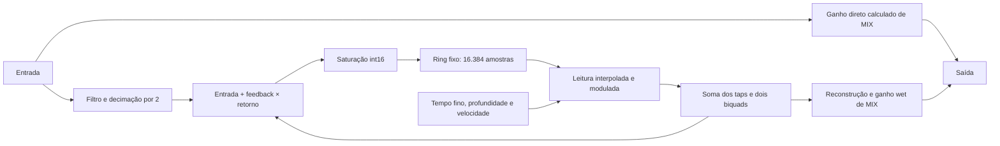

# Cube Baby — delay e controles internos

[Índice](README.md) · [Phaser](CUBE_BABY_PHASER.md) · [Chorus](CUBE_BABY_CHORUS.md) · [Reverb](CUBE_BABY_REVERB.md) · Investigação de 01/10/2026

## Resultado e alcance

O firmware contém **profundidade e velocidade de modulação temporal independentes** de TIME, feedback e MIX. Os três controles originais também possuem uma representação interna mais fina: tempo em amostras e feedback/mistura float32. As cinco famílias passaram pelos ensaios de escrita isolada, permanência e restauração no pedal conectado e estão disponíveis no criador experimental. O verificador cruzou 1.011 snapshots e 534 escritas com o tráfego USB original.

Não houve guitarra, gravação ou avaliação sonora. A análise distingue leitura de código, alteração física de RAM e sinais sintéticos. Esses resultados não certificam qualidade musical, estalos, headroom ou execução acústica prolongada.

## Fontes e perfil

O criador também reconhece o firmware `cubebaby_B_20220706.up`, conferido contra leituras do pedal em 01/10/2026. O perfil B corrige o contexto físico, endereços auxiliares e hashes das rotinas/tabelas, mantendo os mesmos offsets dos cinco controles. Veja a [análise e evidências do B](CUBE_BABY_PHASER.md#perfil-adicional-firmware-b-de-06072022). A tabela abaixo descreve a captura original; o protocolo seleciona os endereços do B separadamente, sem aplicar um delta uniforme.

A janela de código preservada no phaser forneceu os primeiros caminhos. A pesquisa do reverb já havia capturado a aplicação de presets e o chamador DSP; a pesquisa do chorus descreveu o mesmo oscilador normalizado e ensinou a distinguir coeficientes de estados dinâmicos. A pesquisa dos amps fundamenta a separação entre memória, operação matemática e escuta.

O perfil `cube-baby-delay-live-8347f8-v1` exige as verificações da base/alias do phaser e oito assinaturas específicas de delay. Nome da porta e identidade textual não substituem assinaturas; a identidade não é um número de série único. O firmware oficial antigo não foi usado para deslocar endereços por um delta.

| Elemento | Endereço CPU | Evidência e função |
| --- | --- | --- |
| Base RAM 04 | `0x8347F8` | Perfil e alias do banco conferidos |
| Aplicação de presets | `0x831AC0` | TIME, feedback, MIX e seção compartilhada |
| Chamador DSP | `0x833724` | Modulação → delay → reverb → cabinet |
| Estrutura de delay | `0x834E8C` | RAM 04 `0x694`, 76 bytes |
| Processamento | `0x832DA8` | Decimação, atraso modulado, filtros, feedback e saída |
| Inicialização | `0xC13C3C` | Zera estados e ring; copia tempo solicitado ao tempo atual |
| Oscilador | `0x833562` | Chama ROM com `2π·fase + 3π/2`, normaliza o retorno |
| Dois biquads | `0x80A8BC` | Cinco coeficientes por estágio, stride de 28 bytes |
| Coeficientes originais | `0xC488E0` | 56 bytes, dois estágios |
| Filtro de entrada | `0x8359A0` | Uma amostra de saída por par de entrada |
| Tempo atual | `0x80FF84` | Inteiro que converge ao tempo solicitado |
| Ring int16 | `0x80FF86` | 16.384 amostras, 32.768 bytes; alocação fixa |
| Índice de escrita | `0x817F86` | Estado externo, nunca editado |
| Estados dos biquads | `0x817F88` | 32 bytes externos, nunca editados |
| Histórico de saída | `0x817FA8` | int16 usado no primeiro elemento de cada par |
| Fase | `0x817FAC` | float externo, nunca editado |

O arquivo `runtime.bin` inclui os primeiros quatro bytes dos estados do decimador em `0x817FB0`; a inicialização zera 20 bytes nessa região. Apesar do nome histórico, `input-state.bin` contém os primeiros 20 bytes do scratch decimado em `0x81823C`, não os estados completos do filtro. A janela de inicialização capturada tem 196 bytes e inclui parte de outra rotina; a desmontagem delimita a rotina de delay antes do pool de literais, sem interpretar a rotina seguinte como delay.

## Mapa e decisões de exposição

Offsets relativos à RAM 04; inteiros e floats little-endian.

| Offset | Tipo / original | Significado e decisão |
| --- | --- | --- |
| `0x694` | byte, 0 inativo / 3 ativo | Máquina de estados, preservar |
| `0x695` | byte, zero | Reservado, preservar |
| `0x696` | int16, `2400 + 450 × TIME` | Tempo solicitado; resolução de uma amostra, faixa 2400–16350 |
| `0x698` | float32, `feedback / 128` | Realimentação; faixa 0–127/128 |
| `0x69C` | float32, 0,1 | Profundidade interna; faixa experimental 0–0,1 |
| `0x6A0` | float32, 0,01 | Avanço de fase dividido pelo tempo atual; faixa 0–0,01 |
| `0x6A4–0x6DB` | dois blocos de sete floats | Cinco coeficientes e dois floats ignorados por bloco; preservar |
| `0x6DC` | float32, `MIX / 128` | Curva de mistura; faixa 0–118/128 |

Os leitores e escritores abaixo foram identificados na captura atual; os PCs completos estão na [desmontagem](artefatos/delay/disassembly.txt). “Sem leitor” significa ausente nesses caminhos capturados, não uma prova sobre todo o firmware.

| Campo | Escritor observado | Leitor observado / recarga |
| --- | --- | --- |
| Estado `0x694` | Preset `0x831B00`/`0x831D18`; worker `0x832DC6`, `0x832DE4`, `0x832E6C` | Worker `0x832DB0`; estados 1/2 de entrada e 4/5 de saída antecedem 3/0 estáveis |
| Reservado `0x695` | Nenhuma escrita individual identificada | Nenhum leitor identificado; zero exigido pelo perfil |
| TIME `0x696` | Preset `0x831C4E` quando o valor muda | Worker `0x832E7A`; init `0xC13C50`; unidades de amostras internas |
| Feedback `0x698` | Preset `0x831CDA` via `0x831CCE` | Worker `0x832FFC`; fator adimensional da realimentação |
| Profundidade `0x69C` | Preset `0x831D00`, constante 0,1 ao ativar | Worker `0x832E8E`, `0x832EBC`, `0x832F5E`; fração do tempo atual |
| Velocidade `0x6A0` | Preset `0x831CFA`, constante 0,01 ao ativar | Worker `0x832E0A`; fator dividido pelo tempo atual, não Hz |
| Filtros `0x6A4–0x6DB` | Cópia de 56 bytes em `0x831D02–0x831D12` ao ativar | Worker passa `estrutura+0x10` em `0x832F72`; filtro lê cinco floats em `0x80A8C0`, salta outros dois em `0x80A8E4` |
| MIX `0x6DC` | Preset `0x831CDA` via `0x831CEA` | Worker `0x832E0E`; fator adimensional, curva descrita abaixo |

Reenviar os mesmos valores originais não força a reescrita desses campos: a aplicação compara os bytes do banco antes de escrever. Mudar TIME, feedback ou MIX recarrega seu próprio campo. Desligar/religar a seção reinicia os controles e estados; a prévia detecta essa divergência e interrompe os envios. Os dois floats ignorados de cada biquad e o byte reservado não são controles candidatos.

A profundidade usa `D × (1 − profundidade + profundidade × LFO)`, em que `D` é o tempo atual suavizado e o LFO normalizado vai de zero a um. Com profundidade original, o atraso oscila entre 90% e 100% de `D`; profundidade zero elimina essa oscilação e usa `D` integralmente. Isso não desliga o delay.

O avanço de fase é calculado uma vez por bloco como `velocidade / D`. Velocidade zero congela a fase corrente, sem zerá-la. Profundidade e velocidade são independentes dos controles originais, mas a frequência efetiva depende de TIME. O criador mostra ambas como percentual do original, sem unidade fixa em Hz.

O tempo atual muda uma amostra por passo da rede até alcançar o solicitado. A estrutura não redimensiona buffers nem reescreve ponteiros ao mudar TIME. A faixa original cabe no ring fixo, inclusive com interpolação do último índice para zero. O criador conserva essa faixa; não oferece atraso zero nem expansão acima do máximo original.

O worker percorre metade da quantidade de amostras recebida. Sob a hipótese de entrada a 48 kHz usada nas pesquisas anteriores, a rede fica a **24 kHz estimados**: o tempo-base original corresponderia a 100–681,25 ms. A modulação altera o atraso efetivo. Nenhuma dessas durações foi medida por áudio; a interface usa amostras internas.

### Mistura, filtros e realimentação

O MIX não é um crossfade complementar convencional:

- Abaixo de 0,5: ganho direto = 1; ganho do eco = `2 × MIX`.
- A partir de 0,5: ganho direto = `2 − 2 × MIX`; ganho do eco = 1.
- No máximo original, 118/128: direto = 0,15625; eco = 1. Um controle de 100% wet não foi habilitado.

O código faz duas leituras interpoladas com o mesmo índice, fase e profundidade. Cada uma recebe ganho próximo de 0,45; sob a hipótese de função ROM sem estado, sua soma equivale a 0,9 vezes o atraso. Não há evidência de duas vozes independentes nesse caminho. O sinal passa pelos dois biquads antes de alimentar a saída e a realimentação.



Os coeficientes são `b0,b1,b2,a1,a2`, com `y=b0·x+b1·x1+b2·x2−a1·y1−a2·y2`. No primeiro estágio, numerador e denominador coincidem, produzindo transferência identidade com estados iniciais nulos. O segundo estágio tem resposta própria. Alterá-los pode mudar também o ganho da malha de feedback; a pesquisa preserva os coeficientes originais, sem inventar frequência/Q ou um controle tonal ainda não ensaiado.

Há uma particularidade no histórico de saída: o worker converte o valor wet para inteiro **sem multiplicar por 32768** antes de armazená-lo como int16. O primeiro elemento de cada par combina esse histórico com o wet atual. O modelo conserva a operação observada, em vez de substituí-la por interpolação ideal.

| Candidato | Classificação |
| --- | --- |
| Profundidade e velocidade temporal | Controles extras consumidos diretamente pelo worker |
| TIME fino, feedback e MIX float | Maior resolução dos controles existentes |
| Filtros das repetições | Campos consumidos; candidatos futuros, não editáveis nesta versão |
| Ganhos dry/wet independentes | Não encontrados como campos separados; calculados de MIX |
| Estéreo, ping-pong, reverse, múltiplos taps independentes | Nenhum seletor comprovado nos caminhos analisados |
| Expansão do buffer, troca de algoritmo, novos waveforms | Não expostos; exigiriam outras evidências e alterações |
| Flash/persistência após desligar | Não implementada nem ensaiada |

## Ensaios físicos e restauração

O mapeamento inicial encontrou PRESET A (`00 01`), seção delay/modulação desligada e MOD 7. Os diagnósticos exigem aplicativos fechados, portas MIDI únicas, pasta nova e contexto inicial compatível. Guardam o banco de 48 bytes, DSP de 3952 bytes, estado físico e três capturas ociosas antes de alterar RAM. O ensaio prepara TIME=16, feedback=32 e MIX=32 com a seção desligada, registra essas escritas e só então a liga.

- `delay-map`: somente leitura; firmware, constantes, estados e snapshot.
- `delay-sweep`: todos os 32 TIME, 128 feedback e 119 MIX, isoladamente, três snapshots por valor e restauração da referência entre famílias.
- `delay-controls`: duas rodadas de profundidade 0/0,05; velocidade 0/0,005; tempo 2400/9601/16350; feedback 0/0,123 e MIX 0/0,321. Cada caso tem leitura imediata, após 300 ms, reenvio dos controles originais sem mudança e restauração.
- `delay-transitions`: personaliza os cinco controles, muda cada original separadamente, verifica MOD 7→8 e desliga/religa a seção compartilhada.
- `delay-modulation`: série separada com chorus MOD 0 e phaser MOD 9, três snapshots por algoritmo; confere a estrutura inteira de delay e restaura as estruturas inativas ao final.
- `delay-runtime`: lê tempo atual, índice do ring e fase em dez amostras para velocidade original, metade e zero. Nenhum estado externo é escrito; os timestamps e bytes são confrontados com as respostas USB.

Somente o float derivado de volume global em `0xF6C–0xF6F` fica fora da igualdade estável, com diferenças reportadas. Os estados transitórios do delay ficam fora da região DSP comparada. Nenhuma máscara de fase do phaser/chorus integra o perfil de delay. Na série separada de modulação, a região do outro algoritmo é tratada explicitamente como região sob ensaio, não como estado dinâmico de delay; ao final, ela também deve retornar à referência.

Essa exclusão foi conferida novamente para o delay: o chamador carrega `0x835764` (`base+0xF6C`) em `0x83372A` e aproxima o ganho de saída em um estado externo `0x8181B4`. Nas capturas ociosas de sweep e controles, antes das escritas, o float alternou entre 0,046875 e 0,05859375, mudando somente o byte `0xF6E`. O manifesto lista todos os snapshots excluídos nessa região, seus valores e os bytes diferentes; nenhum campo da própria estrutura de delay é mascarado.

Toda escrita preserva intenção, região, endereço e bytes anteriores/pretendidos. O verificador cruza esses registros com tráfego USB bruto, snapshots e contexto; ACK sozinho não comprova alteração. Perda de conexão ou mudança externa interrompe a operação e preserva os registros, sem declarar restauração. Não são reescritos buffers de áudio ou estados externos para forçar igualdade.

**Séries concluídas e verificadas:**

| Série | Snapshots DSP salvos | Escritas com intenção | Restauração |
| --- | ---: | ---: | --- |
| Sweep completo | 846 | 293 | Banco/físico/DSP estável exatos; diferença excluída em `0xF6E` |
| Candidatos, duas rodadas | 116 | 143 | Banco/físico/DSP estável exatos; diferença excluída em `0xF6E` |
| Transições | 21 | 63 | Banco, físico e todos os bytes DSP exatos |
| Chorus e phaser | 15 | 21 | Banco, físico e todos os bytes DSP exatos |
| Estados do processamento | 13 | 14 | Banco/físico/DSP estável exatos; diferença excluída em `0xF6E` |
| **Total** | **1.011** | **534** | **Cinco restaurações confirmadas** |

Os dois mapas somente leitura e as 30 amostras externas de fase/índice/tempo são adicionais a essa contagem. Nenhuma escrita em flash foi encontrada. O ZIP contém 2.624 arquivos originais e tem SHA-256 `37f03f98c0a83d77af1b5c2f66624ce2c636b02824a3f715f606dd0e16ac329a`. O [manifesto](artefatos/delay/evidence.json) guarda os hashes individuais, as intenções, as exclusões e os resultados. O verificador marcou `completeInvestigation=true` somente após conferir todas as séries exigidas; esse campo não significa validação sonora nem cobre as lacunas listadas ao final.

As 22 alterações isoladas permaneceram após 300 ms e após reenvio de volume/TIME/feedback/MIX sem mudança. Alterar um controle original recarregou somente seu campo. MOD 7→8 preservou os ajustes; desligar/religar a seção recarregou os controles originais. Chorus e phaser preservaram todos os 76 bytes de delay personalizados.

Na série externa, o tempo suavizado foi 9600 em todas as leituras e o índice do ring avançou nas três condições. O avanço observado da fase foi 0,025037 ciclo/s com velocidade original, 0,011913 ciclo/s com metade e zero com velocidade zero. A razão observada foi **0,475825**, não exatamente 0,5; são janelas curtas com timestamps USB e fase float32, sem sincronização de áudio. A causa quantitativa desse desvio não foi isolada. A fase congelada foi exatamente `0,5293934941291809` nas dez capturas. Não usamos essas medições para declarar uma taxa de áudio exata.

Uma tentativa de iniciar a série de modulação falhou na enumeração MIDI, antes de abrir a conexão; seu log USB ficou vazio. Uma nova enumeração encontrou as portas únicas e a série foi repetida em pasta nova, conservando a tentativa anterior. Não foi necessário mudar o driver ou relaxar a verificação de portas; a causa transitória não foi estabelecida. Ver [registro](artefatos/delay/enumeration-retry.json).

## Criador experimental e recuperação

Abra **Delay → Criador de delay · experimental**, habilite a seção delay/modulação, desligue chorus/phaser e selecione no aplicativo o mesmo preset físico. **Ler delay ativo** confere perfil/contexto e preserva a referência. Os controles normais continuam disponíveis fora da prévia.

As escritas são serializadas e ajustes rápidos são reunidos. Edições de preset e prévias de amp, IR, phaser, chorus e reverb ficam bloqueadas durante a prévia de delay. O monitor verifica contexto e controles; recarga externa interrompe a prévia sem reaplicar automaticamente.

O registro `%LOCALAPPDATA%/CubeControl/pending-delay-preview.json` preserva a referência e a transação antes da escrita, com backup inicial em `DelayRecovery/`. Um SHA-256 do conteúdo detecta corrupção da referência ou dos parâmetros; não é autenticação criptográfica da origem. **Restaurar delay**, desconexão normal, releitura e fechamento normal tentam restaurar os campos e confirmam por leitura. Após uma falha de contexto, restaure e releia/reconecte antes de iniciar nova edição. Reinício carrega recuperação pendente, sem reaplicação. Backup inválido é preservado e bloqueia novas prévias.

Arquivos `.delay.json` usam `cubecontrol-delay-v1`, com identidade, mapeamento e cinco parâmetros validados, sem endereços arbitrários. Importar prepara a edição local; **Aplicar ajustes** envia à prévia ativa. Exportar não escreve no pedal. Não há gravação em flash, persistência após desligar nem prévia física no dispositivo simulado.

## Reprodução e validação

Artefatos finais em [artefatos/delay](artefatos/delay/): ZIP de capturas USB, `evidence.json`, `model.json`, `field-map.json`, matriz de candidatos, desmontagem comentada e imagens do editor em português/inglês. O mapa cobre os 76 bytes sem lacunas ou sobreposição. As imagens foram renderizadas com transporte falso nos testes de interface; a confirmação física vem exclusivamente das capturas USB. Os verificadores usam a biblioteca padrão Python; somente a geração de desmontagem exige `capstone==5.0.9`.

```powershell
python scripts/delay-evidence.py engenharia-reversa/cube-baby/artefatos/delay/usb-20261001.zip --output C:/CubeControl-Build/delay-recheck.json
python scripts/delay-model.py engenharia-reversa/cube-baby/artefatos/delay/usb-20261001.zip --output C:/CubeControl-Build/delay-model-recheck.json
python -B scripts/delay-evidence-tests.py engenharia-reversa/cube-baby/artefatos/delay/usb-20261001.zip --output C:/CubeControl-Build/delay-evidence-tests.json
dotnet run --project CubeControl-1.1/Cube/windows/Cube.Tests -- --delay-only
dotnet run --project CubeControl-1.1/Cube/windows/Cube.Desktop.Tests -- --delay-only
```

Resultados das suítes focadas, também registrados em [validation.json](artefatos/delay/validation.json):

| Família | Protocolo/pesquisa | Interface |
| --- | ---: | ---: |
| Delay | 31 | 16 |
| Phaser | 18 | 9 |
| Chorus | 9 de pesquisa + 28 de prévia | 14 |
| Reverb | 28 | 11 |

Os testes de delay cobrem firmware incompatível, ACK sem mudança, endereço de resposta divergente, timeout, escrita parcial, mudança física entre campos, recarga externa, restauração, recuperação serializada após reinício, checksum inválido de backup e arquivos inválidos. A interface verifica exclusão das outras operações, importação local antes de aplicar, reunião de ajustes rápidos, monitoramento, desconexão e fechamento real de `MainWindow` com transporte falso. Os testes das outras prévias também conferem o bloqueio de início de delay no sentido inverso. A validação visual inclui português e inglês em largura compacta. Esses resultados referem-se às suítes listadas; não são uma declaração de passagem da suíte geral inteira.

O build final passou pelo script único, sem alterações nesse script e com saída externa ao projeto:

```powershell
powershell -NoProfile -ExecutionPolicy Bypass -File scripts/Build-CubeControl.ps1 -OutputRoot C:/Users/lpaferreira/AppData/Local/CubeControl-Delay-Build
```

Executável: `C:/Users/lpaferreira/AppData/Local/CubeControl-Delay-Build/publish/CubeControl-1.1.0/CubeControl.exe`. Foram reconferidos os hashes dos 724 arquivos publicados e das 596 fontes do manifesto. Duas tentativas anteriores na raiz `C:/CubeControl-Delay-Build` falharam com acesso negado na movimentação final da pasta; a saída no diretório local do usuário concluiu normalmente. Nenhuma causa específica do Windows foi comprovada.

O modelo reconstrói decimação, ring Q15, interpolação, fase, suavização do tempo, dois biquads, feedback, saturação e curva MIX. Assume oscilador senoidal normalizado, como inferido na pesquisa do chorus; a função ROM não foi completamente reconstruída. Usa aritmética Python, estados iniciais nulos e bloco de 256 amostras como hipótese. Não reproduz exatamente float32/FMA, fades de ativação, concorrência, conversores ou ruído analógico.

O verificador rejeita divergências entre arquivos, intenções e pacotes, comandos desconhecidos e escritas fora da lista permitida. Os testes negativos alteram cópias temporárias do ZIP, inclusive snapshot e JSON juntos, endereço de escrita com checksum válido e estado externo. Os hashes documentam a integridade do conjunto preservado; não autenticam a origem contra alguém que reescreva coerentemente todo o conjunto e seus hashes.

Os polos dos filtros originais têm módulos aproximadamente 0,82996 e 0,88048. A soma absoluta da resposta impulsiva numérica dos filtros é aproximadamente 1,02503; multiplicada por 0,9 e pelo feedback máximo original resulta em 0,91532. O resultado sustenta uma margem estrutural sob as hipóteses do modelo; não certifica o hardware por escuta. Casos sintéticos verificam índices válidos, saída finita, silêncio nulo, MIX zero igual ao direto e profundidade zero sem oscilação do atraso.

São 23 cenários. Com tempo fixo de 2400 amostras internas, profundidade zero e feedback 0,5, as janelas das três primeiras repetições ficam em torno de 4800, 9600 e 14400 amostras de entrada; as razões sucessivas entre normas L2 são aproximadamente 0,3734 e 0,3739. Um seno sintético de amplitude 2 força 21.793 saturações do ring em 96.000 amostras de entrada, atingindo exatamente −32768 e 32767. Esse caso verifica o limitador reconstruído; não representa uma medição de headroom do pedal.

Com guitarra, comparar cada controle isolado ao original, igualar volume quando possível, observar ataques, notas sustentadas, mudanças de tempo, congelamento de fase, caudas e silêncio após excitação. Só então avaliar combinações e execução prolongada. Troca física A/B/C e retenção após desligamento continuam fora da validação desta rodada.
